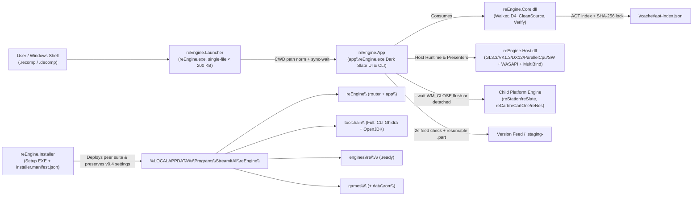
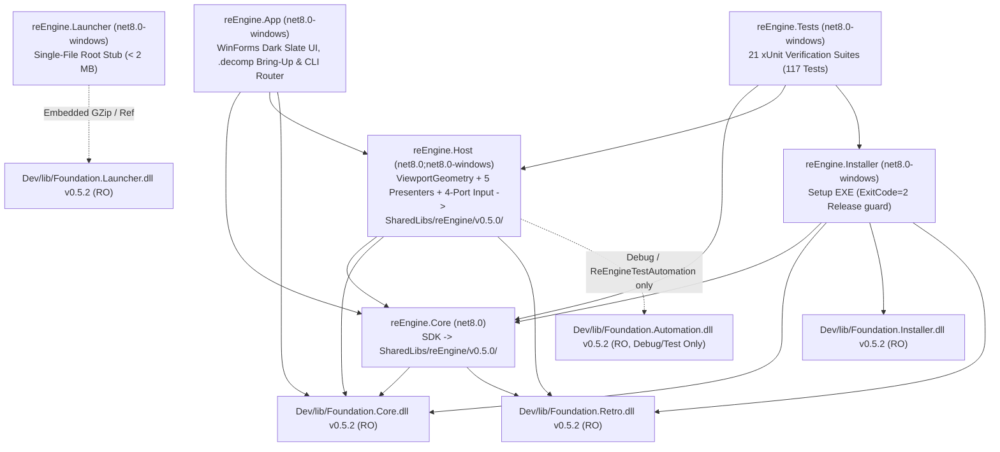

# reEngine — System Architecture

**Synced Version:** `0.5.0` (`2026-11-20`)  
**Scope:** Runtime Topology, Assembly Boundaries, Execution Pipelines, File Inventory & Data Stores  
**License:** Mozilla Public License Version 2.0 (`MPL-2.0`, root [`LICENSE`](../../LICENSE))

---

## 1. System Context & Runtime Model

`reEngine` is a zero-daemon static recompilation package router, unified `reEngine.Host.dll` runtime host (native GPU contexts, SDL3 audio/input, touch/gamepad overlays), `.decomp` Bring-Up runner, `<dataDir>\cache\` AOT assembly manager, and side-by-side platform engine suite manager for clean-room static recompilation and decompilation (`D0`–`D5` pipeline stages).

- **Zero Background Footprint:** Exiting the suite manager UI or child engine leaves zero resident processes (`ReEnginePackagingConstants.AllowAutoStart = false`, `0 MB` idle background memory, zero Windows Startup entries).
- **Peer User-Scope Suite Topology & Custom Auto-Sort:** Non-admin installation uses `%LOCALAPPDATA%\Programs\StreamItAll\reEngine\{reEngine,toolchain,engines,games}\` (`umbrellaSubpath = "StreamItAll\\reEngine\\reEngine"`). `LegacyMigrationHelper` preserves `v0.4.0` settings (`backendId: "directx"`, `isFullscreen`, `audioDriver`, `isHdTexturePackEnabled`) with `.bak` recovery across upgrades.
- **Canonical Runtime Storage (`<InstallRoot>\data\config\settings.json` & `<InstallRoot>\logs\`):** `ProgramBootstrapHelper` anchors `--data-dir <InstallRoot>\data`, `--config <InstallRoot>\data\config\settings.json`, and `--log-dir <InstallRoot>\logs`, and `SettingsMigrationHelper` merges split legacy configs atomically newest-wins.
- **Frontend Bridge, Bounded Shutdown & Interactive `.decomp` UI:**
  - Frontend game launchers (such as `uStation`) route `.recomp` launches synchronously to `reEngine.exe --open <pkg> --wait [--fullscreen] [--save-dir <dir>] [--shutdown-timeout-ms 3000]`.
  - During `--wait` cancellation, `GracefulProcessTreeShutdown` catches cancellation before `JobObjectGuard` disposal, posts `WM_CLOSE` across the child process tree so saves flush cleanly into `--save-dir` within `shutdownTimeoutMs`, and only force-terminates on timeout. Interactive detached launches (`ShouldWaitForExit = false`) remain unguarded so launcher stubs (`reStation.exe` -> `app\reStation.Player.exe`) keep child windows alive.
  - Double-clicking a `.decomp` file from Windows Explorer opens `ReEngineMainForm` straight onto the `Bring-Up` shelf (`ReEngineMainForm.Decomp.cs`) with automatic suite-tree media discovery (`SuiteMediaTreeWalker`), `MissingMediaPromptDialog` (use-in-place default + opt-in `.cue`/`.bin` copy into `data\rom\`), standalone `--verify-module`, and interactive stage execution.



---

## 2. Assembly / `.dll` & Module Dependency Graph

The solution [`Dev\reEngine.slnx`](../reEngine.slnx) inherits [`Dev\Directory.Build.props`](../Directory.Build.props) (`Version = 0.5.0`, `LangVersion = latest`, `Nullable = enable`, `TreatWarningsAsErrors = true`, `Deterministic = true`, `ContinuousIntegrationBuild = true` in `Release`, `<DebugType>none</DebugType>`, and `<PathMap>` workspace scrubbing) and consumes `Foundation v0.5.2` from `Dev\lib\`.



| Assembly | Target | Allowed Dependencies | Boundary Constraints & Rules |
| :--- | :--- | :--- | :--- |
| `reEngine.Core` | `net8.0` | `Foundation.Core`, `Foundation.Retro` | Zero WinForms/SDL UI deps; zero retail ROM/BIOS/generated assets |
| `reEngine.Host` | `net8.0` / `net8.0-windows` | `reEngine.Core`, `Foundation.Core`, `Foundation.Retro`, `ppy.SDL3-CS`, OS native GPU libs (`opengl32`/`vulkan-1`/`d3d12`/`dxgi`) (`Foundation.Automation` on `Debug \| ReEngineTestAutomation=true` only) | Release `net8.0` & `net8.0-windows` contain **0** `Foundation.Automation` or `System.Windows.Forms` refs; direct clean-room P/Invoke/COM without GPL/heavy third-party SDKs |
| `reEngine.App` | `net8.0-windows` | `reEngine.Core`, `reEngine.Host`, `Foundation.Core`, WinForms | Never modifies read-only external directories; Fail-Closed `ExitCode = 2` if `--automation-port` in Release; `ExitCode = 6` on `BackendUnavailableException` |
| `reEngine.Launcher` | `net8.0-windows` | Embedded `Foundation.Launcher.dll` | **Zero** `reEngine.Core` or `reEngine.Host` ref (keeps single-file stub `< 2 MB`) |
| `reEngine.Installer` | `net8.0-windows` | `reEngine.Core`, gzipped `Foundation.{Core,Installer,Retro}`, `installer.manifest.json` | `AllowAutoStart = false`; preserves `v0.4.0` keys in `data\config\settings.json`; zero unconfirmed `%LOCALAPPDATA%` writes in test mode |
| `reEngine.Tests` | `net8.0-windows` | `Core`, `Host`, `Installer` + linked `Launcher`/`App` files + xUnit + `Foundation.Automation` | Isolated `APP_ISOLATED_TEST=1` temp roots only; Stage 2 visible-window sandbox E2E |

---

## 3. End-to-End Data Flow per Major Pipeline

### 3.1 `.recomp` Launch, Suite Media Fallback, Versioned Routing & Graceful `--wait` Teardown
1. Shell double-click or CLI invokes root `reEngine.exe` ([`reEngine.Launcher\Program.cs`](../src/reEngine.Launcher/Program.cs)), which preserves `--verify-module`, `--headless`, and `--json` synchronously via [`LauncherArgsHelper`](../src/reEngine.Launcher/LauncherArgsHelper.cs), normalizes file paths relative to caller CWD (keeping bare engine slugs like `reSlate` verbatim for `--verify-module`), and delegates to `app\reEngine.exe`.
2. [`Program.cs`](../src/reEngine.App/Program.cs) dispatches interactive Explorer `.decomp` invocations directly onto `ReEngineMainForm` (`MainShelfKind.BringUp`), handles dual-mode `--verify-module` ([`Program.CliHandlers.cs`](../src/reEngine.App/Program.CliHandlers.cs), [`Program.Verify.cs`](../src/reEngine.App/Program.Verify.cs)), or executes [`RecompLaunchCoordinator`](../src/reEngine.App/RecompLaunchCoordinator.cs).
3. [`RecompLaunchPlanBuilder`](../src/reEngine.App/RecompLaunchPlanBuilder.cs) normalizes backend aliases (`dx12`/`d3d12` -> `directx`, `metal`), throws `BackendUnavailableException` (`ExitCode = 6`) when `--require-backend` rejects an unavailable backend, falls back cleanly through `SuiteMediaTreeWalker` when module `data\rom\` is empty, and forwards `--fullscreen`, `--save-dir`, and `--audio-driver` to `>= 0.3.0` engines.
4. On synchronous `--wait` cancellation, [`GracefulProcessTreeShutdown`](../src/reEngine.App/GracefulProcessTreeShutdown.cs) enumerates descendant PIDs and posts `WM_CLOSE` for up to `shutdownTimeoutMs` (`3000ms` default) BEFORE `JobObjectGuard.Dispose()`, flushing saves before termination.

### 3.2 `reEngine.Host` Viewport Precision, 5-Backend GPU Contexts, 4-Port Input & Interactive Overlays
1. [`NativeAudioDriverSelector`](../src/reEngine.Host/Core/NativeAudioDriverSelector.cs) applies `SDL_SetHint("SDL_AUDIO_DRIVER", driver)` (`wasapi` on Windows, `pipewire`/`alsa` on Linux, `coreaudio` on Apple, `aaudio` on Android, `emscripten` on WASM) BEFORE `SDL_InitSubSystem(InitAudio)` and isolates audio failures from video/gamepad initialization.
2. [`HostViewportGeometry`](../src/reEngine.Host/Core/HostViewportGeometry.cs) computes bounded source overscan cropping (`HostOverscanCrop`), aspect-locked destination rects across all 5 `HostAspectRatioMode` modes (`nativePar`, `fourByThree`, `squareInteger`, `nativeFit`, `horPlus16By9`), and inverse window-to-content pointer normalization (`TryMapWindowToContentNormalized`), eliminating stretch across [`Sdl3HostWindow`](../src/reEngine.Host/Core/Sdl3HostWindow.cs), [`ParallelCpuPresenter`](../src/reEngine.Host/Rendering/ParallelCpuPresenter.cs), [`Gl33Presenter`](../src/reEngine.Host/Rendering/Gl33Presenter.cs) (guarded on `0x0` windows, `glCheckFramebufferStatus == 0x8CD5`, owner-thread `TryReadSurfaceRect`, and `FlushAndSyncForSnapshot` prior to QuickSave/teardown), [`VulkanPresenter`](../src/reEngine.Host/Rendering/VulkanPresenter.cs), and [`D3d12Presenter`](../src/reEngine.Host/Rendering/D3d12Presenter.cs), with live `SDL_SetWindowFullscreen` transitions and decoupled `IHostAutomationBridge` (`AutomationBridgeFactory`).
3. [`HostInputMapper`](../src/reEngine.Host/Input/HostInputMapper.cs) + [`HostControlTierStore`](../src/reEngine.Host/Input/HostControlTierStore.cs) + [`Sdl3GamepadProvider`](../src/reEngine.Host/Input/Sdl3GamepadProvider.cs) poll 4 hot-pluggable SDL3 gamepad ports (`PadPorts[0..3]`), persist Standard 33 3-tier bindings (`globalController`, `perGameController`, `perGameModern` in `settings.controls.json`) with hidden-slot conflict checks, enforce Menu D-Pad + Left-Stick isolation, and dispatch interactive `F1`/`F3` callbacks (`IHostSessionEventCallbacks`) plus `F5`/`F9`/`F11`/`Alt+Enter`/Fast-Forward/Cutscene-Skip hotkeys. [`EngineVersionResolver`](../src/reEngine.Core/Resolution/EngineVersionResolver.cs) ranks `-hf.<n>` hotfixes strictly above stable releases (`-hf.<n> > stable > prerelease`) while enforcing `.ready` markers across all `0.3.0+` leaves.

### 3.3 `.decomp`, Root-Tree Media Discovery, `D4_CleanSource` & `--verify-module` Pipeline
1. [`SuiteMediaTreeWalker`](../src/reEngine.Core/Decomp/SuiteMediaTreeWalker.cs) performs depth-capped (`<= 5`), reparse-safe, containment-checked media searches across module-local and `<SuiteRoot>` (`games\*\data\rom\`, `gamedata\`, `data\rom\`), flags multi-game ambiguities cleanly, and supports opt-in `StageMediaIntoRomDirectoryAsync` copying `.cue` + contained `.bin` tracks (plus `.fds` parity alongside `.nes`).
2. [`DecompD4StrictnessValidator`](../src/reEngine.Core/Decomp/DecompD4StrictnessValidator.cs) enforces canonical `D4_CleanSource` across `CanonicalCorpusTiers` while mapping legacy `D4_FunctionalRewrite` without double counting.
3. [`PackageVerificationService`](../src/reEngine.Core/Decomp/PackageVerificationService.cs) validates `.recomp` and `.decomp` schema, clean-room integrity, engine/alias tracks, and media readiness (`hasMediaReady` warning-only unless `--require-media`), emitting Standard 18 camelCase JSON (`isPassed`, `generatedAtUtc`, `durationMs`, `exitCode`).

---

## 4. Architecture Notes & SLOC Discipline (`<= 250 / 400`)

All `v0.5.0` modules (`Dev/src/**/*.cs` and `Dev/tests/**/*.cs`) maintain modular splits with new files under `250` code-only SLOC (`HostViewportGeometry`, `HostSessionExtensionsContracts`, `HostControlTierStore`, `HostInputEvaluationHelper`, `HostMultiBindHelpers`, `F1DrawerTabRenderers`, `InstallerCliAndAutomation`) and every file across `Dev\src` strictly `<= 320` code-only SLOC.

---

## 5. Settings, Manifest & State Store Ownership Map

`reEngine` uses zero SQLite databases; all runtime state persists in atomic JSON stores with `.bak` recovery:

| File Store (under `<dataDir>\`) | Owner Type | Canonical Keys | Backup / Locking Mechanism |
| :--- | :--- | :--- | :--- |
| `config\settings.json` (template: [`Dev\settings.example.json`](../settings.example.json)) | `UpdateCoordinator` / `SettingsMigrationHelper` / `LegacyMigrationHelper` | `schemaVersion`, `appId`, `updatedAtUtc`, `installProfile`, `backendId`, `aspectRatioMode`, `overscanCropPx`, `isFastForwardEnabled`, `resolutionScale`, `isFullscreen`, `audioDriver`, `isHdTexturePackEnabled`, `shutdownTimeoutMs`, `shouldCheckUpdates`, `shouldAutoStagePatches`, `pinnedEngineVersions`, `stagedUpdatePath`, `reEngineInstallDir`, `suiteInstallDir`, `umbrellaSubpath`, `decompSchemaVersion`, `goalDecompTier`, `targetDecompTier` | `GranularSettingsManager` / `.tmp` atomic rename + `.bak` recovery + `config_history\`; `[JsonExtensionData]` preserves unknown keys |
| `config\settings.controls.json` | `HostControlTierStore` | `schemaVersion`, `inputProfileMode` (`globalController`/`perGameController`/`perGameModern`), `activeSchema`, `globalController`, `perGameController`, `perGameModern` | `.tmp` atomic replace with duplicate/hidden-slot validation |
| `cache\aot-index.json` | `AotCacheManager` | `schemaVersion`, `entries[]` (`moduleId`, `romSha256`, `engineId`, `engineVersion`, `moduleVersion`, `fileSizeBytes`, `sha256Hex`) | `.aot-index.lock` cross-process mutex + `.bak` rotation + `.tmp.<guid>` atomic rename |
| `virtual_registry.json` | `VirtualRegistryAssociationStore` | `.recomp` (`reEngine.RecompModule`), `.decomp` (`reEngine.DecompModule`), `commandTemplate` | `.tmp` atomic replace strictly under `APP_ISOLATED_TEST=1` |
| `modules\<moduleId>\settings.json` | Child `re*` engine (isolated by `RecompLaunchPlanBuilder`) | Delegated to engine contract | Contained inside `<dataDir>\modules\<moduleId>\` |
| `staged_updates\<engineId>\.staging-<ver>\*.part.meta.json` & `engines\<engineId>\v<Ver>\.ready` | `UpdatePackageApplier` | `.part.meta.json`: `engineId`, `version`, `downloadUrl`, `sha256Hex`, `expectedSizeBytes`, `fileSizeBytes`, `updatedAtUtc`; `.ready`: `engineId`, `version`, `completedAtUtc` | HTTP `Range` resume + SHA-256 verification + atomic staging directory rename |

---

## 6. Failure Modes & Resilience

- **Dual-Binary Release Fail-Closed Automation Gate:** `reEngine.Host` (`#if !REENGINE_ENABLE_AUTOMATION` or null `AutomationBridgeFactory`), `reEngine.App`, AND `reEngine.Installer` ALL fail closed (`ExitCode = 2`) when `--automation-port` is supplied on a `Release` build; `Foundation.Automation.dll` is omitted completely from `Release` publish outputs and `SharedLibs\reEngine\v0.5.0\`.
- **Zip-Slip / Traversal & SSRF Guards:** Both `RecompPackageReader.Load`, `DecompPipelineCoordinator.ParseManifest`, `SuiteMediaTreeWalker`, `HdPackResolver`, and `UpdatePackageApplier.ExtractArchiveSafely` reject rooted, symlink/reparse, or `..`-escaping paths and entries; `UpdatePackageApplier.AssertSafeRemoteUrl` blocks `file://`, loopback, RFC 1918, and link-local/metadata IP ranges at rest and runtime.
- **Missing Engine or Backend Availability:**
  - `.recomp`: throws `InvalidOperationException` -> Exit `1` (`No compatible engine`); engines declaring `hostProtocolVersion >= 0.3.0` / `minSuiteVersion >= 0.3.0` / `>= 0.3` tracks receive full CLI flags & `.ready` gating even when the engine itself is pre-`0.3.0` (`reCart v0.1.0`).
  - `--require-backend` unavailable (e.g., `metal` on Windows or pre-0.3.0 engine): throws `BackendUnavailableException` -> Exit `6` (mapped cleanly in `HostSessionRunner` and `Program.MapExceptionToExitCode`).
  - `.decomp`: populates `DecompUnbuiltEngineError` (`[1/3 What Failed]`, `[2/3 Missing]`, `[3/3 Remediation]`) -> Exit `3`.
- **Clean-Room Violations:** `AotCacheManager.ValidateCleanRoomRecompPackage`, `DecompPipelineCoordinator.ValidateCleanRoomOutputDirectory`, `DecompD4StrictnessValidator`, and `PackageVerificationService` flag bundled ROMs/save-states, `.g.cs`/`.Generated.dll`, `-Wno-everything` compiler suppressions, or non-zero decompiler tells.
- **Corrupted `aot-index.json`, Dual-Root Split Settings, or Locked AOT DLLs:** `AotCacheManager` verifies length + SHA-256 and rotates `.bak`; `SettingsMigrationHelper` merges legacy dual-root configs safely; `ReEngineAppStatusHelper.InspectAotCache` logs file-lock `IOException` via `Trace.WriteLine`.
- **Offline Update Feeds / Crashes:** `UpdateCoordinator` skips unavailable feeds cleanly (`NetworkUnavailable = true`, `[WARN]`, `2s` per-target poll timeout, Exit `0` unless `--strict` returns Exit `4`). Fatal unhandled exceptions write `logs\crashes\crash_reengine_*.json` via `CrashBundleService`.

---

## 7. Security & Privacy Model

- **Zero PII & Deterministic Paths:** `Directory.Build.props` enables `Deterministic = true` and `ContinuousIntegrationBuild = true` + `<PathMap>` in Release; release verification and archive exclusions (`-xr!data -xr!logs`) keep `Builds\`, `Releases\`, `SharedLibs\`, and `Archive\` free of PII, machine paths, local workspace configs, `.pdb`, `.env`, and `*secret*.json`.
- **No Network Calls at Rest or Decomp:** Zero telemetry servers, zero runtime Ghidra/OpenJDK downloads (`OfflineToolchainLocator` uses staged `toolchain\` only), and zero background daemons (`AllowAutoStart = false`).
- **Registry Isolation:** `WindowsRegistryAssociationStore` refuses registry writes when `suppressHostMutations: true` or `APP_ISOLATED_TEST=1` is active; isolated tests write solely to `virtual_registry.json`.
- **Apache-2.0 / GPL Separation:** `stage_offline_toolchain.ps1` and `OfflineToolchainLocator` reject unstripped `ghidra\GPL\` directories and require `THIRDPARTY_LICENSES.txt` alongside `toolchain\`.

---

## 8. Testing Strategy Map (21 Suites, 117 Unit/Contract Tests + 7-Step Stage 2 Visible E2E)

Run isolated zero-warning unit & contract tests:
```powershell
$env:APP_ISOLATED_TEST = "1"
dotnet test Dev\reEngine.slnx -c Release /warnaserror
dotnet test Dev\reEngine.slnx -c Debug -p:ReEngineTestAutomation=true /warnaserror
```
Run full 7-step Stage 2 visible-window sandbox E2E (12-point Installer + 5-backend WinForms Library + interactive Explorer `.decomp` Bring-Up + `--verify-module --json` + synchronous `--open --wait --fullscreen --save-dir` WM_CLOSE flush + visible SDL3 OpenGL Host + Dual-Binary Release ExitCode=2):
```powershell
powershell -NoProfile -ExecutionPolicy Bypass -File Dev\scripts\run_stage2_sandbox_e2e.ps1 -Version 0.5.0
```

| Test Class (`Dev\tests\reEngine.Tests\`) | Covered Components | Key Verified Contracts |
| :--- | :--- | :--- |
| [`ManifestAndResolverTests.cs`](../tests/reEngine.Tests/ManifestAndResolverTests.cs) | `RecompPackageReader`, `EngineVersionResolver`, `RecompLaunchCoordinator` | Zip-Slip guard, parent-root `app\*.recomp` resolution, track ranking, `BuildChildLaunchPlan` isolation |
| [`DecompAndToolchainTests.cs`](../tests/reEngine.Tests/DecompAndToolchainTests.cs) | `DecompPipelineCoordinator`, `OfflineToolchainLocator` | `sample-re64.decomp`, 3-part `UnbuiltEngineError`, clean-room violations, `ghidra\GPL\` stripping |
| [`DecompProviderAndD4ValidatorTests.cs`](../tests/reEngine.Tests/DecompProviderAndD4ValidatorTests.cs) | `DecompPipelineCoordinator`, `ProviderLoadContext`, `DecompD4StrictnessValidator` | `app\reStation.Decomp.dll` probe, ALC shared-contract unification, D4 warnings/flags/archive checks |
| [`AotCacheManagerTests.cs`](../tests/reEngine.Tests/AotCacheManagerTests.cs) | `AotCacheManager`, `AotCacheContracts` | `<dataDir>\cache\` indexing, `fileSizeBytes`/`sha256Hex`, tamper invalidation, `.bak` & eviction |
| [`InstallerAndAppStatusTests.cs`](../tests/reEngine.Tests/InstallerAndAppStatusTests.cs) | `reEngine.Installer.Program`, `LegacyMigrationHelper`, `ReEngineAppStatusHelper` | `StreamItAll\reEngine\reEngine`, `--profile`, `--reengine-dir`/`--suite-dir`, opt-in migration, status badges |
| [`InstallerWizardAutoSortTests.cs`](../tests/reEngine.Tests/InstallerWizardAutoSortTests.cs) | `ReEngineWizardPathNormalizer`, `InstallerWizardForm` | Parent-folder `<parent>\reEngine` auto-sort, companion `<reEngineDir>\engines\` selection, live suite sync |
| [`AssociationUpdateAndContainmentTests.cs`](../tests/reEngine.Tests/AssociationUpdateAndContainmentTests.cs) | `FileAssociationStores`, `UpdateCoordinator`, `ReEngineBootstrapHelper` | `.recomp`/`.decomp` HKCU & virtual stores, track sweep, peer `..\toolchain`/`..\engines` resolution, containment |
| [`UpdateStagingAndTracksTests.cs`](../tests/reEngine.Tests/UpdateStagingAndTracksTests.cs) | `UpdatePackageApplier`, `EngineVersionResolver`, `EngineAliasCatalog` | SSRF blocking, HTTP Range `.part` resume, `.staging->.ready` promotion, `SeriesMap` aliases, pinned rollback |
| [`UpdateSweepAndTelemetryTests.cs`](../tests/reEngine.Tests/UpdateSweepAndTelemetryTests.cs) | `UpdateCoordinator`, `ReEngineTelemetryFormatter` | Multi-track sweep resilience, offline `[WARN]` zero-crash guarantee, single `[HEARTBEAT]` formatting |
| [`LauncherAndLaunchPlanTests.cs`](../tests/reEngine.Tests/LauncherAndLaunchPlanTests.cs) | `LauncherArgsHelper`, `RecompLaunchOptions` | Relative CWD arg normalization (`decomp` preserved), `--open`/`--wait`/`--backend`/`--host-demo` passthrough |
| [`SettingsMigrationAndLaunchTests.cs`](../tests/reEngine.Tests/SettingsMigrationAndLaunchTests.cs) | `SettingsMigrationHelper`, `ProgramBootstrapHelper`, `RecompLaunchPlanBuilder`, `RecompLaunchCoordinator` | Dual-root settings merge to `data\config\settings.json`, `--scale`/`opengl`/`--jit-bringup` forwarding, detached child survival |
| [`HostSurfaceAndInputTests.cs`](../tests/reEngine.Tests/HostSurfaceAndInputTests.cs) | `HostRgbaSurfaceBackend`, `HostInputMapper`, `Sdl3AudioPump` | Integer/aspect scaling on `PixelOverlayCanvas`, Schema A/B/C input mapping, `AudioRingBuffer` + WAV |
| [`HostUiDrawerAndGateTests.cs`](../tests/reEngine.Tests/HostUiDrawerAndGateTests.cs) | `F1SettingsDrawerView`, `F3HudOverlayView`, `FirstRunMediaGateView` | `F1` 5-tab drawer & clicks, `F3` HUD telemetry, first-run user media gate render/PNG capture |
| [`HostReleaseAutomationStripTests.cs`](../tests/reEngine.Tests/HostReleaseAutomationStripTests.cs) | `HostSessionRunner` (`Release` vs `Debug+Automation`) | Fail-closed `ExitCode=2` in `Release` builds vs `REENGINE_ENABLE_AUTOMATION` opt-in |
| [`HostMultiBackendAndAudioTests.cs`](../tests/reEngine.Tests/HostMultiBackendAndAudioTests.cs) | `HostBackendProbe`, `ParallelCpuPresenter`, `HdPackResolver`, `NativeAudioDriverSelector`, `LegacyMigrationHelper` | `directx`/`dx12` normalization, `ExitCode = 6` metal gate, `1x` ParallelCpu SHA-256 parity, nested `hdpacks\` containment, `wasapi`, v0.4 settings `.bak` |
| [`HostMultiBindInputAndTouchTests.cs`](../tests/reEngine.Tests/HostMultiBindInputAndTouchTests.cs) | `HostMultiBindRegistry`, `Sdl3GamepadProvider`, `ControlsTabView`, `KeybindsTabView`, `HostTouchOverlayView`, `HostSessionRunner` | 3-slot KBM/wheel `1001..1007`, live Keybinds capture & `Escape` cancel, Xbox/HID `2001..2032`, dynamic `ControlOptions`, touch hit/pinch |
| [`MediaTreeWalkerAndVerifyModuleTests.cs`](../tests/reEngine.Tests/MediaTreeWalkerAndVerifyModuleTests.cs) | `DecompD4StrictnessValidator`, `SuiteMediaTreeWalker`, `PackageVerificationService` | `D4_CleanSource` + alias dedupe, suite discovery/ambiguity + `moduleId` traversal rejection, `.cue` `.bin` staging, `--verify-module` JSON & exit codes |
| [`SyncWaitShutdownAndDecompUiTests.cs`](../tests/reEngine.Tests/SyncWaitShutdownAndDecompUiTests.cs) | `LauncherArgsHelper`, `RecompLaunchPlanBuilder`, `GracefulProcessTreeShutdown`, `Program.Verify`, `BringUpShelfPanel` | Selective `--verify-module` normalization, `--fullscreen`/`--save-dir`/`--audio-driver`, bounded `WM_CLOSE` save flush, interactive `.decomp` UI routing |
| [`HostViewportGeometryAndPresentersTests.cs`](../tests/reEngine.Tests/HostViewportGeometryAndPresentersTests.cs) | `HostViewportGeometry`, `HostRgbaSurfaceBackend`, `ParallelCpuPresenter`, `Gl33Presenter`, `VulkanNative`, `D3d12Native`, `HostSessionRunner` | 5 aspect modes, overscan crop, inverse pointer map, Surface0 border fill, GL `0x0`/FBO guards, `TryReadSurfaceRect` & pre-QuickSave `FlushAndSyncForSnapshot` sync, Release `ExitCode = 2` automation block |
| [`HostMultiPortInputAndHotkeysTests.cs`](../tests/reEngine.Tests/HostMultiPortInputAndHotkeysTests.cs) | `Sdl3GamepadProvider`, `HostControlTierStore`, `HostInputMapper`, `F1SettingsDrawerView` | 4-port gamepad snapshots, Standard 33 3-tier `settings.controls.json` + collision block, Menu D-Pad + Left-Stick isolation, `F5`/`F9`/`F11`/FF/Cutscene-Skip & interactive `F1` callbacks |
| [`EngineRoutingAndMediaDiscoveryTests.cs`](../tests/reEngine.Tests/EngineRoutingAndMediaDiscoveryTests.cs) | `EngineAliasCatalog`, `EngineVersionResolver`, `RecompLaunchPlanBuilder`, `SuiteMediaTreeWalker`, `LauncherArgsHelper`, `reEngine.Installer` | 3-way `reCart`/`reCartOne`/`reNes`, `-hf.<n>` SemVer precedence + `.ready` gate, `hostProtocolVersion` >= `0.3.0` CLI forwarding, `.fds` discovery/clean-room rejection, `--aspect-mode` passthrough, Installer `ExitCode = 2` |

---

## 9. Design Decisions Log (ADR)

- **ADR-001 · `2026-11-13` · `v0.1.0` — Zero-Daemon Launcher Architecture (`AllowAutoStart = false`):** Keep `reEngine.Launcher` free of `reEngine.Core` (embedding only `Foundation.Launcher.dll`) and exit every process when work completes. Consequence: `0 MB` idle footprint and `< 2 MB` stub EXE.
- **ADR-002 · `2026-11-14` · `v0.1.2` — Parent-Root `app\*.recomp` Cartridge Resolution:** Resolve `<GameRoot>\app\<Module>.recomp` back to `<GameRoot>\` so `data\rom\` media remains isolated across binary upgrades.
- **ADR-003 · `2026-11-15` · `v0.2.0` — Peer Suite Directory Topology (`StreamItAll\reEngine\{reEngine,toolchain,engines,games}`):** Default non-admin installs use `%LOCALAPPDATA%\Programs\StreamItAll\reEngine\reEngine\` with peer siblings `..\toolchain\` and `..\engines\` primary.
- **ADR-004 · `2026-11-15` · `v0.2.0` — Direct `InstallerWizardForm` Hosting in `reEngine.Installer`:** Hosts `InstallerWizardForm` directly with `installer.manifest.json` (`--profile`, `--suite-dir`, `--reengine-dir`).
- **ADR-005 · `2026-11-15` · `v0.2.1` — Setup Wizard Auto-Sort (`<parent>\reEngine`) & Companion `<reEngineDir>\engines\` Creation:** Normalizes generic parent picks in interactive Setup to `<parent>\reEngine\`.
- **ADR-006 · `2026-11-15` · `v0.2.1-hf.1` — `APP_ISOLATED_TEST=1` & `Foundation` Alignment:** Aligned to `AppEnvironment` and `UiPresentationMode.TrayOrBackground`.
- **ADR-007 · `2026-11-18` · `v0.3.0` — Shared `reEngine.Host.dll` Over `Foundation.Core.PixelOverlayCanvas` & Conditional Automation:** Extracted clean SDL3 window/audio/input/overlay runtime directly on top of `Foundation v0.5.0` primitives (`PixelOverlayCanvas`, `HighResFramePacer`, `AudioRingBuffer`) with zero automation assemblies in `Release`.
- **ADR-008 · `2026-11-18` · `v0.3.0` — Bidirectional Aliasing, Canonical `data\config\settings.json` & Detached Interactive Child Survival:** Added symmetric alias resolution (`reSlate` <-> `reStation`, etc.), `.ready` atomic update markers, unified `ProviderLoadContext`, single-root `data\config\settings.json` bootstrap + migration, and detached child-process handoff without kill-on-close `JobObjectGuard` unless `--wait` is requested.
- **ADR-009 · `2026-11-19` · `v0.4.0` — Unified `reEngine.Host` Native GPU/Input/Audio Stack, `.decomp` Interactive Bring-Up & Bounded `--wait` Shutdown:** Added clean-room native OpenGL 3.3+, Vulkan 1.3+, and DirectX 12 presenters + `ParallelCpu` 16px bands + `<dataDir>\hdpacks\` + native OS audio pinning (`SDL_AUDIO_DRIVER=wasapi` set before `InitAudio`), 3-slot multi-bind + Xbox/HID SDL3 gamepads + `HostTouchOverlayView` + live Keybinds capture, `D4_CleanSource`, containment-safe `SuiteMediaTreeWalker` + `MissingMediaPromptDialog` (use-in-place default), dual-mode `--verify-module`, and bounded `<= 3s` `WM_CLOSE` process-tree teardown before `JobObjectGuard` kill on `--wait` cancel.
- **ADR-010 · `2026-11-20` · `v0.5.0` — `HostViewportGeometry`, 4-Port / 3-Tier Input, Decoupled `IHostAutomationBridge`, 3-Way `reCart` Alias & `hostProtocolVersion` Routing:** Eliminated window-resize stretch across all 5 presenters with bounded overscan crop and normalized content pointer mapping, guarded GL `0x0`/`0x8CD5` FBOs, upgraded to 4-port SDL3 gamepads + Standard 33 3-tier persistence (`settings.controls.json`) + Menu D-Pad/Left-Stick isolation, decoupled `IHostAutomationBridge` from `SharedLibs\reEngine\v0.5.0\reEngine.Host.dll`, added 3-way `reCart`/`reCartOne`/`reNes`, SemVer `hostProtocolVersion >= 0.3.0` routing, `.fds` discovery, `--aspect-mode`, `Foundation v0.5.2` `"suiteId": "reEngine"`, and Dual-Binary Release `ExitCode = 2`.

---

## 10. Zero-Touch Extension Playbooks

1. **Adding a New Platform Engine (`reCart`/`reCartOne`/`reNes`, `reCart64`/`re64`, `reBlast16`/`reGenesis`, `reCube`):** Consume `<SHARED_LIBS>\reEngine\v0.5.0\reEngine.Core.dll` and `reEngine.Host.dll` (+ `Foundation v0.5.2`), implement `IHostSessionCallbacks` + `IHostSessionEventCallbacks`, optionally inject Debug-only `IHostAutomationBridge` via `HostSessionOptions.AutomationBridgeFactory`, declare `schemaVersion: 2`, `hostProtocolVersion: "0.5.0"`, and `legacyEngineIds` in `engine.manifest.json`, and install with `.ready` under `<SuiteRoot>\engines\<engineId>\v<Ver>\`.
2. **Adding a Game `.recomp` / `.decomp` Module:** Ship `module.recomp.json` / `module.decomp.json` (`MyGame.recomp`, `SampleModule.decomp`), declaring `engineId`, `supportedEngineTracks`, `backendId`, and `executionTierMode`, while keeping user `data\rom\` media untracked locally.
3. **Adding a New Persisted Settings Field:** Add a nullable camelCase property or read via `ReEngineSettings.ExtensionData`, document it in `INTERFACES.md` + `Dev\settings.example.json`, and preserve `.bak` recovery.
4. **Adding a CLI Subcommand/Flag:** Add option parsing in `RecompLaunchOptions` (or `Program.CliHandlers.cs`), register sync/value tokens in `LauncherArgsHelper`, and add containment assertions for filesystem path options.
