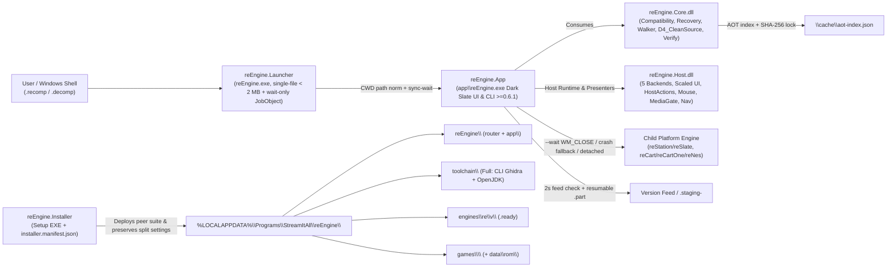
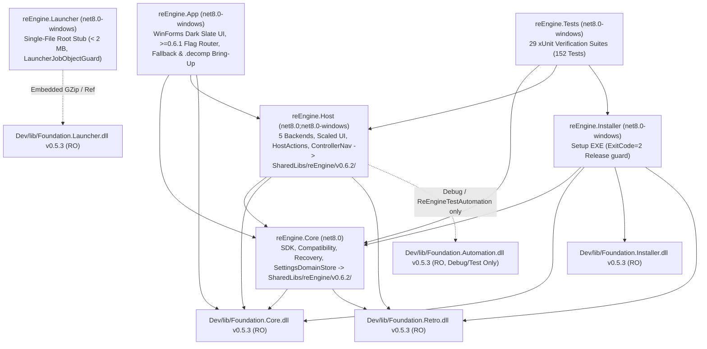

# reEngine — System Architecture

**Synced Version:** `0.6.2` (`2026-11-23`)  
**Scope:** Runtime Topology, Assembly Boundaries, Execution Pipelines, File Inventory & Data Stores  
**License:** Mozilla Public License Version 2.0 (`MPL-2.0`, root [`LICENSE`](../../LICENSE))

---

## 1. System Context & Runtime Model

`reEngine` is a zero-daemon static recompilation package router, unified `reEngine.Host.dll` runtime host (native GPU contexts, live video filter pipeline, late-latch VRR pacing, SDL3 hot-switchable audio DSP & Sound Test, 4-port input, expressive 3-tier & rebindable host actions, relative mouse capture, scaled crisp overlays, full-screen Media Gate, and 100% controller navigation), `.decomp` Bring-Up runner, `<dataDir>\cache\` AOT assembly manager, and side-by-side platform engine suite manager (`D0`–`D5` pipeline stages).

- **Zero Background Footprint:** Exiting the suite manager UI or child engine leaves zero resident processes (`ReEnginePackagingConstants.AllowAutoStart = false`, `0 MB` idle background memory, zero Windows Startup entries).
- **Peer User-Scope Suite Topology & Custom Auto-Sort:** Non-admin installation uses `%LOCALAPPDATA%\Programs\StreamItAll\reEngine\{reEngine,toolchain,engines,games}\` (`umbrellaSubpath = "StreamItAll\\reEngine\\reEngine"`). `LegacyMigrationHelper` preserves all domain configs (`settings.json`, `settings.video.json`, `settings.audio.json`, `settings.controls.json`) and existing schema versions (`Math.Max(existingSchemaVersion, 1)`) with `.bak` recovery across upgrades.
- **Canonical Standard 19 Split Storage (`<InstallRoot>\data\config\` & `<InstallRoot>\logs\`):** `ProgramBootstrapHelper` anchors `--data-dir <InstallRoot>\data`, `--config <InstallRoot>\data\config\settings.json`, and `--log-dir <InstallRoot>\logs`. `SettingsDomainStore` + `HostSettingsStore` separate runtime state across `settings.json` (v2 core/execution), `settings.video.json`, `settings.audio.json`, and `settings.controls.json` with automatic `v1 -> v2` migration (`data\config_history\`) and self-healing `data\quarantine\` recovery.
- **Frontend Bridge, Engine Fallback, Bounded Shutdown & Interactive `.decomp` UI:**
  - Frontend game launchers (such as `uStation`) route `.recomp` launches synchronously to `reEngine.exe --open <pkg> --wait [--fullscreen] [--save-dir <dir>] [--shutdown-timeout-ms 3000]`.
  - Root `reEngine.Launcher` binds [`LauncherJobObjectGuard`](../src/reEngine.Launcher/LauncherJobObjectGuard.cs) (`JOB_OBJECT_LIMIT_KILL_ON_JOB_CLOSE`) strictly when `ShouldWaitForChild` is `true` (so detached interactive children outlive launcher exit cleanly); inside `reEngine.App`, during `--wait` cancellation, `GracefulProcessTreeShutdown` posts `WM_CLOSE` across the child process tree so saves flush cleanly into `--save-dir` within `shutdownTimeoutMs` before `JobObjectGuard` disposal, and abnormally exiting engines trigger prompt-first fallback relaunch (`RecompLaunchCoordinator.TryCrashFallbackRelaunchAsync`) assisted by [`SessionRecoveryLocator`](../src/reEngine.Core/Execution/SessionRecoveryLocator.cs).
  - Double-clicking a `.decomp` file from Windows Explorer opens `ReEngineMainForm` straight onto the `Bring-Up` shelf (`ReEngineMainForm.Decomp.cs`) with automatic suite-tree media discovery (`SuiteMediaTreeWalker`), `MissingMediaPromptDialog` (use-in-place default + opt-in `.cue`/`.bin` copy into `data\rom\`), standalone `--verify-module`, and interactive stage execution.



---

## 2. Assembly / `.dll` & Module Dependency Graph

The solution [`Dev\reEngine.slnx`](../reEngine.slnx) inherits [`Dev\Directory.Build.props`](../Directory.Build.props) (`Version = 0.6.2`, `LangVersion = latest`, `Nullable = enable`, `TreatWarningsAsErrors = true`, `Deterministic = true`, `ContinuousIntegrationBuild = true` in `Release`, `<DebugType>none</DebugType>`, and `<PathMap>` workspace scrubbing) and consumes `Foundation v0.5.3` (`GET /v1/snapshot.png` + `ExeboxStreamHelpers`) from `Dev\lib\`.



| Assembly | Target | Allowed Dependencies | Boundary Constraints & Rules |
| :--- | :--- | :--- | :--- |
| `reEngine.Core` | `net8.0` | `Foundation.Core`, `Foundation.Retro` | Zero WinForms/SDL UI deps; zero retail ROM/BIOS/generated assets |
| `reEngine.Host` | `net8.0` / `net8.0-windows` | `reEngine.Core`, `Foundation.Core`, `Foundation.Retro`, `ppy.SDL3-CS`, OS native GPU libs (`opengl32`/`vulkan-1`/`d3d12`/`dxgi`) (`Foundation.Automation` on `Debug \| ReEngineTestAutomation=true` only) | Release `net8.0` & `net8.0-windows` contain **0** `Foundation.Automation` or `System.Windows.Forms` refs; direct clean-room P/Invoke/COM without GPL/heavy third-party SDKs |
| `reEngine.App` | `net8.0-windows` | `reEngine.Core`, `reEngine.Host`, `Foundation.Core`, WinForms | Never modifies read-only external directories; Fail-Closed `ExitCode = 2` if `--automation-port` in Release; `ExitCode = 6` on `BackendUnavailableException` |
| `reEngine.Launcher` | `net8.0-windows` | Embedded `Foundation.Launcher.dll` | **Zero** `reEngine.Core` or `reEngine.Host` ref (keeps single-file stub `< 2 MB`) |
| `reEngine.Installer` | `net8.0-windows` | `reEngine.Core`, gzipped `Foundation.{Core,Installer,Retro}`, `installer.manifest.json` | `AllowAutoStart = false`; preserves split `settings[.{video,audio,controls}].json` & `schemaVersion >= 1`; zero unconfirmed `%LOCALAPPDATA%` writes in test mode |
| `reEngine.Tests` | `net8.0-windows` | `Core`, `Host`, `Installer` + linked `Launcher`/`App` files + xUnit + `Foundation.Automation` | Isolated `APP_ISOLATED_TEST=1` temp roots only; Stage 2 visible-window sandbox E2E |

---

## 3. End-to-End Data Flow per Major Pipeline

### 3.1 `.recomp` Launch, Suite Media Fallback, Engine Resolution & Crash Recovery, `--wait` Teardown
1. Shell double-click or CLI invokes root `reEngine.exe` ([`reEngine.Launcher\Program.cs`](../src/reEngine.Launcher/Program.cs)), which preserves `--verify-module`, `--headless`, `--json`, and `--host-demo`/`--demo-cart` synchronously via [`LauncherArgsHelper`](../src/reEngine.Launcher/LauncherArgsHelper.cs), normalizes caller-CWD relative paths (`--rom`, `--disc`, `--media-path`, selective `--verify-module`), handles optional-value `--require-backend [<id>]`, attaches [`LauncherJobObjectGuard`](../src/reEngine.Launcher/LauncherJobObjectGuard.cs) (`JOB_OBJECT_LIMIT_KILL_ON_JOB_CLOSE`) strictly when `ShouldWaitForChild` is `true`, and delegates to `app\reEngine.exe`.
2. [`Program.cs`](../src/reEngine.App/Program.cs) dispatches interactive Explorer `.decomp` invocations directly onto `ReEngineMainForm` (`MainShelfKind.BringUp`), runs `--host-demo` / `--demo-cart` (`DemoCartSessionHelper`), handles dual-mode `--verify-module`, or executes [`RecompLaunchCoordinator`](../src/reEngine.App/RecompLaunchCoordinator.cs).
3. [`EngineVersionResolver`](../src/reEngine.Core/Resolution/EngineVersionResolver.cs) enforces resolution precedence: (1) `pinnedEngineVersions` (`moduleId` -> `engineId` -> `EngineAliasCatalog` aliases: exact `SemVer`, `"bundled"`, `"target"`, `"latest"`), (2) latest `.ready`-gated `re*` candidate `>= engineVersion` NOT matching `incompatibleEngineVersions` ([`EngineCompatibilityEvaluator`](../src/reEngine.Core/Resolution/EngineCompatibilityEvaluator.cs) supporting exact, `0.2.x`/`0.*`, and comparator ranges like `>=0.5.0 <0.5.2`) ranking `-hf.<n> > stable > prerelease`, and (3) bundled fallback (`TryResolveBundledOrTargetFallback`).
4. [`RecompLaunchPlanBuilder`](../src/reEngine.App/RecompLaunchPlanBuilder.cs) + [`RecompLaunchFlagRouter`](../src/reEngine.App/RecompLaunchFlagRouter.cs) normalize backends (`dx12`/`d3d12` -> `directx`, `metal`), throw `BackendUnavailableException` (`ExitCode = 6`) on `--require-backend`, fall back through `SuiteMediaTreeWalker`, and route flags across `< 0.3.0`, `>= 0.3.0`, `>= 0.6.0`, and `>= 0.6.1` (`Supports061Routing`).
5. On abnormal child exit (`not in {0, 6, 130}`), `RecompLaunchCoordinator.TryCrashFallbackRelaunchAsync` scans [`SessionRecoveryLocator`](../src/reEngine.Core/Execution/SessionRecoveryLocator.cs) (`checkpoint > quickResume > quickSave/.state > saveVaultBackup > saveFile`) and offers a prompt-first relaunch onto bundled/target fallback (suppressed cleanly under `--headless`, `--json`, `--dry-run`, or `APP_ISOLATED_TEST=1`). On synchronous `--wait` cancellation, [`GracefulProcessTreeShutdown`](../src/reEngine.App/GracefulProcessTreeShutdown.cs) posts `WM_CLOSE` BEFORE `JobObjectGuard.Dispose()`.

### 3.2 `reEngine.Host` Execution Resilience, Display/Filter Pipeline, Audio DSP, Action Keybinds & Scaled Overlays
1. **Execution Resilience (`reEngine.Core.Execution` + `HostSessionRuntimeBridge`):** [`BootCrashSentinel`](../src/reEngine.Core/Execution/BootCrashSentinel.cs) writes `<dataDir>\booting.sentinel` on boot, checks dead PIDs to trigger in-memory Safe Mode (`HostSettingsStore.ApplyInMemorySafeMode` disables HD packs and falls back Vulkan/DirectX 12 to OpenGL without touching saved disk config), and clears on frame `1`. [`MediaRamPreloader`](../src/reEngine.Core/Execution/MediaRamPreloader.cs) enforces physical headroom (`>= 512 MiB` free and `<= 75%` available) before buffering contained BYO media, and [`ExecutionTierPolicy`](../src/reEngine.Core/Execution/ExecutionTierPolicy.cs) quarantines `interpreterOracle` strictly to CLI invocations (`--force-zero-rwx` maps to `aotWithThreadedIr`).
2. **Display Modes, VRR Pacing, Color Quantization & 8 Live Video Filters:** [`HostFramePacingController`](../src/reEngine.Host/Core/HostFramePacingController.cs) tracks `Framerate` (`Original`/`Enhanced`), `Target FPS` (`30..240`/Max `0`), `backgroundFpsCap`, and fast-forward `2.0..4.0`, calling `HighResFramePacer.Reset()` on cadence transitions. [`HostViewportGeometry`](../src/reEngine.Host/Core/HostViewportGeometry.cs) supports `21:9 Hor+`, automatic `4:3` FMV centering, and HUD anchors; [`HostVideoFilterPipeline`](../src/reEngine.Host/Rendering/HostVideoFilterPipeline.cs) runs 24-bit vs 15-bit + 4x4 Bayer dithering and all 8 live filters (`nearest`, `bilinear`, `sharpBilinear`, `scanlines`, `crtLite`/`crt-aperture`, `lcdGrid`, `xbrz`, `ntscComposite`); post-present `F12` [`HostScreenshotService`](../src/reEngine.Host/Core/HostScreenshotService.cs) reads back from `Gl33Presenter`, `VulkanPresenter`, `D3d12Presenter`, `ParallelCpuPresenter`, and `Sdl3HostWindow` (`TrySwitchBackend` live switching).
3. **Audio DSP, Scaled Overlays, Host Action Keybinds, Media Gate & Controller Nav:** [`HostOverlayTextRenderer`](../src/reEngine.Host/Ui/HostOverlayTextRenderer.cs) scales coverage-sampled 5x7 bitmap text (`1.45x` default * live `uiTextScale` `0.75x–2.0x`) across full-title tabs (`Video`, `Audio`, `Controls`, `Keybinds`, `System`, `Media`) with dynamic drawer sizing (`430–780px`), scrolling, `AudioTabView` (`HostBiquadFilter` + `HostAudioDspPipeline` + `HostSoundTestService`), `ControlsTabView` (`Modern PC (Per-Action)` / `Game 1:1` / `Global 1:1` zero raw `"Schema A/B/C"`, `Modern WASD + Mouse`, sensitivity stepper, `menuControllerChord`), `KeybindsTabView` + [`HostActionBindingSet`](../src/reEngine.Host/Input/HostActionBindingSet.cs) (8 rebindable host actions with cross-tier collision guard + unbound-`Tab` FF hold), `SystemTabView` (`Quick Save/Load`, `Fast-Forward` + `2x/3x/4x`, `Skip Cutscene`, `Runtime Logging`, `Clean-Capture Mode`, `Quit Game`), [`FirstRunMediaGateView`](../src/reEngine.Host/Ui/FirstRunMediaGateView.cs) (full-screen Deep Slate Glass drop zone + Win32 [`HostNativeFileDialog`](../src/reEngine.Host/Core/HostNativeFileDialog.cs) + `AcceptPickedPath` routing Browse/Module validation through `OnFileDropped` to retain warning banners + quiet `Launch Demo / Test Cart`), [`HostAotCompileOverlayView`](../src/reEngine.Host/Ui/HostAotCompileOverlayView.cs) (`~60 Hz`), [`F3HudOverlayView`](../src/reEngine.Host/Ui/F3HudOverlayView.cs) (`[ORIG]`/`[ENH]`/`[MAX]` + `[FF <N>x]` + fixed-width padded telemetry + invariant worst-case pill width `0 px` jitter + Clean-Capture hide), [`HostInputMapper`](../src/reEngine.Host/Input/HostInputMapper.cs) (2-frame deferred non-hotkey synthetic tap auto-release via `_syntheticTapFramesRemaining` + `AdvanceSyntheticTapAutoRelease`), [`HostRelativeMouseController`](../src/reEngine.Host/Core/HostRelativeMouseController.cs) (`SDL_SetWindowRelativeMouseMode`), [`HostDrawerControllerNav`](../src/reEngine.Host/Ui/HostDrawerControllerNav.cs), [`HostSessionOverlayAndSettingsHelper`](../src/reEngine.Host/Core/HostSessionOverlayAndSettingsHelper.cs) (`HostSessionRunner.SetAotCompileState` / `SetMediaGateState` / `UpdateDrawerDescriptor` thread-safe queues + `HostSettingsStore` startup hydration honoring `PreferExplicitBackend`/`PreferExplicitScale`/`PreferExplicitAspectRatio` + live `F1` dirty-save persistence to `settings.json`, `settings.video.json`, and `settings.audio.json`, skipped during Safe Mode), and [`HostSessionParityHelper`](../src/reEngine.Host/Core/HostSessionParityHelper.cs) (4-step non-quitting `Esc` precedence + idle `settings.controls.json` write suppression + `SDL_EVENT_DROP_FILE`).

### 3.3 `.decomp`, Root-Tree Media Discovery, `D4_CleanSource` & `--verify-module` Pipeline
1. [`SuiteMediaTreeWalker`](../src/reEngine.Core/Decomp/SuiteMediaTreeWalker.cs) performs depth-capped (`<= 5`), reparse-safe, containment-checked media searches across module-local and `<SuiteRoot>` (`games\*\data\rom\`, `gamedata\`, `data\rom\`), flags multi-game ambiguities cleanly, and supports opt-in `StageMediaIntoRomDirectoryAsync` copying `.cue` + contained `.bin` tracks (plus `.fds` parity alongside `.nes`).
2. [`DecompD4StrictnessValidator`](../src/reEngine.Core/Decomp/DecompD4StrictnessValidator.cs) enforces canonical `D4_CleanSource` across `CanonicalCorpusTiers` while mapping legacy `D4_FunctionalRewrite` without double counting.
3. [`PackageVerificationService`](../src/reEngine.Core/Decomp/PackageVerificationService.cs) validates `.recomp` and `.decomp` schema, clean-room integrity, engine/alias tracks, and media readiness (`hasMediaReady` warning-only unless `--require-media`), emitting Standard 18 camelCase JSON (`isPassed`, `generatedAtUtc`, `durationMs`, `exitCode`).

---

## 4. Architecture Notes & SLOC Discipline (`<= 250 / 400 / 600`)

All `v0.6.2` modules (`Dev/src/**/*.cs` and `Dev/tests/**/*.cs`) stay well below the `400` code-only SLOC soft ceiling via cohesive helper extractions (`HostSessionOverlayAndSettingsHelper` [`222` SLOC, keeping `HostSessionRunner.cs` at `386` SLOC], `EngineCompatibilityEvaluator`, `SessionRecoveryLocator`, `LauncherJobObjectGuard`, `HostActionBindingSet`, `HostNativeFileDialog`, `HostRelativeMouseController`, `HostOverlayTextRenderer`, `HostDrawerControllerNav`, `HostAotCompileOverlayView`, `HostSessionParityHelper`, `DemoCartSessionHelper`, and extracted modular test suites).

---

## 5. Settings, Manifest & State Store Ownership Map

`reEngine` uses zero SQLite databases; all runtime state persists in Standard 19 split atomic JSON domains with `.bak`, `config_history\`, and `quarantine\` recovery:

| File Store (under `<dataDir>\`) | Owner Type | Canonical Keys | Backup / Locking Mechanism |
| :--- | :--- | :--- | :--- |
| `config\settings.json` (template: [`Dev\settings.example.json`](../settings.example.json)) | `SettingsDomainStore` / `HostSettingsStore` / `LegacyMigrationHelper` | `schemaVersion: 2`, `domain: "core"`, `appId`, `updatedAtUtc`, `installProfile`, `executionTierMode`, `isJitEnabled`, `shouldPreloadMediaToRam`, `isFastBootEnabled`, `isSafeModeActive`, `shouldFastLoadData`, `shouldEnableRuntimeLogs`, `fastForwardMultiplier`, `shutdownTimeoutMs`, `shouldCheckUpdates`, `shouldAutoStagePatches`, `pinnedEngineVersions`, `stagedUpdatePath`, `reEngineInstallDir`, `suiteInstallDir`, `umbrellaSubpath`, `decompSchemaVersion`, `goalDecompTier`, `targetDecompTier` | `GranularSettingsManager` `.tmp` atomic rename + `.bak` + `config_history\` + `quarantine\`; `[JsonExtensionData]` preserves unknown keys |
| `config\settings.video.json` | `SettingsDomainStore` / `HostSettingsStore` | `schemaVersion: 2`, `domain: "video"`, `backendId`, `resolutionScale`, `displayMode`, `monitorIndex`, `isFullscreen`, `isVsyncEnabled`, `frameRateMode`, `targetFps`, `backgroundFpsCap`, `aspectRatioMode`, `overscanCropPx`, `isFastForwardEnabled`, `isHdTexturePackEnabled`, `hudAnchorMode`, `videoFilterMode`, `isTrueColor24BitEnabled`, `isDitheringEnabled`, `screenshotCaptureMode`, `uiTextScale`, `isFpsOverlayEnabled`, `isCleanCaptureModeEnabled` | Atomic `.tmp` + `.bak` + `quarantine\` recovery |
| `config\settings.audio.json` | `SettingsDomainStore` / `HostSettingsStore` | `schemaVersion: 2`, `domain: "audio"`, `audioDriver`, `audioOutputDevice`, `masterVolume`, `isAudioMuted`, `bgmVolume`, `sfxVolume`, `voiceVolume`, `shouldMuteOnFocusLoss`, `audioLowPassHz`, `audioHighPassHz`, `audioStereoWidthPercent`, `audioResamplingMode`, `fastForwardAudioMode` | Atomic `.tmp` + `.bak` + `quarantine\` recovery |
| `config\settings.controls.json` | `HostControlTierStore` | `schemaVersion`, `appId`, `domain` (`"controls"`), `updatedAtUtc`, `inputProfileMode` (`globalController`/`perGameController`/`perGameModern`), `activeSchema`, `controlMode`, `mouseSensitivity`, `menuControllerChord`, `hostActionBindings`, `globalController`, `perGameController`, `perGameModern` | `.tmp` atomic replace with duplicate/hidden-slot validation, `[JsonExtensionData]` preservation, and `SerializeDirtyCheckJson()` idle disk-write suppression |
| `cache\aot-index.json` | `AotCacheManager` | `schemaVersion`, `entries[]` (`moduleId`, `romSha256`, `engineId`, `engineVersion`, `moduleVersion`, `fileSizeBytes`, `sha256Hex`) | `.aot-index.lock` cross-process mutex + `.bak` rotation + `.tmp.<guid>` atomic rename |
| `virtual_registry.json` | `VirtualRegistryAssociationStore` | `.recomp` (`reEngine.RecompModule`), `.decomp` (`reEngine.DecompModule`), `commandTemplate` | `.tmp` atomic replace strictly under `APP_ISOLATED_TEST=1` |
| `modules\<moduleId>\settings.json` | Child `re*` engine (isolated by `RecompLaunchPlanBuilder`) | Delegated to engine contract | Contained inside `<dataDir>\modules\<moduleId>\` |
| `staged_updates\<engineId>\.staging-<ver>\*.part.meta.json` & `engines\<engineId>\v<Ver>\.ready` | `UpdatePackageApplier` | `.part.meta.json`: `engineId`, `version`, `downloadUrl`, `sha256Hex`, `expectedSizeBytes`, `fileSizeBytes`, `updatedAtUtc`; `.ready`: `engineId`, `version`, `completedAtUtc` | HTTP `Range` resume + SHA-256 verification + atomic staging directory rename |

---

## 6. Failure Modes & Resilience

- **Dual-Binary Release Fail-Closed Automation Gate:** `reEngine.Host` (`#if !REENGINE_ENABLE_AUTOMATION` or null `AutomationBridgeFactory`), `reEngine.App`, AND `reEngine.Installer` ALL fail closed (`ExitCode = 2`) when `--automation-port` is supplied on a `Release` build; `Foundation.Automation.dll` and `System.Windows.Forms` / `Foundation.UI` are omitted completely from `Release` `SharedLibs\reEngine\v0.6.2\`.
- **Zip-Slip / Traversal & SSRF Guards:** Both `RecompPackageReader.Load`, `DecompPipelineCoordinator.ParseManifest`, `SuiteMediaTreeWalker`, `HdPackResolver`, `SessionRecoveryLocator`, and `UpdatePackageApplier.ExtractArchiveSafely` reject rooted, symlink/reparse, or `..`-escaping paths and entries; `UpdatePackageApplier.AssertSafeRemoteUrl` blocks `file://`, loopback, RFC 1918, and link-local/metadata IP ranges at rest and runtime.
- **Missing Engine, Crash Fallback & Backend Availability:**
  - `.recomp`: throws `InvalidOperationException` -> Exit `1` (`No compatible engine`); `EngineCompatibilityEvaluator` excludes `incompatibleEngineVersions`; abnormal engine exit triggers prompt-first fallback relaunch (`TryCrashFallbackRelaunchAsync`) + `SessionRecoveryLocator` artifact discovery (prompt suppressed cleanly in headless/test runs).
  - `--require-backend [<id>]` unavailable (e.g., `metal` on Windows or pre-0.3.0 engine): throws `BackendUnavailableException` -> Exit `6` (mapped cleanly in `HostSessionRunner` and `Program.MapExceptionToExitCode`).
  - `.decomp`: populates `DecompUnbuiltEngineError` (`[1/3 What Failed]`, `[2/3 Missing]`, `[3/3 Remediation]`) -> Exit `3`.
- **Non-Quitting Host `Esc` & Clean-Room Violations:** `HostSessionParityHelper.ApplyNonQuittingEscape` never terminates the host process (cancels keybind capture -> closes drawer -> passes `Esc` to game if bound in `perGameModern` -> releases relative mouse capture; explicit exit uses `System_QuitGame`, `X`, or `Alt+F4`). `AotCacheManager`, `DecompPipelineCoordinator`, `DecompD4StrictnessValidator`, and `PackageVerificationService` flag clean-room violations.
- **Corrupted `aot-index.json`, Dual-Root Split Settings, or Locked AOT DLLs:** `AotCacheManager` verifies length + SHA-256 and rotates `.bak`; `SettingsMigrationHelper` merges legacy dual-root configs safely; `ReEngineAppStatusHelper.InspectAotCache` logs file-lock `IOException` via `Trace.WriteLine`.
- **Offline Update Feeds / Crashes:** `UpdateCoordinator` skips unavailable feeds cleanly (`NetworkUnavailable = true`, `[WARN]`, `2s` per-target poll timeout, Exit `0` unless `--strict` returns Exit `4`). Fatal unhandled exceptions write `logs\crashes\crash_reengine_*.json` via `CrashBundleService`.

---

## 7. Security & Privacy Model

- **Zero PII & Deterministic Paths:** `Directory.Build.props` enables `Deterministic = true` and `ContinuousIntegrationBuild = true` + `<PathMap>` in Release; release verification and archive exclusions (`-xr!data -xr!logs`) keep `Builds\`, `Releases\`, `SharedLibs\`, and `Archive\` free of PII, machine paths, local workspace configs, `.pdb`, `.env`, and `*secret*.json`.
- **No Network Calls at Rest or Decomp:** Zero telemetry servers, zero runtime Ghidra/OpenJDK downloads (`OfflineToolchainLocator` uses staged `toolchain\` only), and zero background daemons (`AllowAutoStart = false`).
- **Registry Isolation:** `WindowsRegistryAssociationStore` refuses registry writes when `suppressHostMutations: true` or `APP_ISOLATED_TEST=1` is active; isolated tests write solely to `virtual_registry.json`.
- **Apache-2.0 / GPL Separation:** `stage_offline_toolchain.ps1` and `OfflineToolchainLocator` reject unstripped `ghidra\GPL\` directories and require `THIRDPARTY_LICENSES.txt` alongside `toolchain\`.

---

## 8. Testing Strategy Map (29 Suites, 152 Unit/Contract Tests + Stage 2 Visible E2E)

Run isolated zero-warning unit & contract tests:
```powershell
$env:APP_ISOLATED_TEST = "1"
dotnet test Dev\reEngine.slnx -c Release /warnaserror
dotnet test Dev\reEngine.slnx -c Debug -p:ReEngineTestAutomation=true /warnaserror
```
Run full Stage 2 visible-window sandbox E2E (12-point Installer + 5-backend WinForms Library + interactive Explorer `.decomp` Bring-Up + `--verify-module --json` + synchronous `--open --wait --fullscreen --save-dir` WM_CLOSE flush + visible SDL3 OpenGL Host + `Stage2V060Probes` + `Stage2V061ParityProbes` [quiet `--demo-cart`, Glass Media Gate, scaled UI, expressive Controls, host Keybinds, `F3` badges + Clean-Capture, non-quitting `Esc`, `System_QuitGame`] + Dual-Binary Release ExitCode=2):
```powershell
powershell -NoProfile -ExecutionPolicy Bypass -File Dev\scripts\run_stage2_sandbox_e2e.ps1 -Version 0.6.2
```

| Test Class (`Dev\tests\reEngine.Tests\`) | Covered Components | Key Verified Contracts |
| :--- | :--- | :--- |
| [`ManifestAndResolverTests.cs`](../tests/reEngine.Tests/ManifestAndResolverTests.cs) | `RecompPackageReader`, `EngineVersionResolver`, `RecompLaunchCoordinator` | Zip-Slip guard, parent-root `app\*.recomp` resolution, track ranking, `BuildChildLaunchPlan` isolation |
| [`DecompAndToolchainTests.cs`](../tests/reEngine.Tests/DecompAndToolchainTests.cs) | `DecompPipelineCoordinator`, `OfflineToolchainLocator` | `sample-re64.decomp`, 3-part `UnbuiltEngineError`, clean-room violations, `ghidra\GPL\` stripping |
| [`DecompProviderAndD4ValidatorTests.cs`](../tests/reEngine.Tests/DecompProviderAndD4ValidatorTests.cs) | `DecompPipelineCoordinator`, `ProviderLoadContext`, `DecompD4StrictnessValidator` | `app\reStation.Decomp.dll` probe, ALC shared-contract unification, D4 warnings/flags/archive checks |
| [`AotCacheManagerTests.cs`](../tests/reEngine.Tests/AotCacheManagerTests.cs) | `AotCacheManager`, `AotCacheContracts` | `<dataDir>\cache\` indexing, `fileSizeBytes`/`sha256Hex`, tamper invalidation, `.bak` & eviction |
| [`InstallerAndAppStatusTests.cs`](../tests/reEngine.Tests/InstallerAndAppStatusTests.cs) | `reEngine.Installer.Program`, `LegacyMigrationHelper`, `ReEngineAppStatusHelper` | `StreamItAll\reEngine\reEngine`, `--profile`, `--reengine-dir`/`--suite-dir`, opt-in migration, status badges |
| [`InstallerWizardAutoSortTests.cs`](../tests/reEngine.Tests/InstallerWizardAutoSortTests.cs) | `ReEngineWizardPathNormalizer`, `InstallerWizardForm` | Parent-folder `<parent>\reEngine` auto-sort, companion `<reEngineDir>\engines\` selection, live suite sync |
| [`AssociationUpdateAndContainmentTests.cs`](../tests/reEngine.Tests/AssociationUpdateAndContainmentTests.cs) | `FileAssociationStores`, `UpdateCoordinator`, `ReEngineBootstrapHelper` | `.recomp`/`.decomp` HKCU & virtual stores, track sweep, peer `..\toolchain`/`..\engines` resolution, containment |
| [`UpdateStagingAndTracksTests.cs`](../tests/reEngine.Tests/UpdateStagingAndTracksTests.cs) | `UpdatePackageApplier`, `EngineVersionResolver`, `EngineAliasCatalog` | SSRF blocking, HTTP Range `.part` resume, `.staging->.ready` promotion, `SeriesMap` aliases, pinned rollback |
| [`UpdateSweepAndTelemetryTests.cs`](../tests/reEngine.Tests/UpdateSweepAndTelemetryTests.cs) | `UpdateCoordinator`, `ReEngineTelemetryFormatter` | Multi-track sweep resilience, offline `[WARN]` zero-crash guarantee, single `[HEARTBEAT]` formatting |
| [`LauncherAndLaunchPlanTests.cs`](../tests/reEngine.Tests/LauncherAndLaunchPlanTests.cs) | `LauncherArgsHelper`, `RecompLaunchOptions` | Relative CWD arg normalization (`decomp` preserved), `--open`/`--wait`/`--backend`/`--host-demo` passthrough |
| [`SettingsMigrationAndLaunchTests.cs`](../tests/reEngine.Tests/SettingsMigrationAndLaunchTests.cs) | `SettingsMigrationHelper`, `ProgramBootstrapHelper`, `RecompLaunchPlanBuilder`, `RecompLaunchCoordinator` | Dual-root settings merge to `data\config\settings.json`, `--scale`/`opengl`/`--jit-bringup` forwarding, detached child survival |
| [`HostSurfaceAndInputTests.cs`](../tests/reEngine.Tests/HostSurfaceAndInputTests.cs) | `HostRgbaSurfaceBackend`, `HostInputMapper`, `Sdl3AudioPump` | Integer/aspect scaling on `PixelOverlayCanvas`, Schema A/B/C input mapping, `AudioRingBuffer` + WAV |
| [`HostUiDrawerAndGateTests.cs`](../tests/reEngine.Tests/HostUiDrawerAndGateTests.cs) | `F1SettingsDrawerView`, `F3HudOverlayView`, `FirstRunMediaGateView` | `F1` drawer & clicks, `F3` HUD telemetry, first-run Glass media gate render/PNG capture |
| [`HostReleaseAutomationStripTests.cs`](../tests/reEngine.Tests/HostReleaseAutomationStripTests.cs) | `HostSessionRunner` (`Release` vs `Debug+Automation`) | Fail-closed `ExitCode=2` in `Release` builds vs `REENGINE_ENABLE_AUTOMATION` opt-in |
| [`HostMultiBackendAndAudioTests.cs`](../tests/reEngine.Tests/HostMultiBackendAndAudioTests.cs) | `HostBackendProbe`, `ParallelCpuPresenter`, `HdPackResolver`, `NativeAudioDriverSelector`, `LegacyMigrationHelper` | `directx`/`dx12` normalization, `ExitCode = 6` metal gate, `1x` ParallelCpu SHA-256 parity, nested `hdpacks\` containment, `wasapi`, v0.4 settings `.bak` |
| [`HostMultiBindInputAndTouchTests.cs`](../tests/reEngine.Tests/HostMultiBindInputAndTouchTests.cs) | `HostMultiBindRegistry`, `Sdl3GamepadProvider`, `ControlsTabView`, `KeybindsTabView`, `HostTouchOverlayView`, `HostSessionRunner` | 3-slot KBM/wheel `1001..1007`, live Keybinds capture & `Escape` cancel, Xbox/HID `2001..2032`, dynamic `ControlOptions`, touch hit/pinch |
| [`MediaTreeWalkerAndVerifyModuleTests.cs`](../tests/reEngine.Tests/MediaTreeWalkerAndVerifyModuleTests.cs) | `DecompD4StrictnessValidator`, `SuiteMediaTreeWalker`, `PackageVerificationService` | `D4_CleanSource` + alias dedupe, suite discovery/ambiguity + `moduleId` traversal rejection, `.cue` `.bin` staging, `--verify-module` JSON & exit codes |
| [`SyncWaitShutdownAndDecompUiTests.cs`](../tests/reEngine.Tests/SyncWaitShutdownAndDecompUiTests.cs) | `LauncherArgsHelper`, `RecompLaunchPlanBuilder`, `GracefulProcessTreeShutdown`, `Program.Verify`, `BringUpShelfPanel` | Selective `--verify-module` normalization, `--fullscreen`/`--save-dir`/`--audio-driver`, bounded `WM_CLOSE` save flush, interactive `.decomp` UI routing |
| [`HostViewportGeometryAndPresentersTests.cs`](../tests/reEngine.Tests/HostViewportGeometryAndPresentersTests.cs) | `HostViewportGeometry`, `HostRgbaSurfaceBackend`, `ParallelCpuPresenter`, `Gl33Presenter`, `VulkanNative`, `D3d12Native`, `HostSessionRunner` | 5 aspect modes, overscan crop, inverse pointer map, Surface0 border fill, GL `0x0`/FBO guards, `TryReadSurfaceRect` & pre-QuickSave `FlushAndSyncForSnapshot` sync, Release `ExitCode = 2` automation block |
| [`HostMultiPortInputAndHotkeysTests.cs`](../tests/reEngine.Tests/HostMultiPortInputAndHotkeysTests.cs) | `Sdl3GamepadProvider`, `HostControlTierStore`, `HostInputMapper`, `F1SettingsDrawerView` | 4-port gamepad snapshots, Standard 33 3-tier `settings.controls.json` + collision block, Menu D-Pad + Left-Stick isolation, `F5`/`F9`/`F11`/FF/Cutscene-Skip & interactive `F1` callbacks |
| [`EngineRoutingAndMediaDiscoveryTests.cs`](../tests/reEngine.Tests/EngineRoutingAndMediaDiscoveryTests.cs) | `EngineAliasCatalog`, `EngineVersionResolver`, `RecompLaunchPlanBuilder`, `SuiteMediaTreeWalker`, `LauncherArgsHelper`, `reEngine.Installer` | 3-way `reCart`/`reCartOne`/`reNes`, `-hf.<n>` SemVer precedence + `.ready` gate, `hostProtocolVersion` >= `0.3.0` CLI forwarding, `.fds` discovery/clean-room rejection, `--aspect-mode` passthrough, Installer `ExitCode = 2` |
| [`HostExecutionResilienceAndSettingsSplitTests.cs`](../tests/reEngine.Tests/HostExecutionResilienceAndSettingsSplitTests.cs) | `BootCrashSentinel`, `MediaRamPreloader`, `ExecutionTierPolicy`, `SettingsDomainStore`, `HostSettingsStore` | Dead-PID Safe Mode sentinel + `--safe-mode-reset`, `>= 512 MiB` / `<= 75%` RAM preload + containment, `interpreterOracle` CLI quarantine, `v1 -> v2` split config + quarantine recovery |
| [`HostDisplayVrrFiltersAndCaptureTests.cs`](../tests/reEngine.Tests/HostDisplayVrrFiltersAndCaptureTests.cs) | `HostFramePacingController`, `HostViewportGeometry`, `HostVideoFilterPipeline`, `HostScreenshotService`, `ParallelCpuPresenter` | VRR `HighResFramePacer.Reset()` cadence transitions, `21:9` + `4:3` FMV + HUD anchor zones, 15-bit Bayer dithering & all 8 live video filters, `F12` clean/filtered PNG capture |
| [`HostAudioDspAndJukeboxTests.cs`](../tests/reEngine.Tests/HostAudioDspAndJukeboxTests.cs) | `HostBiquadFilter`, `HostAudioDspPipeline`, `HostSoundTestService`, `F1SettingsDrawerView`, `AudioTabView` | Butterworth LP/HP stop-band attenuation, mix/mid-side stereo width/SincCubic resampling/FF clamp/5ms focus ramp, Sound Test jukebox PCM, 6th Audio tab toggles |
| [`AppV060RoutingAndUiTests.cs`](../tests/reEngine.Tests/AppV060RoutingAndUiTests.cs) | `LauncherArgsHelper`, `RecompLaunchOptions`, `RecompLaunchOptionParser`, `RecompLaunchFlagRouter`, `LibraryDisplayAudioPanel`, `DetailsRightDrawer` | Launcher/App `ValueOptions` parity, v0.6.0 CLI flag parsing/validation, `>= 0.6.0` child routing gate, WinForms STA split-domain settings roundtrip & Safe Mode reset |
| [`EngineResolutionV061AndCrashFallbackTests.cs`](../tests/reEngine.Tests/EngineResolutionV061AndCrashFallbackTests.cs) | `EngineCompatibilityEvaluator`, `EngineVersionResolver`, `SessionRecoveryLocator`, `RecompLaunchCoordinator`, `RecompLaunchOptionParser`, `LauncherArgsHelper` | `incompatibleEngineVersions` rules, `pinnedEngineVersions` (`moduleId` > `engineId`) + latest `.ready` selection, prompt-first crash fallback + closest checkpoint/save discovery, `>= 0.6.1` CLI parity & optional `--require-backend` |
| [`HostParityUiScaleMediaGateAndControllerNavTests.cs`](../tests/reEngine.Tests/HostParityUiScaleMediaGateAndControllerNavTests.cs) | `HostOverlayTextRenderer`, `F1SettingsDrawerView`, `ControlsTabView`, `FirstRunMediaGateView`, `HostAotCompileOverlayView`, `F3HudOverlayView`, `HostDrawerControllerNav`, `DemoCartSessionHelper` | `1.45x * uiTextScale` bounds, full tab titles + scroll + `8x`, expressive Controls (zero `"Schema A/B/C"`), full-screen Media Gate + quiet `--demo-cart`, responsive AOT pump, `F3` `[ORIG]`/`[ENH]`/`[MAX]`/`[FF]` + Clean-Capture hide, 100% controller nav |
| [`HostNonQuittingEscMouseCaptureAndHotkeysTests.cs`](../tests/reEngine.Tests/HostNonQuittingEscMouseCaptureAndHotkeysTests.cs) | `HostActionBindingSet`, `HostControlTierStore`, `HostInputMapper`, `HostRelativeMouseController`, `HostSessionParityHelper`, `HostNativeFileDialog`, `KeybindsTabView` | 8 rebindable host actions + cross-conflict blocking, `menuControllerChord`, unbound-`Tab` FF hold, relative mouse capture/release lifecycle, 4-step non-quitting `Esc` + `Quit Game`, idle `settings.controls.json` write suppression, `OFN_NOCHANGEDIR` |
| [`HostV062PrelaunchParityTests.cs`](../tests/reEngine.Tests/HostV062PrelaunchParityTests.cs) | `F3HudOverlayView`, `HostInputMapper`, `FirstRunMediaGateView`, `HostSessionRunner`, `HostSessionOverlayAndSettingsHelper`, `HostSettingsStore` | Invariant `0 px` F3 pill width, 2-frame deferred non-hotkey synthetic tap release, Browse error banner retention, live AOT/MediaGate state queuing, `HostSettingsStore` round-trip hydration & dirty-save persistence |

---

## 9. Design Decisions Log (ADR)

- **ADR-013 · `2026-11-23` · `v0.6.2` — Thread-Safe Live Overlay Controls, `HostSettingsStore` Hydration/Dirty-Save, `0 px` Jitter `F3` HUD & Deferred Synthetic Tap Release:** Extracted `HostSessionOverlayAndSettingsHelper` (`222` SLOC) out of `HostSessionRunner` (`386` SLOC) to queue thread-safe `SetAotCompileState` / `SetMediaGateState` / `UpdateDrawerDescriptor` updates; wired `HostSessionOptions` startup/persistence fields (`InitialAotCompileState`, `InitialMediaGateError`, `SettingsDataDirectory`, `SettingsConfigPathOverride`, `PreferExplicitBackend`/`PreferExplicitScale`/`PreferExplicitAspectRatio`) and live `F1` dirty-save persistence across `settings.json`, `settings.video.json`, and `settings.audio.json` (skipped cleanly in Safe Mode); routed `FirstRunMediaGateView.AcceptPickedPath` Browse validation through `OnFileDropped`; padded `F3HudOverlayView` telemetry columns with worst-case template measurement (`0 px` jitter); and deferred synthetic non-hotkey keyboard tap auto-release by 2 frames in `HostInputMapper`.

- **ADR-001 · `2026-11-13` · `v0.1.0` — Zero-Daemon Launcher Architecture (`AllowAutoStart = false`):** Keep `reEngine.Launcher` free of `reEngine.Core` (embedding only `Foundation.Launcher.dll`) and exit every process when work completes. Consequence: `0 MB` idle footprint and `< 2 MB` stub EXE.
- **ADR-002 · `2026-11-14` · `v0.1.2` — Parent-Root `app\*.recomp` Cartridge Resolution:** Resolve `<GameRoot>\app\<Module>.recomp` back to `<GameRoot>\` so `data\rom\` media remains isolated across binary upgrades.
- **ADR-003 · `2026-11-15` · `v0.2.0` — Peer Suite Directory Topology (`StreamItAll\reEngine\{reEngine,toolchain,engines,games}`):** Default non-admin installs use `%LOCALAPPDATA%\Programs\StreamItAll\reEngine\reEngine\` with peer siblings `..\toolchain\` and `..\engines\` primary.
- **ADR-004 · `2026-11-15` · `v0.2.0` — Direct `InstallerWizardForm` Hosting in `reEngine.Installer`:** Hosts `InstallerWizardForm` directly with `installer.manifest.json` (`--profile`, `--suite-dir`, `--reengine-dir`).
- **ADR-005 · `2026-11-15` · `v0.2.1` — Setup Wizard Auto-Sort (`<parent>\reEngine`) & Companion `<reEngineDir>\engines\` Creation:** Normalizes generic parent picks in interactive Setup to `<parent>\reEngine\`.
- **ADR-006 · `2026-11-15` · `v0.2.1-hf.1` — `APP_ISOLATED_TEST=1` & `Foundation` Alignment:** Aligned to `AppEnvironment` and `UiPresentationMode.TrayOrBackground`.
- **ADR-007 · `2026-11-18` · `v0.3.0` — Shared `reEngine.Host.dll` Over `Foundation.Core.PixelOverlayCanvas` & Conditional Automation:** Extracted clean SDL3 window/audio/input/overlay runtime directly on top of `Foundation v0.5.0` primitives (`PixelOverlayCanvas`, `HighResFramePacer`, `AudioRingBuffer`) with zero automation assemblies in `Release`.
- **ADR-008 · `2026-11-18` · `v0.3.0` — Bidirectional Aliasing, Canonical `data\config\settings.json` & Detached Interactive Child Survival:** Added symmetric alias resolution (`reSlate` <-> `reStation`, etc.), `.ready` atomic update markers, unified `ProviderLoadContext`, single-root `data\config\settings.json` bootstrap + migration, and detached child-process handoff without kill-on-close `JobObjectGuard` unless `--wait` is requested.
- **ADR-009 · `2026-11-19` · `v0.4.0` — Unified `reEngine.Host` Native GPU/Input/Audio Stack, `.decomp` Interactive Bring-Up & Bounded `--wait` Shutdown:** Added clean-room native OpenGL 3.3+, Vulkan 1.3+, and DirectX 12 presenters + `ParallelCpu` 16px bands + `<dataDir>\hdpacks\` + native OS audio pinning (`SDL_AUDIO_DRIVER=wasapi` set before `InitAudio`), 3-slot multi-bind + Xbox/HID SDL3 gamepads + `HostTouchOverlayView` + live Keybinds capture, `D4_CleanSource`, containment-safe `SuiteMediaTreeWalker` + `MissingMediaPromptDialog` (use-in-place default), dual-mode `--verify-module`, and bounded `<= 3s` `WM_CLOSE` process-tree teardown before `JobObjectGuard` kill on `--wait` cancel.
- **ADR-010 · `2026-11-20` · `v0.5.0` — `HostViewportGeometry`, 4-Port / 3-Tier Input, Decoupled `IHostAutomationBridge`, 3-Way `reCart` Alias & `hostProtocolVersion` Routing:** Eliminated window-resize stretch across all 5 presenters with bounded overscan crop and normalized content pointer mapping, guarded GL `0x0`/`0x8CD5` FBOs, upgraded to 4-port SDL3 gamepads + Standard 33 3-tier persistence (`settings.controls.json`) + Menu D-Pad/Left-Stick isolation, decoupled `IHostAutomationBridge` from `SharedLibs\reEngine\v0.5.0\reEngine.Host.dll`, added 3-way `reCart`/`reCartOne`/`reNes`, SemVer `hostProtocolVersion >= 0.3.0` routing, `.fds` discovery, `--aspect-mode`, `Foundation v0.5.2` `"suiteId": "reEngine"`, and Dual-Binary Release `ExitCode = 2`.
- **ADR-011 · `2026-11-20` · `v0.6.0` — Host Resilience (`BootCrashSentinel` / `MediaRamPreloader` / `ExecutionTierPolicy`), Standard 19 Split Config, 8 Video Filters, Late-Latch VRR, Audio DSP/Jukebox & `>= 0.6.0` Flag Routing:** Split JSON state into `settings.json` (`v2`), `settings.video.json`, `settings.audio.json`, and `settings.controls.json` with `data\quarantine\` and `config_history\` self-healing; added dead-PID Safe Mode sentinel + `--safe-mode-reset`, RAM preloading with `>= 512 MiB` / `<= 75%` headroom fallback, `interpreterOracle` CLI quarantine, 3 display modes + monitor selector, late-latch VRR pacer resets, `21:9` + `4:3` FMV + HUD anchor zones, 15-bit Bayer dithering + 8 live filters, post-present `F12` capture + multi-backend GPU readback, biquad Audio DSP + hot-switchable SDL3 playback devices + Sound Test jukebox on the 6th `Audio` drawer tab, `>= 0.6.0` CLI gating, and `SingleSetup7` releases.
- **ADR-012 · `2026-11-20` · `v0.6.1` — `R08` Single-Host Parity Floor, `R01`/`R04` Engine Precedence + Crash Fallback, Unified CLI/Launcher `JobObjectGuard` & `Foundation v0.5.3`:** Delivered `HostOverlayTextRenderer` (`1.45x * uiTextScale`), full clear tab names, expressive Controls UI (zero `"Schema A/B/C"`), `HostActionBindingSet` (`hostActionBindings` + `menuControllerChord`), unbound-`Tab` FF, `HostRelativeMouseController` + non-quitting 4-step `Esc` + `System_QuitGame`, full-screen Glass Media Gate (`HostNativeFileDialog` + quiet `--demo-cart`), `HostAotCompileOverlayView`, `F3` `[ORIG]`/`[ENH]`/`[MAX]` + `[FF <N>x]` + Clean-Capture hide, `HostDrawerControllerNav`, `HostSessionParityHelper` (suppressing idle `settings.controls.json` writes), `EngineCompatibilityEvaluator` + `SessionRecoveryLocator` crash fallback, wait-only `LauncherJobObjectGuard`, unified `>= 0.6.1` CLI parity, and `Foundation v0.5.3` SDK sync.

---

## 10. Zero-Touch Extension Playbooks

1. **Adding a New Platform Engine (`reCart`/`reCartOne`/`reNes`, `reCart64`/`re64`, `reBlast16`/`reGenesis`, `reCube`):** Consume `<SHARED_LIBS>\reEngine\v0.6.2\reEngine.Core.dll` and `reEngine.Host.dll` (+ `Foundation v0.5.3`), implement `IHostSessionCallbacks`, `IHostSessionEventCallbacks`, and optional `IHostSoundTestProvider`, optionally inject Debug-only `IHostAutomationBridge` via `HostSessionOptions.AutomationBridgeFactory`, declare `schemaVersion: 2`, `hostProtocolVersion: "0.6.2"`, and `legacyEngineIds` in `engine.manifest.json`, and install with `.ready` under `<SuiteRoot>\engines\<engineId>\v<Ver>\`.
2. **Adding a Game `.recomp` / `.decomp` Module:** Ship `module.recomp.json` / `module.decomp.json` (`MyGame.recomp`, `SampleModule.decomp`), declaring `engineId`, `supportedEngineTracks`, optional `incompatibleEngineVersions` / `defaultFramerateMode`, `backendId`, and `executionTierMode`, while keeping user `data\rom\` media untracked locally.
3. **Adding a New Persisted Settings Field:** Add a nullable camelCase property or read via `ReEngineSettings.ExtensionData`, document it in `INTERFACES.md` + `Dev\settings.example.json`, and preserve `.bak` recovery.
4. **Adding a CLI Subcommand/Flag:** Add option parsing in `RecompLaunchOptions` (or `Program.CliHandlers.cs`), register sync/value tokens in `LauncherArgsHelper` (keeping optional flags like `--require-backend [<id>]` explicitly handled), route in `RecompLaunchFlagRouter`, and add containment assertions for filesystem path options.
