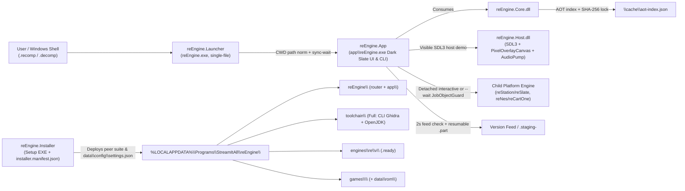
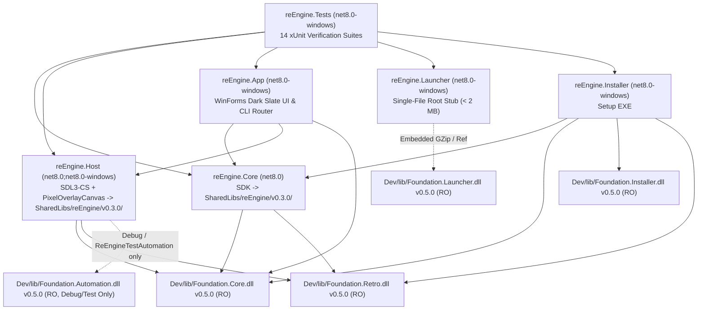

# reEngine — System Architecture

**Synced Version:** `0.3.0` (`2026-11-18`)  
**Scope:** Runtime Topology, Assembly Boundaries, Execution Pipelines, File Inventory & Data Stores  
**License:** Mozilla Public License Version 2.0 (`MPL-2.0`, root [`LICENSE`](../../LICENSE))

---

## 1. System Context & Runtime Model

`reEngine` is a zero-daemon package router, clean-room `reEngine.Host.dll` runtime host (SDL3 window/audio/input + overlays), `.decomp` pipeline coordinator, `<dataDir>\cache\` AOT assembly manager, and side-by-side platform engine suite manager for static recompilation and clean-room decompilation (`D0`–`D5` pipeline stages).

- **Zero Background Footprint:** Exiting the suite manager UI or child engine leaves zero resident processes (`ReEnginePackagingConstants.AllowAutoStart = false`, `0 MB` idle background memory, zero Windows Startup entries).
- **Peer User-Scope Suite Topology & Custom Auto-Sort:** Non-admin installation uses `%LOCALAPPDATA%\Programs\StreamItAll\reEngine\{reEngine,toolchain,engines,games}\` (`umbrellaSubpath = "StreamItAll\\reEngine\\reEngine"`). In interactive Setup, selecting a non-umbrella parent folder automatically sorts `reEngine` into `<parent>\reEngine\` with companion `<reEngineDir>\engines\` created on install unless `<parent>\engines\` already exists. `ResolveToolchainDir` and `ResolveEnginesRootDir` resolve peer sibling `..\toolchain\` / `..\engines\` when present or fall back to local `.\toolchain\` / `.\engines\` for custom and portable installs.
- **Canonical Runtime Storage (`<InstallRoot>\data\config\settings.json` & `<InstallRoot>\logs\`):** `ProgramBootstrapHelper` anchors `--data-dir <InstallRoot>\data`, `--config <InstallRoot>\data\config\settings.json`, and `--log-dir <InstallRoot>\logs` whenever not overridden or under `APP_ISOLATED_TEST=1`, and `SettingsMigrationHelper` merges any legacy dual-root `data\settings.json` + `app\data\settings.json` atomically newest-wins (preserving `config_history\` backups and `.migrated.bak` archives).
- **Frontend & Boundary Guarantees:**
  - Frontend game launchers (such as `uStation`) route `.recomp` launches synchronously to `reEngine.exe --open <pkg> --wait`.
  - Platform engines (`reStation`/`reSlate`, `reNes`/`reCartOne`, future `re64`/`reCart64`, `reGenesis`/`reBlast16`, `reCube`) run under `JobObjectGuard` during synchronous `--wait` runs and run unguarded during interactive UI/double-click launches so detached launcher stubs (`reStation.exe` -> `app\reStation.Player.exe`) keep the game window alive after launcher exit `0`.
  - Upstream `Foundation`, documentation specs, and external read-only research repositories remain strictly separate (`0` copied raw research media).



---

## 2. Assembly / `.dll` & Module Dependency Graph

The solution [`Dev\reEngine.slnx`](../reEngine.slnx) inherits [`Dev\Directory.Build.props`](../Directory.Build.props) (`Version = 0.3.0`, `LangVersion = latest`, `Nullable = enable`, `TreatWarningsAsErrors = true`, `Deterministic = true`, `ContinuousIntegrationBuild = true` in `Release`, `<DebugType>none</DebugType>`, and `<PathMap>` workspace scrubbing) and consumes `Foundation v0.5.0` from `Dev\lib\`.



| Assembly | Target | Allowed Dependencies | Boundary Constraints & Rules |
| :--- | :--- | :--- | :--- |
| `reEngine.Core` | `net8.0` | `Foundation.Core`, `Foundation.Retro` | Zero WinForms/SDL UI deps; zero retail ROM/BIOS/generated assets |
| `reEngine.Host` | `net8.0` / `net8.0-windows` | `Foundation.Core`, `Foundation.Retro`, `ppy.SDL3-CS` (`Foundation.Automation` on `Debug \| ReEngineTestAutomation=true` only) | Release `net8.0` & `net8.0-windows` contain **0** `Foundation.Automation` or `System.Windows.Forms` (`net8.0`) refs; reuses `PixelOverlayCanvas`, `HighResFramePacer`, `AudioRingBuffer`, `RgbaPngWriter`, `WavCaptureWriter` |
| `reEngine.App` | `net8.0-windows` | `reEngine.Core`, `reEngine.Host`, `Foundation.Core`, WinForms | Never modifies read-only external directories; Fail-Closed `ExitCode = 2` if `--automation-port` in Release |
| `reEngine.Launcher` | `net8.0-windows` | Embedded `Foundation.Launcher.dll` | **Zero** `reEngine.Core` or `reEngine.Host` ref (keeps single-file stub `< 2 MB`) |
| `reEngine.Installer` | `net8.0-windows` | `reEngine.Core`, gzipped `Foundation.{Core,Installer,Retro}`, `installer.manifest.json` | `AllowAutoStart = false`; writes `data\config\settings.json`; zero unconfirmed `%LOCALAPPDATA%` writes in test mode |
| `reEngine.Tests` | `net8.0-windows` | All 5 assemblies + xUnit (`InternalsVisibleTo`) + `Foundation.Automation` | Isolated `APP_ISOLATED_TEST=1` temp roots only; visible-window Stage 2 E2E |

---

## 3. End-to-End Data Flow per Major Pipeline

### 3.1 `.recomp` Launch, Versioned Routing & Per-Module Isolation Pipeline
1. Shell double-click or CLI invokes root `reEngine.exe` ([`reEngine.Launcher\Program.cs`](../src/reEngine.Launcher/Program.cs)), which normalizes caller-CWD relative paths via [`LauncherArgsHelper`](../src/reEngine.Launcher/LauncherArgsHelper.cs) (`--backend`, `--scale`, `--suite-tab`, `--automation-port`, `--verify-module`, etc.) and delegates to `app\reEngine.exe`.
2. [`ProgramBootstrapHelper.NormalizeBootstrapArgs`](../src/reEngine.App/Program.Bootstrap.cs) pins `--data-dir <InstallRoot>\data`, `--config <InstallRoot>\data\config\settings.json`, and `--log-dir <InstallRoot>\logs` unless isolated/explicitly overridden, and [`SettingsMigrationHelper.MigrateIfNeeded`](../src/reEngine.App/SettingsMigrationHelper.cs) merges legacy split `settings.json` files atomically newest-wins before loading settings.
3. [`Program.cs`](../src/reEngine.App/Program.cs) constructs `AppEnvironment`, enforces fail-closed containment under `APP_ISOLATED_TEST=1`, opens either the Dark Slate 3-shelf + right-drawer [`ReEngineMainForm`](../src/reEngine.App/ReEngineMainForm.cs) (with `UpdateCoordinator` non-blocking background sweep on `Load`), `--host-demo` visible SDL3 host, or [`RecompLaunchCoordinator`](../src/reEngine.App/RecompLaunchCoordinator.cs).
4. `RecompPackageReader.Load` validates Zip-Slip safety and resolves `<GameRoot>\app\<Module>.recomp` back to `<GameRoot>\` so `DiscoverPreloadMedia` detects `.cue > .chd > .iso > ... > .bin` inside `data\rom\`.
5. `EngineVersionResolver` resolves bidirectional aliases (`EngineAliasCatalog`), enforces `.ready` readiness markers on `>= 0.3.0` installs (skipping `.staging-*`), checks `supportedEngineTracks` in order, honors `pinnedEngineVersions`, and [`RecompLaunchPlanBuilder`](../src/reEngine.App/RecompLaunchPlanBuilder.cs) isolates `--data-dir`, `--config`, and `--log-dir` to `<dataDir>\modules\<moduleId>\`. For `0.2.7+` engines, it forwards `--scale`, `--backend opengl|software`, and `--jit-bringup` cleanly, while reserving `vulkan`/`parallelCpu`/`--require-backend`/`--automation-port` strictly for `>= 0.3.0` engines. During interactive UI/double-click launches (`ShouldWaitForExit = false`), `RecompLaunchCoordinator` omits `JobObjectGuard` so detached child windows (e.g., `reStation.exe` -> `app\reStation.Player.exe`) remain alive cleanly after launcher handoff.

### 3.2 `reEngine.Host` Clean-Room SDL3 Surface & Audio/Input Pipeline
1. [`HostSessionRunner`](../src/reEngine.Host/Core/HostSessionRunner.cs) opens a visible SDL3 window via [`Sdl3HostWindow`](../src/reEngine.Host/Core/Sdl3HostWindow.cs) (`CreateWindowUtf8` / `SDL_CreateWindow` + `SDL_CreateRenderer` streaming RGBA texture via `Sdl3Native`), allocates a `Foundation.Core.AudioRingBuffer`-backed [`Sdl3AudioPump`](../src/reEngine.Host/Core/Sdl3AudioPump.cs), and paces frames on `HighResFramePacer`.
2. Child engines implement [`IHostSessionCallbacks`](../src/reEngine.Host/Contracts/HostContracts.cs), receiving `HostInputFrame` mapped across console-agnostic `SchemaA` (classic D-pad/face), `SchemaB` (modern dual-input), and `SchemaC` (analog/C-button layout) by [`HostInputMapper`](../src/reEngine.Host/Input/HostInputMapper.cs).
3. Rendered content is scaled through [`HostRgbaSurfaceBackend`](../src/reEngine.Host/Core/HostRgbaSurfaceBackend.cs) onto `Foundation.Core.PixelOverlayCanvas`, layered with `FirstRunMediaGateView`, 5-tab `F1SettingsDrawerView` (`Video`/`Controls`/`Keybinds`/`System`/`DiscMedia`), and `F3HudOverlayView`, and captured via `RgbaPngWriter` / `WavCaptureWriter` (`--dump-screenshot`, `--dump-audio`).
4. In `Debug` / `ReEngineTestAutomation=true` builds only, [`SdlAutomationProxyControl`](../src/reEngine.Host/Automation/SdlAutomationProxyControl.cs) exposes widget tree bounds and `IRenderSurfaceSnapshotProvider` over `Foundation.Automation.AutomationLoopbackServer`; in `Release` builds, specifying `--automation-port` exits immediately with `ExitCode = 2`.

### 3.3 `.decomp`, Provider ALC Unification, D4 Validator & Resumable Update Pipeline
1. [`DecompPipelineCoordinator.DispatchAsync`](../src/reEngine.Core/Decomp/DecompPipelineCoordinator.cs) resolves engine tracks/aliases, locates `OfflineToolchainLocator`, and probes `decompProviderAssembly` / `<engineId>.Decomp.dll` / `app\<engineId>.Decomp.dll` / `<engineId>.dll`. Its `ProviderLoadContext` unifies shared contract assemblies (`reEngine.Core`, `reEngine.Host`, `Foundation.Core`, `Foundation.Retro`) with `AssemblyLoadContext.Default` and supports both `.deps.json` and same-directory sibling dependency probing.
2. [`DecompD4StrictnessValidator`](../src/reEngine.Core/Decomp/DecompD4StrictnessValidator.cs) validates `D4BuildReport` (`d4_build_report.json`) for zero compiler warnings/errors, zero `-Wno-everything` suppression, `craftsmanshipTellCount == 0`, strict corpus tier structure, `Dev\schemas\d4_rewrites\*.json` without `cBody`, and clean-room `.decomp` archives (rejecting `.c`/`.cpp`/`.json` raw body leaks or ROM extensions).
3. [`UpdatePackageApplier`](../src/reEngine.Core/Updates/UpdatePackageApplier.cs) blocks SSRF private/link-local targets, resumes partial `.part` + `.part.meta.json` transfers with HTTP `Range`, verifies SHA-256, and extracts Zip-Slip-checked updates into `.staging-<ver>` before atomic directory rename to `v<Ver>` and `.ready` stamp creation.

---

## 4. File & Symbol Lookup Registry (`<= 400 CodeSLOC`)

| File (relative to repo root) | CodeSLOC | Total | Ceiling | Exported Symbols & Role |
| :--- | :---: | :---: | :---: | :--- |
| [`Dev/src/reEngine.Core/Bootstrap/ReEnginePackagingConstants.cs`](../src/reEngine.Core/Bootstrap/ReEnginePackagingConstants.cs) | `22` | `56` | `<= 250` | `ReEnginePackagingConstants` (`0.3.0`, `AllowAutoStart = false`), `ReEngineBootstrapResult` |
| [`Dev/src/reEngine.Host/Ui/KeybindsTabView.cs`](../src/reEngine.Host/Ui/KeybindsTabView.cs) | `22` | `30` | `<= 250` | `KeybindsTabView` (`F1` drawer Schema A/B/C keybind readout) |
| [`Dev/src/reEngine.Core/Bootstrap/ReEngineTelemetryFormatter.cs`](../src/reEngine.Core/Bootstrap/ReEngineTelemetryFormatter.cs) | `25` | `44` | `<= 250` | `ReEngineTelemetryFormatter` (UTC log & heartbeat prefixing) |
| [`Dev/src/reEngine.Host/Ui/F3HudOverlayView.cs`](../src/reEngine.Host/Ui/F3HudOverlayView.cs) | `36` | `56` | `<= 250` | `F3HudOverlayView`, `F3HudTelemetry` (compact FPS/backend/tier overlay) |
| [`Dev/src/reEngine.Core/Manifests/EngineManifestModel.cs`](../src/reEngine.Core/Manifests/EngineManifestModel.cs) | `37` | `76` | `<= 250` | `EngineManifestModel` (`engine.manifest.json` schema descriptor) |
| [`Dev/src/reEngine.Core/Aot/AotCacheContracts.cs`](../src/reEngine.Core/Aot/AotCacheContracts.cs) | `50` | `87` | `<= 250` | `AotCacheKey`, `AotCacheEntry`, `IAotCacheManager` |
| [`Dev/src/reEngine.App/Ui/ReEngineTheme.cs`](../src/reEngine.App/Ui/ReEngineTheme.cs) | `53` | `63` | `<= 250` | `ReEngineTheme` (Dark Slate `#0E0E10` / `#38BDF8` button & pill helpers) |
| [`Dev/src/reEngine.Host/Input/HostInputSchemas.cs`](../src/reEngine.Host/Input/HostInputSchemas.cs) | `57` | `77` | `<= 250` | `HostInputSchemas` (Schema A/B/C presets & key parsing) |
| [`Dev/src/reEngine.Core/Resolution/EngineAliasCatalog.cs`](../src/reEngine.Core/Resolution/EngineAliasCatalog.cs) | `60` | `84` | `<= 250` | `EngineAliasCatalog` (`reSlate`<->`reStation`, `reCartOne`<->`reNes`, etc.) |
| [`Dev/src/reEngine.App/Program.Bootstrap.cs`](../src/reEngine.App/Program.Bootstrap.cs) | `61` | `73` | `<= 250` | `ProgramBootstrapHelper` (default `data\config\settings.json` & `logs\` wiring) |
| [`Dev/src/reEngine.Core/Decomp/DecompPipelineContracts.cs`](../src/reEngine.Core/Decomp/DecompPipelineContracts.cs) | `61` | `102` | `<= 250` | `DecompStage`, `IDecompPlatformProvider`, `DecompUnbuiltEngineError` |
| [`Dev/src/reEngine.Core/Manifests/DecompPackageManifest.cs`](../src/reEngine.Core/Manifests/DecompPackageManifest.cs) | `67` | `140` | `<= 250` | `DecompPackageManifest` (`supportedEngineTracks`, `decompProviderAssembly`, `toolchainRequirements`) |
| [`Dev/src/reEngine.App/Ui/BringUpShelfPanel.cs`](../src/reEngine.App/Ui/BringUpShelfPanel.cs) | `69` | `86` | `<= 250` | `BringUpShelfPanel` (decompilation toolchain & precompiled AOT cache readiness) |
| [`Dev/src/reEngine.Host/Ui/HostOverlayLayoutHelpers.cs`](../src/reEngine.Host/Ui/HostOverlayLayoutHelpers.cs) | `69` | `83` | `<= 250` | `HostOverlayLayoutHelpers` (`PixelOverlayCanvas` text & pill primitives) |
| [`Dev/src/reEngine.Core/Updates/UpdateModels.cs`](../src/reEngine.Core/Updates/UpdateModels.cs) | `70` | `129` | `<= 250` | `ReEngineSettings`, `UpdateFeedManifest`, `UpdatePartMeta`, `MultiEngineUpdateSweepResult` |
| [`Dev/src/reEngine.Host/Core/Sdl3AudioPump.cs`](../src/reEngine.Host/Core/Sdl3AudioPump.cs) | `73` | `91` | `<= 250` | `Sdl3AudioPump` (`AudioRingBuffer` + `WavCaptureWriter` + SDL3 audio stream) |
| [`Dev/src/reEngine.Host/Ui/FirstRunMediaGateView.cs`](../src/reEngine.Host/Ui/FirstRunMediaGateView.cs) | `76` | `96` | `<= 250` | `FirstRunMediaGateView` (user media prompt & SHA-256 verification state) |
| [`Dev/src/reEngine.App/SettingsMigrationHelper.cs`](../src/reEngine.App/SettingsMigrationHelper.cs) | `96` | `118` | `<= 250` | `SettingsMigrationHelper` (atomic newest-wins merge to `data\config\settings.json`) |
| [`Dev/src/reEngine.App/Ui/LibraryShelfPanel.cs`](../src/reEngine.App/Ui/LibraryShelfPanel.cs) | `117` | `140` | `<= 250` | `LibraryShelfPanel` (`opengl`/`software` backend & scale selectors, non-clobbering `ApplySettings`, JIT toggle) |
| [`Dev/src/reEngine.Host/Core/HostRgbaSurfaceBackend.cs`](../src/reEngine.Host/Core/HostRgbaSurfaceBackend.cs) | `103` | `125` | `<= 250` | `HostRgbaSurfaceBackend` (`PixelOverlayCanvas` nearest/aspect scale + PNG snapshot) |
| [`Dev/src/reEngine.App/Ui/EnginesShelfPanel.cs`](../src/reEngine.App/Ui/EnginesShelfPanel.cs) | `126` | `150` | `<= 250` | `EnginesShelfPanel` (responsive engine list, pin track, persistent option handlers, assoc & update actions) |
| [`Dev/src/reEngine.App/Ui/DetailsRightDrawer.cs`](../src/reEngine.App/Ui/DetailsRightDrawer.cs) | `108` | `127` | `<= 250` | `DetailsRightDrawer` (slide-over right inspector & clear pinned track) |
| [`Dev/src/reEngine.Launcher/LauncherArgsHelper.cs`](../src/reEngine.Launcher/LauncherArgsHelper.cs) | `110` | `135` | `<= 250` | `LauncherArgsHelper` (CWD path resolution & sync-wait flag preservation) |
| [`Dev/src/reEngine.Core/Decomp/D4BuildReport.cs`](../src/reEngine.Core/Decomp/D4BuildReport.cs) | `112` | `158` | `<= 250` | `D4BuildReport`, `FlexibleCompilerFlagsJsonConverter` |
| [`Dev/src/reEngine.Launcher/Program.cs`](../src/reEngine.Launcher/Program.cs) | `112` | `132` | `<= 250` | `Program` (root launcher stub loading embedded `Foundation.Launcher`) |
| [`Dev/src/reEngine.Host/Core/Sdl3HostWindow.cs`](../src/reEngine.Host/Core/Sdl3HostWindow.cs) | `122` | `148` | `<= 250` | `Sdl3HostWindow` (visible SDL3 window lifecycle, keyboard/mouse pump, upload) |
| [`Dev/scripts/stage_offline_toolchain.ps1`](../scripts/stage_offline_toolchain.ps1) | `124` | `148` | `<= 250` | Offline Apache-2.0 Ghidra + `jlink` OpenJDK `<= 160 MB` stager |
| [`Dev/src/reEngine.Core/Decomp/DecompD4StrictnessValidator.cs`](../src/reEngine.Core/Decomp/DecompD4StrictnessValidator.cs) | `132` | `169` | `<= 250` | `DecompD4StrictnessValidator` (clean-room build report & archive strictness check) |
| [`Dev/src/reEngine.Core/Decomp/OfflineToolchainLocator.cs`](../src/reEngine.Core/Decomp/OfflineToolchainLocator.cs) | `139` | `186` | `<= 250` | `ReEngineInstallProfile`, `OfflineToolchainStatus`, `OfflineToolchainLocator` |
| [`Dev/src/reEngine.App/RecompLaunchCoordinator.cs`](../src/reEngine.App/RecompLaunchCoordinator.cs) | `146` | `175` | `<= 250` | `RecompLaunchCoordinator` (engine resolution, update sweep, detached/wait child launch) |
| [`Dev/src/reEngine.Host/Core/Sdl3Native.cs`](../src/reEngine.Host/Core/Sdl3Native.cs) | `147` | `168` | `<= 250` | `Sdl3Native` (minimal `SDL3.dll` P/Invoke bindings for window/renderer/audio) |
| [`Dev/src/reEngine.App/ReEngineMainForm.Layout.cs`](../src/reEngine.App/ReEngineMainForm.Layout.cs) | `150` | `177` | `<= 250` | `ReEngineMainForm` partial (responsive header pills, shelf strip, right drawer) |
| [`Dev/src/reEngine.Installer/ReEngineWizardPathNormalizer.cs`](../src/reEngine.Installer/ReEngineWizardPathNormalizer.cs) | `183` | `222` | `<= 250` | `ReEngineWizardPathNormalizer` (Setup Wizard `<parent>\reEngine` auto-sort, saved profile sync & mnemonic guard) |
| [`Dev/src/reEngine.App/ReEngineAppStatusHelper.cs`](../src/reEngine.App/ReEngineAppStatusHelper.cs) | `186` | `218` | `<= 250` | `ReEngineAppStatusHelper`, `ResolveAppInstallRoot`, `GetJitBringup` / `SetJitBringup` |
| [`Dev/src/reEngine.App/Program.CliHandlers.cs`](../src/reEngine.App/Program.CliHandlers.cs) | `161` | `182` | `<= 250` | `Program` partial (`--check-updates`, `--verify`, `decomp`, `--host-demo`) |
| [`Dev/src/reEngine.App/RecompLaunchOptions.cs`](../src/reEngine.App/RecompLaunchOptions.cs) | `162` | `179` | `<= 250` | `RecompLaunchOptions` (CLI flag parser & backend/scale/host/automation options) |
| [`Dev/src/reEngine.Host/Contracts/HostContracts.cs`](../src/reEngine.Host/Contracts/HostContracts.cs) | `165` | `225` | `<= 250` | `HostInputFrame`, `HostSessionOptions`, `IHostSessionCallbacks`, `HostWidgetBounds` |
| [`Dev/src/reEngine.Host/Core/HostSessionRunner.cs`](../src/reEngine.Host/Core/HostSessionRunner.cs) | `165` | `213` | `<= 250` | `HostSessionRunner` (main SDL3 loop, hotkeys, overlays, Release ExitCode=2 gate) |
| [`Dev/src/reEngine.Host/Ui/F1SettingsDrawerView.cs`](../src/reEngine.Host/Ui/F1SettingsDrawerView.cs) | `169` | `200` | `<= 250` | `F1SettingsDrawerView` (5-tab `Video`/`Controls`/`Keybinds`/`System`/`Disc-Media` canvas drawer) |
| [`Dev/src/reEngine.App/RecompLaunchPlanBuilder.cs`](../src/reEngine.App/RecompLaunchPlanBuilder.cs) | `186` | `218` | `<= 250` | `ChildLaunchPlan`, `RecompLaunchPlanBuilder` (`0.2.7+` vs `0.3.x` passthrough flags) |
| [`Dev/src/reEngine.Core/Updates/UpdateCoordinator.cs`](../src/reEngine.Core/Updates/UpdateCoordinator.cs) | `191` | `233` | `<= 250` | `UpdateCoordinator` (`2s` poll feed check, track sweep, `.part` delegation) |
| [`Dev/src/reEngine.Core/Updates/UpdatePackageApplier.cs`](../src/reEngine.Core/Updates/UpdatePackageApplier.cs) | `191` | `226` | `<= 250` | `UpdatePackageApplier` (SSRF guard, HTTP Range `.part`, atomic `.staging->.ready`) |
| [`Dev/src/reEngine.Host/Automation/SdlAutomationProxyControl.cs`](../src/reEngine.Host/Automation/SdlAutomationProxyControl.cs) | `191` | `221` | `<= 250` | `SdlAutomationProxyControl` (`#if REENGINE_ENABLE_AUTOMATION` STA proxy + PNG snap) |
| [`Dev/src/reEngine.Host/Input/HostInputMapper.cs`](../src/reEngine.Host/Input/HostInputMapper.cs) | `196` | `224` | `<= 250` | `HostInputMapper` (keybind remaps, live Schema A/B/C switch, SDL key normalization) |
| [`Dev/src/reEngine.App/Program.cs`](../src/reEngine.App/Program.cs) | `210` | `254` | `<= 250` | `Program` partial (CLI/GUI dispatch, `AutomationCliHelper.TryCreateFromArgs`, `ExitCode=2` Release gate) |
| [`Dev/src/reEngine.Core/Decomp/DecompPipelineCoordinator.cs`](../src/reEngine.Core/Decomp/DecompPipelineCoordinator.cs) | `211` | `258` | `<= 250` | `DecompPipelineCoordinator`, `ProviderLoadContext`, `DecompDispatchResult` |
| [`Dev/scripts/build_release.ps1`](../scripts/build_release.ps1) | `231` | `270` | `<= 250` | Single-pass test, staging, installer build, 7-file release (+ Portable ZIP), `SharedLibs`, Archive |
| [`Dev/src/reEngine.Core/Manifests/RecompPackageManifest.cs`](../src/reEngine.Core/Manifests/RecompPackageManifest.cs) | `231` | `313` | `<= 250` | `RecompPackageManifest`, `RecompPackageReader` (`supportedEngineTracks`, `backendId`) |
| [`Dev/src/reEngine.Installer/LegacyMigrationHelper.cs`](../src/reEngine.Installer/LegacyMigrationHelper.cs) | `239` | `275` | `<= 250` | `LegacyMigrationHelper` (`TryReadExistingInstallSettings` & `PersistInstallProfileSettings`) |
| [`Dev/src/reEngine.App/ReEngineMainForm.cs`](../src/reEngine.App/ReEngineMainForm.cs) | `265` | `298` | `<= 400` | `ReEngineMainForm` (UI handlers, immediate settings persistence, detached `.recomp` launch, `IsDisposed` guards) |
| [`Dev/src/reEngine.Core/Resolution/EngineVersionResolver.cs`](../src/reEngine.Core/Resolution/EngineVersionResolver.cs) | `247` | `312` | `<= 250` | `SemVer`, `EngineTrackMatcher`, `EngineVersionResolver` (`.ready` + pin + alias resolve) |
| [`Dev/scripts/run_stage2_sandbox_e2e.ps1`](../scripts/run_stage2_sandbox_e2e.ps1) | `296` | `319` | `<= 400` | Stage 2 sandbox + visible WinForms + detached child window + SDL3 + Release ExitCode=2 E2E |
| [`Dev/src/reEngine.Core/Aot/AotCacheManager.cs`](../src/reEngine.Core/Aot/AotCacheManager.cs) | `283` | `346` | `<= 400` | `AotCacheManager` (`aot-index.json` + `.bak` + SHA-256 cache store) |
| [`Dev/src/reEngine.Core/Associations/FileAssociationStores.cs`](../src/reEngine.Core/Associations/FileAssociationStores.cs) | `290` | `384` | `<= 400` | `IFileAssociationStore`, `WindowsRegistryAssociationStore`, `VirtualRegistryAssociationStore` |
| [`Dev/src/reEngine.Core/Bootstrap/ReEngineBootstrapHelper.cs`](../src/reEngine.Core/Bootstrap/ReEngineBootstrapHelper.cs) | `320` | `396` | `<= 400` | `ReEngineBootstrapHelper` (`Install`, path resolution, `IsIsolatedTestEnv`) |
| [`Dev/src/reEngine.Installer/Program.cs`](../src/reEngine.Installer/Program.cs) | `359` | `400` | `<= 400` | `Program` (`InstallerWizardForm` upgrade-path/profile auto-detection, `--reengine-dir`/`--suite-dir`) |

---

## 5. Settings, Manifest & State Store Ownership Map

`reEngine` uses zero SQLite databases; all runtime state persists in atomic JSON stores with `.bak` recovery:

| File Store (under `<dataDir>\`) | Owner Type | Canonical Keys | Backup / Locking Mechanism |
| :--- | :--- | :--- | :--- |
| `config\settings.json` (template: [`Dev\settings.example.json`](../settings.example.json)) | `UpdateCoordinator` / `SettingsMigrationHelper` / `LegacyMigrationHelper` | `schemaVersion`, `appId`, `updatedAtUtc`, `installProfile`, `backendId`, `resolutionScale`, `shouldCheckUpdates`, `shouldAutoStagePatches`, `pinnedEngineVersions`, `stagedUpdatePath`, `reEngineInstallDir`, `suiteInstallDir`, `umbrellaSubpath`, `decompSchemaVersion`, `goalDecompTier`, `targetDecompTier` | `GranularSettingsManager` / `.tmp` atomic rename + `.bak` recovery + `config_history\`; `[JsonExtensionData]` preserves unknown keys |
| `cache\aot-index.json` | `AotCacheManager` | `schemaVersion`, `entries[]` (`moduleId`, `romSha256`, `engineId`, `engineVersion`, `moduleVersion`, `fileSizeBytes`, `sha256Hex`) | `.aot-index.lock` cross-process mutex + `.bak` rotation + `.tmp.<guid>` atomic rename |
| `virtual_registry.json` | `VirtualRegistryAssociationStore` | `.recomp` (`reEngine.RecompModule`), `.decomp` (`reEngine.DecompModule`), `commandTemplate` | `.tmp` atomic replace strictly under `APP_ISOLATED_TEST=1` |
| `modules\<moduleId>\settings.json` | Child `re*` engine (isolated by `RecompLaunchPlanBuilder`) | Delegated to engine contract | Contained inside `<dataDir>\modules\<moduleId>\` |
| `staged_updates\<engineId>\.staging-<ver>\*.part.meta.json` & `engines\<engineId>\v<Ver>\.ready` | `UpdatePackageApplier` | `.part.meta.json`: `engineId`, `version`, `downloadUrl`, `sha256Hex`, `expectedSizeBytes`, `fileSizeBytes`, `updatedAtUtc`; `.ready`: `engineId`, `version`, `completedAtUtc` | HTTP `Range` resume + SHA-256 verification + atomic staging directory rename |

---

## 6. Failure Modes & Resilience

- **Release Build Fail-Closed Automation Gate:** Both `reEngine.Host` (`#if !REENGINE_ENABLE_AUTOMATION`) and `reEngine.App` fail closed (`ExitCode = 2`) when `--automation-port` is supplied on a `Release` build; `Foundation.Automation.dll` is omitted completely from `Release` publish outputs.
- **Zip-Slip / Traversal & SSRF Guards:** Both `RecompPackageReader.Load`, `DecompPipelineCoordinator.ParseManifest`, and `UpdatePackageApplier.ExtractArchiveSafely` reject rooted or `..`-escaping ZIP entries; `UpdatePackageApplier.AssertSafeRemoteUrl` blocks `file://`, loopback, RFC 1918, and link-local/metadata IP ranges at rest and runtime.
- **Missing or Unbuilt Platform Engine:**
  - `.recomp`: throws `InvalidOperationException` -> Exit `1` (`No compatible engine`); missing `0.3.0+` flag support drops unsupported flags cleanly unless `--require-backend` is specified.
  - `.decomp`: populates `DecompUnbuiltEngineError` (`[1/3 What Failed]`, `[2/3 Missing]`, `[3/3 Remediation]`) -> Exit `3`.
- **Clean-Room Violations:** `AotCacheManager.ValidateCleanRoomRecompPackage`, `DecompPipelineCoordinator.ValidateCleanRoomOutputDirectory`, and `DecompD4StrictnessValidator` flag bundled ROMs/save-states, `.g.cs`/`.Generated.dll`, `-Wno-everything` compiler suppressions, or non-zero decompiler tells.
- **Corrupted `aot-index.json`, Dual-Root Split Settings, or Locked AOT DLLs:** `AotCacheManager` verifies length + SHA-256 and rotates `.bak`; `SettingsMigrationHelper` merges legacy dual-root configs safely; `ReEngineAppStatusHelper.InspectAotCache` logs file-lock `IOException` via `Trace.WriteLine`.
- **Offline Update Feeds / Crashes:** `UpdateCoordinator` skips unavailable feeds cleanly (`NetworkUnavailable = true`, `[WARN]`, `2s` per-target poll timeout, Exit `0` unless `--strict` returns Exit `4`). Fatal unhandled exceptions write `logs\crashes\crash_reengine_*.json` via `CrashBundleService`.

---

## 7. Security & Privacy Model

- **Zero PII & Deterministic Paths:** `Directory.Build.props` enables `Deterministic = true` and `ContinuousIntegrationBuild = true` + `<PathMap>` in Release; release verification and archive exclusions (`-xr!data -xr!logs`) keep `Builds\`, `Releases\`, `SharedLibs\`, and `Archive\` free of PII, machine paths, local workspace configs, `.pdb`, `.env`, and `*secret*.json`.
- **No Network Calls at Rest or Decomp:** Zero telemetry servers, zero runtime Ghidra/OpenJDK downloads (`OfflineToolchainLocator` uses staged `toolchain\` only), and zero background daemons (`AllowAutoStart = false`).
- **Registry Isolation:** `WindowsRegistryAssociationStore` refuses registry writes when `suppressHostMutations: true` or `APP_ISOLATED_TEST=1` is active; isolated tests write solely to `virtual_registry.json`.
- **Apache-2.0 / GPL Separation:** `stage_offline_toolchain.ps1` and `OfflineToolchainLocator` reject unstripped `ghidra\GPL\` directories and require `THIRDPARTY_LICENSES.txt` alongside `toolchain\`.

---

## 8. Testing Strategy Map (14 Suites, 77 Unit/Contract Tests + Stage 2 Visible E2E)

Run isolated zero-warning unit & contract tests:
```powershell
$env:APP_ISOLATED_TEST = "1"
dotnet test Dev\reEngine.slnx -c Release /warnaserror
dotnet test Dev\reEngine.slnx -c Debug -p:ReEngineTestAutomation=true /warnaserror
```
Run full Stage 2 visible-window sandbox E2E (12-point Installer + live WinForms + real detached child window + live SDL3 Host + Release ExitCode=2):
```powershell
powershell -NoProfile -ExecutionPolicy Bypass -File Dev\scripts\run_stage2_sandbox_e2e.ps1
```

| Test Class (`Dev\tests\reEngine.Tests\`) | Covered Components | Key Verified Contracts |
| :--- | :--- | :--- |
| [`ManifestAndResolverTests.cs`](../tests/reEngine.Tests/ManifestAndResolverTests.cs) | `RecompPackageReader`, `EngineVersionResolver`, `RecompLaunchCoordinator` | Zip-Slip guard, parent-root `app\*.recomp` resolution, track ranking, `BuildChildLaunchPlan` isolation |
| [`DecompAndToolchainTests.cs`](../tests/reEngine.Tests/DecompAndToolchainTests.cs) | `DecompPipelineCoordinator`, `OfflineToolchainLocator` | `sample-re64.decomp`, 3-part `UnbuiltEngineError`, clean-room violations, `ghidra\GPL\` stripping |
| [`DecompProviderAndD4ValidatorTests.cs`](../tests/reEngine.Tests/DecompProviderAndD4ValidatorTests.cs) | `DecompPipelineCoordinator`, `ProviderLoadContext`, `DecompD4StrictnessValidator` | `app\reStation.Decomp.dll` probe, ALC shared-contract unification, D4 warnings/flags/archive checks |
| [`AotCacheManagerTests.cs`](../tests/reEngine.Tests/AotCacheManagerTests.cs) | `AotCacheManager`, `AotCacheContracts` | `<dataDir>\cache\` indexing, `fileSizeBytes`/`sha256Hex`, tamper invalidation, `.bak` & eviction |
| [`InstallerAndAppStatusTests.cs`](../tests/reEngine.Tests/InstallerAndAppStatusTests.cs) | `reEngine.Installer.Program`, `LegacyMigrationHelper`, `ReEngineAppStatusHelper` | `StreamItAll\reEngine\reEngine`, `--profile`, `--reengine-dir`/`--suite-dir`, opt-in migration, status badges |
| [`InstallerWizardAutoSortTests.cs`](../tests/reEngine.Tests/InstallerWizardAutoSortTests.cs) | `ReEngineWizardPathNormalizer`, `InstallerWizardForm` | Parent-folder `<parent>\reEngine` auto-sort, companion `<reEngineDir>\engines\` selection, live suite sync |
| [`AssociationUpdateAndContainmentTests.cs`](../tests/reEngine.Tests/AssociationUpdateAndContainmentTests.cs) | `FileAssociationStores`, `UpdateCoordinator`, `ReEngineBootstrapHelper` | `.recomp`/`.decomp` HKCU & virtual stores, track sweep, peer `..\toolchain`/`..\engines` resolution, containment |
| [`UpdateStagingAndTracksTests.cs`](../tests/reEngine.Tests/UpdateStagingAndTracksTests.cs) | `UpdatePackageApplier`, `EngineVersionResolver`, `EngineAliasCatalog` | SSRF blocking, HTTP Range `.part` resume, `.staging->.ready` promotion, `SeriesMap` aliases, pinned rollback |
| [`UpdateSweepAndTelemetryTests.cs`](../tests/reEngine.Tests/UpdateSweepAndTelemetryTests.cs) | `UpdateCoordinator`, `ReEngineTelemetryFormatter` | Multi-track sweep resilience, offline `[WARN]` zero-crash guarantee, single `[HEARTBEAT]` formatting |
| [`LauncherAndLaunchPlanTests.cs`](../tests/reEngine.Tests/LauncherAndLaunchPlanTests.cs) | `LauncherArgsHelper`, `RecompLaunchOptions` | Relative CWD arg normalization (`decomp` preserved), `--open`/`--wait`/`--backend`/`--host-demo` passthrough |
| [`SettingsMigrationAndLaunchTests.cs`](../tests/reEngine.Tests/SettingsMigrationAndLaunchTests.cs) | `SettingsMigrationHelper`, `ProgramBootstrapHelper`, `RecompLaunchPlanBuilder`, `RecompLaunchCoordinator` | Dual-root settings merge to `data\config\settings.json`, `--scale`/`opengl`/`--jit-bringup` forwarding, detached child survival |
| [`HostSurfaceAndInputTests.cs`](../tests/reEngine.Tests/HostSurfaceAndInputTests.cs) | `HostRgbaSurfaceBackend`, `HostInputMapper`, `Sdl3AudioPump` | Integer/aspect scaling on `PixelOverlayCanvas`, Schema A/B/C input mapping, `AudioRingBuffer` + WAV |
| [`HostUiDrawerAndGateTests.cs`](../tests/reEngine.Tests/HostUiDrawerAndGateTests.cs) | `F1SettingsDrawerView`, `F3HudOverlayView`, `FirstRunMediaGateView` | `F1` 5-tab drawer & clicks, `F3` HUD telemetry, first-run user media gate render/PNG capture |
| [`HostReleaseAutomationStripTests.cs`](../tests/reEngine.Tests/HostReleaseAutomationStripTests.cs) | `HostSessionRunner` (`Release` vs `Debug+Automation`) | Fail-closed `ExitCode=2` in `Release` builds vs `REENGINE_ENABLE_AUTOMATION` opt-in |

---

## 9. Design Decisions Log (ADR)

- **ADR-001 · `2026-11-13` · `v0.1.0` — Zero-Daemon Launcher Architecture (`AllowAutoStart = false`):** Keep `reEngine.Launcher` free of `reEngine.Core` (embedding only `Foundation.Launcher.dll`) and exit every process when work completes. Consequence: `0 MB` idle footprint and `< 2 MB` stub EXE.
- **ADR-002 · `2026-11-14` · `v0.1.2` — Parent-Root `app\*.recomp` Cartridge Resolution:** Resolve `<GameRoot>\app\<Module>.recomp` back to `<GameRoot>\` so `data\rom\` media remains isolated across binary upgrades.
- **ADR-003 · `2026-11-15` · `v0.2.0` — Peer Suite Directory Topology (`StreamItAll\reEngine\{reEngine,toolchain,engines,games}`):** Default non-admin installs use `%LOCALAPPDATA%\Programs\StreamItAll\reEngine\reEngine\` with peer siblings `..\toolchain\` and `..\engines\` primary.
- **ADR-004 · `2026-11-15` · `v0.2.0` — Direct `InstallerWizardForm` Hosting in `reEngine.Installer`:** Hosts `InstallerWizardForm` directly with `installer.manifest.json` (`--profile`, `--suite-dir`, `--reengine-dir`).
- **ADR-005 · `2026-11-15` · `v0.2.1` — Setup Wizard Auto-Sort (`<parent>\reEngine`) & Companion `<reEngineDir>\engines\` Creation:** Normalizes generic parent picks in interactive Setup to `<parent>\reEngine\`.
- **ADR-006 · `2026-11-15` · `v0.2.1-hf.1` — `APP_ISOLATED_TEST=1` & `Foundation` Alignment:** Aligned to `AppEnvironment` and `UiPresentationMode.TrayOrBackground`.
- **ADR-007 · `2026-11-18` · `v0.3.0` — Shared `reEngine.Host.dll` Over `Foundation.Core.PixelOverlayCanvas` & Conditional Automation:** Extracted clean SDL3 window/audio/input/overlay runtime directly on top of `Foundation v0.5.0` primitives (`PixelOverlayCanvas`, `HighResFramePacer`, `AudioRingBuffer`) with zero automation assemblies in `Release`.
- **ADR-008 · `2026-11-18` · `v0.3.0` — Bidirectional Aliasing, Canonical `data\config\settings.json` & Detached Interactive Child Survival:** Added symmetric alias resolution (`reSlate` <-> `reStation`, etc.), `.ready` atomic update markers, unified `ProviderLoadContext`, single-root `data\config\settings.json` bootstrap + migration, and detached child-process handoff without kill-on-close `JobObjectGuard` unless `--wait` is requested.

---

## 10. Zero-Touch Extension Playbooks

1. **Adding a New Platform Engine (`re64`/`reCart64`, `reGenesis`/`reBlast16`, `reCube`):** Consume `<SHARED_LIBS>\reEngine\v0.3.0\reEngine.Core.dll` and `reEngine.Host.dll`, implement `IHostSessionCallbacks` + `IDecompPlatformProvider` inside `app\<engineId>.Decomp.dll`, write `engine.manifest.json` + `.ready`, and install under `<SuiteRoot>\engines\<engineId>\v<Ver>\`.
2. **Adding a Game `.recomp` / `.decomp` Module:** Ship `module.recomp.json` / `module.decomp.json` (`MyGame.recomp`, `SampleModule.decomp`), declaring `engineId`, `supportedEngineTracks`, `backendId`, and `executionTierMode`, while keeping user `data\rom\` media untracked locally.
3. **Adding a New Persisted Settings Field:** Add a nullable camelCase property or read via `ReEngineSettings.ExtensionData`, document it in `INTERFACES.md` + `Dev\settings.example.json`, and preserve `.bak` recovery.
4. **Adding a CLI Subcommand/Flag:** Add option parsing in `RecompLaunchOptions` (or `Program.CliHandlers.cs`), register value tokens in `LauncherArgsHelper.ValueOptions`, and add containment assertions for filesystem path options.
