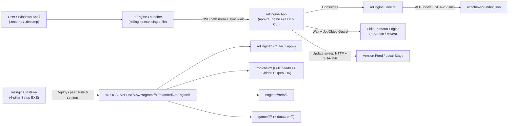
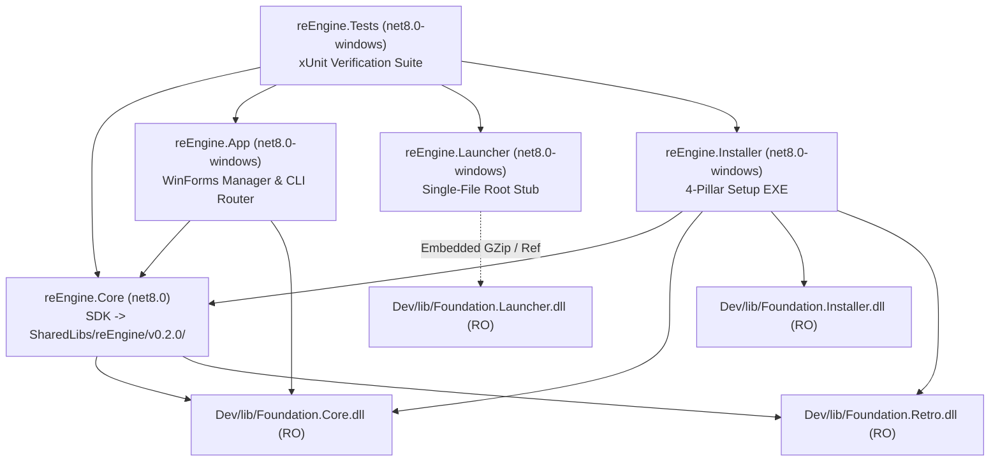

# reEngine — System Architecture

**Synced Version:** `0.2.0` (`2026-11-15`)  
**Owner:** `reEngine` Core (`@devv` / `@dean`)  
**License:** Mozilla Public License Version 2.0 (`MPL-2.0`, root [`LICENSE`](../../LICENSE))

---

## 1. System Context & Runtime Model

`reEngine` is a zero-daemon router, `.decomp` pipeline coordinator, `<dataDir>\cache\` AOT assembly manager, and side-by-side platform engine suite manager for static recompilation (`R1–R3`) and clean-room decompilation (`D0–D5`).

- **Zero Background Footprint:** Exiting the suite manager UI or child engine leaves zero resident processes (`ReEnginePackagingConstants.AllowAutoStart = false`, `0 MB` idle background memory, zero Windows Startup entries).
- **Peer User-Scope Suite Topology:** Non-admin installation uses `%LOCALAPPDATA%\Programs\StreamItAll\reEngine\{reEngine,toolchain,engines,games}\` (`umbrellaSubpath = "StreamItAll\\reEngine\\reEngine"`). `ResolveToolchainDir` and `ResolveEnginesRootDir` treat sibling `..\toolchain\` and `..\engines\` under `suiteInstallDir` as primary, falling back to local `.\toolchain\` and `.\engines\` for isolated Sandbox/portable installs.
- **Sister-App & Read-Only Boundaries:**
  - `uStation` routes `.recomp` launches synchronously to `reEngine.exe --open <pkg> --wait`.
  - Platform engines (`reStation`, `reNes`, future `re64`, `reCube`, `reGenesis`) run as bounded child processes via `JobObjectGuard` and expose optional `IDecompPlatformProvider` plugins.
  - `Foundation\`, `_DevBible\`, and `<WORKSPACE_ROOT>\Research\*` remain strictly read-only (`0` copied raw `Corpus\` assets).



---

## 2. Assembly / `.dll` & Module Dependency Graph

The solution [`Dev\reEngine.slnx`](../reEngine.slnx) inherits [`Dev\Directory.Build.props`](../Directory.Build.props) (`LangVersion = latest`, `Nullable = enable`, `TreatWarningsAsErrors = true`, `Deterministic = true`, `ContinuousIntegrationBuild = true` in `Release`, `<DebugType>none</DebugType>`, and `<PathMap>` workspace scrubbing). See [`v0.2.0-decomp-and-toolchain.md`](architecture/v0.2.0-decomp-and-toolchain.md).



| Assembly | Target | Allowed Dependencies | Forbidden Dependencies & Rules |
| :--- | :--- | :--- | :--- |
| `reEngine.Core` | `net8.0` | `Foundation.Core`, `Foundation.Retro` | Zero WinForms UI deps; zero retail ROM/BIOS/generated assets |
| `reEngine.App` | `net8.0-windows` | `reEngine.Core`, `Foundation.Core`, WinForms | Never modifies `Foundation\`, `_DevBible\`, or `Research\*` |
| `reEngine.Launcher` | `net8.0-windows` | Embedded `Foundation.Launcher.dll` | **Zero** `reEngine.Core` ref (keeps single-file stub `< 2 MB`) |
| `reEngine.Installer` | `net8.0-windows` | `reEngine.Core`, gzipped `Foundation.{Core,Installer,Retro}` | `AllowAutoStart = false`; zero unconfirmed `%LOCALAPPDATA%` writes in test mode |
| `reEngine.Tests` | `net8.0-windows` | All 4 assemblies + xUnit (`InternalsVisibleTo`) | Temp sandbox isolation only; zero host registry/program mutations |

---

## 3. End-to-End Data Flow per Major Pipeline

### 3.1 `.recomp` Launch & Per-Module Isolation Pipeline
1. Shell double-click or CLI invokes root `reEngine.exe` ([`reEngine.Launcher\Program.cs`](../src/reEngine.Launcher/Program.cs)), which normalizes caller-CWD relative paths via [`LauncherArgsHelper`](../src/reEngine.Launcher/LauncherArgsHelper.cs) and delegates to `app\reEngine.exe`.
2. [`reEngine.App\Program.cs`](../src/reEngine.App/Program.cs#L75-L195) constructs `SandboxEnvironment`, enforces containment under `--test-mode` (`ResolveSandboxBoundary` / `EnforceSandboxContainment`), resolves `enginesDir` via `ResolveEnginesDir` (peer `..\engines` primary), and passes `--open` / positional target to [`RecompLaunchCoordinator`](../src/reEngine.App/RecompLaunchCoordinator.cs).
3. `RecompPackageReader.Load` validates Zip-Slip safety and resolves `<GameRoot>\app\<Module>.recomp` back to `<GameRoot>\` so `DiscoverPreloadMedia` detects `.cue > .chd > .iso > ... > .bin` inside `data\rom\`.
4. `EngineVersionResolver` matches `compatibleEngineTrack` and minimum `engineVersion`; optional 3s update sweep checks `(engineId, track)` feeds; `BuildChildLaunchPlan` isolates `--data-dir`, `--config`, and `--log-dir` to `<dataDir>\modules\<moduleId>\` and launches inside `JobObjectGuard`.

### 3.2 `.decomp` Pipeline & AOT Cache Pipeline
1. [`Program.RunDecompCliAsync`](../src/reEngine.App/Program.CliHandlers.cs#L75-L141) receives `decomp --module <file.decomp>` (`--stage D0..D5`, `--engine-dir`, `--toolchain-dir`, `--output-dir`), containment-checking `outputDir` in `--test-mode`.
2. [`DecompPipelineCoordinator.DispatchAsync`](../src/reEngine.Core/Decomp/DecompPipelineCoordinator.cs) parses `DecompPackageManifest`, selects `OfflineToolchainLocator` (`..\toolchain` primary, `.\toolchain` fallback), resolves the compatible `re*` engine (returning deterministic 3-part `DecompUnbuiltEngineError` -> Exit `3` if unbuilt), invokes `IDecompPlatformProvider.RunDecompAsync`, and enforces clean-room output checks (rejecting `.bin`/`.iso`/`.sav`/`*.g.cs`/`*.Generated.dll`).
3. Compiled host AOT outputs are stored by [`AotCacheManager`](../src/reEngine.Core/Aot/AotCacheManager.cs#L307-L332) into `<dataDir>\cache\<moduleId>\<romSha16>-<engineId>-<engineVer>-<modVer>\` using cross-process `.aot-index.lock`, `aot-index.json` (`fileSizeBytes`, `sha256Hex`), `.bak` rotation, and atomic write-rename.

---

## 4. File & Symbol Lookup Registry (`<= 400 CodeSLOC`)

| File (relative to repo root) | CodeSLOC | Total | Tier (`250/400/600`) | Exported Symbols & Role |
| :--- | :---: | :---: | :---: | :--- |
| [`Dev/src/reEngine.Core/Bootstrap/ReEngineTelemetryFormatter.cs`](../src/reEngine.Core/Bootstrap/ReEngineTelemetryFormatter.cs) | `25` | `44` | `<= 250` | `ReEngineTelemetryFormatter` (UTC log & heartbeat prefixing) |
| [`Dev/src/reEngine.Core/Aot/AotCacheContracts.cs`](../src/reEngine.Core/Aot/AotCacheContracts.cs) | `50` | `87` | `<= 250` | `AotCacheKey`, [`AotCacheEntry`](../src/reEngine.Core/Aot/AotCacheContracts.cs#L33-L41), `IAotCacheManager` |
| [`Dev/src/reEngine.Core/Updates/UpdateModels.cs`](../src/reEngine.Core/Updates/UpdateModels.cs) | `53` | `100` | `<= 250` | `ReEngineSettings`, `UpdateFeedManifest`, `EngineTrackUpdateOutcome` |
| [`Dev/src/reEngine.Core/Decomp/DecompPipelineContracts.cs`](../src/reEngine.Core/Decomp/DecompPipelineContracts.cs) | `61` | `102` | `<= 250` | `DecompStage`, `IDecompPlatformProvider`, `DecompUnbuiltEngineError` |
| [`Dev/src/reEngine.Core/Manifests/DecompPackageManifest.cs`](../src/reEngine.Core/Manifests/DecompPackageManifest.cs) | `61` | `128` | `<= 250` | `DecompPackageManifest`, `DecompToolchainRequirements` |
| [`Dev/src/reEngine.Launcher/LauncherArgsHelper.cs`](../src/reEngine.Launcher/LauncherArgsHelper.cs) | `108` | `133` | `<= 250` | `LauncherArgsHelper` (CWD path resolution & sync-wait policy) |
| [`Dev/src/reEngine.Launcher/Program.cs`](../src/reEngine.Launcher/Program.cs) | `112` | `132` | `<= 250` | `Program` (root launcher stub loading embedded `Foundation.Launcher`) |
| [`Dev/scripts/stage_offline_toolchain.ps1`](../scripts/stage_offline_toolchain.ps1) | `124` | `148` | `<= 250` | Offline Apache-2.0 Ghidra + `jlink` OpenJDK `<= 160 MB` stager |
| [`Dev/src/reEngine.App/Program.CliHandlers.cs`](../src/reEngine.App/Program.CliHandlers.cs) | `124` | `142` | `<= 250` | [`Program` partial](../src/reEngine.App/Program.CliHandlers.cs#L15-L142) (`--check-updates`, `--headless`, `decomp`) |
| [`Dev/src/reEngine.App/RecompLaunchOptions.cs`](../src/reEngine.App/RecompLaunchOptions.cs) | `129` | `150` | `<= 250` | `RecompLaunchOptions` (CLI flag parser & passthrough carrier) |
| [`Dev/src/reEngine.Core/Decomp/OfflineToolchainLocator.cs`](../src/reEngine.Core/Decomp/OfflineToolchainLocator.cs) | `139` | `186` | `<= 250` | `ReEngineInstallProfile`, `OfflineToolchainStatus`, [`OfflineToolchainLocator`](../src/reEngine.Core/Decomp/OfflineToolchainLocator.cs#L53-L95) |
| [`Dev/src/reEngine.App/ReEngineAppStatusHelper.cs`](../src/reEngine.App/ReEngineAppStatusHelper.cs) | `156` | `185` | `<= 250` | [`ReEngineAppStatusHelper`](../src/reEngine.App/ReEngineAppStatusHelper.cs#L96-L185), `AotCacheStatusSummary`, `DecompDispatchStatusSummary` |
| [`Dev/src/reEngine.Installer/LegacyMigrationHelper.cs`](../src/reEngine.Installer/LegacyMigrationHelper.cs) | `178` | `206` | `<= 250` | [`LegacyMigrationHelper`](../src/reEngine.Installer/LegacyMigrationHelper.cs#L70-L150) (`PersistInstallProfileSettings`, `TryMigrateLegacyInstall`) |
| [`Dev/src/reEngine.Core/Manifests/RecompPackageManifest.cs`](../src/reEngine.Core/Manifests/RecompPackageManifest.cs) | `215` | `289` | `<= 250` | `RecompPackageManifest`, `RecompPackageReader` |
| [`Dev/src/reEngine.Core/Decomp/DecompPipelineCoordinator.cs`](../src/reEngine.Core/Decomp/DecompPipelineCoordinator.cs) | `238` | `294` | `<= 250` | `DecompPipelineCoordinator`, `DecompDispatchResult` |
| [`Dev/src/reEngine.App/RecompLaunchCoordinator.cs`](../src/reEngine.App/RecompLaunchCoordinator.cs) | `245` | `283` | `<= 250` | `RecompLaunchCoordinator`, `ChildLaunchPlan` |
| [`Dev/src/reEngine.App/ReEngineMainForm.Layout.cs`](../src/reEngine.App/ReEngineMainForm.Layout.cs) | `254` | `288` | `<= 400` | `ReEngineMainForm` partial (Dark Slate layout, pills, tooltips) |
| [`Dev/src/reEngine.Core/Resolution/EngineVersionResolver.cs`](../src/reEngine.Core/Resolution/EngineVersionResolver.cs) | `272` | `343` | `<= 400` | `SemVer`, `EngineTrackMatcher`, `EngineVersionResolver` |
| [`Dev/scripts/build_release.ps1`](../scripts/build_release.ps1) | `276` | `322` | `<= 400` | Single-pass test, staging, installer build, release sanitize & SDK drop |
| [`Dev/src/reEngine.App/Program.cs`](../src/reEngine.App/Program.cs) | `279` | `323` | `<= 400` | [`Program` partial](../src/reEngine.App/Program.cs#L17-L323) (CLI/GUI dispatch, `ResolveEnginesDir`, sandbox guard) |
| [`Dev/src/reEngine.Core/Aot/AotCacheManager.cs`](../src/reEngine.Core/Aot/AotCacheManager.cs) | `283` | `346` | `<= 400` | [`AotCacheManager`](../src/reEngine.Core/Aot/AotCacheManager.cs#L307-L346) (`aot-index.json` + `.bak` + SHA-256 cache store) |
| [`Dev/src/reEngine.Core/Associations/FileAssociationStores.cs`](../src/reEngine.Core/Associations/FileAssociationStores.cs) | `286` | `380` | `<= 400` | `IFileAssociationStore`, `WindowsRegistryAssociationStore`, `VirtualRegistryAssociationStore` |
| [`Dev/src/reEngine.App/ReEngineMainForm.cs`](../src/reEngine.App/ReEngineMainForm.cs) | `287` | `324` | `<= 400` | `ReEngineMainForm` (UI handlers, [`OnRegisterAssociationClicked`](../src/reEngine.App/ReEngineMainForm.cs#L164-L171), showcase) |
| [`Dev/src/reEngine.Core/Updates/UpdateCoordinator.cs`](../src/reEngine.Core/Updates/UpdateCoordinator.cs) | `312` | `370` | `<= 400` | `UpdateCoordinator`, multi-engine sweep, `.part`/`.sha256` patch staging |
| [`Dev/src/reEngine.Core/Bootstrap/ReEngineBootstrapHelper.cs`](../src/reEngine.Core/Bootstrap/ReEngineBootstrapHelper.cs) | `312` | `414` | `<= 400` | `ReEnginePackagingConstants`, [`ReEngineBootstrapHelper`](../src/reEngine.Core/Bootstrap/ReEngineBootstrapHelper.cs#L73-L215) |
| [`Dev/src/reEngine.Installer/Program.cs`](../src/reEngine.Installer/Program.cs) | `344` | `384` | `<= 400` | [`Program`](../src/reEngine.Installer/Program.cs#L40-L384) (`InstallerWizardForm` GUI wiring, `--reengine-dir`/`--suite-dir`) |

---

## 5. Settings, Manifest & State Store Ownership Map

`reEngine` uses zero SQLite databases; all runtime state persists in atomic JSON stores with `.bak` recovery:

| File Store (under `<dataDir>\`) | Owner Type | Canonical Keys (`Standard 18`) | Backup / Locking Mechanism |
| :--- | :--- | :--- | :--- |
| `settings.json` (template: [`Dev\settings.example.json`](../settings.example.json)) | `UpdateCoordinator` / `LegacyMigrationHelper` | `schemaVersion`, `appId`, `installProfile`, `reEngineInstallDir`, `suiteInstallDir`, `umbrellaSubpath`, `decompSchemaVersion`, `goalDecompTier`, `targetDecompTier`, `shouldCheckUpdates`, `shouldAutoStagePatches`, `enginesDirectoryOverride`, `preferredResolutionScale` | `GranularSettingsManager` / `.tmp` atomic rename + `.bak` recovery; `[JsonExtensionData]` preserves unknown keys |
| `cache\aot-index.json` | `AotCacheManager` | `schemaVersion`, `entries[]` (`moduleId`, `romSha256`, `engineId`, `engineVersion`, `moduleVersion`, `fileSizeBytes`, `sha256Hex`) | `.aot-index.lock` cross-process mutex + `.bak` rotation + `.tmp.<guid>` atomic rename |
| `virtual_registry.json` | `VirtualRegistryAssociationStore` | `.recomp` (`reEngine.RecompModule`), `.decomp` (`reEngine.DecompModule`), `commandTemplate` | `.tmp` atomic replace strictly in `--test-mode` / `Sandbox\` |
| `modules\<moduleId>\settings.json` | Child `re*` engine (isolated by `RecompLaunchCoordinator`) | Delegated to engine contract | Contained inside `<dataDir>\modules\<moduleId>\` |
| `staged_updates\<engineId>\v<ver>\` | `UpdateCoordinator` | `.part` download staging + SHA-256 verification | Non-destructive track isolation |

---

## 6. Failure Modes & Resilience

- **Zip-Slip / Traversal in `.recomp` or `.decomp` Archives:** Both `RecompPackageReader.Load` and `DecompPipelineCoordinator.ParseManifest` reject rooted or `..`-escaping ZIP entry paths immediately (`InvalidDataException` -> Exit `2`).
- **Missing or Unbuilt Platform Engine:**
  - `.recomp`: throws `InvalidOperationException` -> Exit `1` (`No compatible engine`).
  - `.decomp`: populates `DecompUnbuiltEngineError` (`[1/3 What Failed]`, `[2/3 Missing]`, `[3/3 Remediation]`) -> Exit `3`.
- **Clean-Room Violation (`data\rom\` / `*.g.cs` / `*.Generated.dll`):** `AotCacheManager.ValidateCleanRoomRecompPackage` flags bundled `.Generated.dll`/`.g.cs` inside `.recomp`; `DecompPipelineCoordinator.ValidateCleanRoomOutputDirectory` flags retail ROM/save-state extensions or generated binaries in `.decomp` output.
- **Corrupted `aot-index.json` or Tampered Cached DLL:** `AotCacheManager.TryGetEntryAsync` compares actual file byte length and lowercase SHA-256 against `AssemblySizeBytes` (`fileSizeBytes`) / `AssemblySha256` (`sha256Hex`) and returns `null` (cache miss) on tamper; `SaveIndexAsync` preserves `aot-index.json.bak` before atomic overwrite.
- **Offline Update Feeds / Crashes:** Transient HTTP/socket errors degrade to `NetworkUnavailable = true` (`[WARN]`, `0` crash dumps, Exit `0` unless `--strict` returns Exit `4`). Fatal unhandled exceptions write `logs\crashes\crash_reengine_*.json` populated with `SnapshotRecentLogs()` before exit.

---

## 7. Security & Privacy Model

- **Zero PII & Deterministic Paths:** `Directory.Build.props` enables `Deterministic = true` and `ContinuousIntegrationBuild = true` + `<PathMap>` in Release; `audit_installer.ps1` and `Assert-NoEndUserLeaks` block machine paths, usernames, Notion UUIDs, `.pdb`, `.env`, and `*secret*.json` across `Builds\`, `Installers\`, and `Releases\`.
- **No Network Calls at Rest or Decomp:** Zero telemetry servers, zero runtime Ghidra/OpenJDK downloads (`OfflineToolchainLocator` uses staged `toolchain\` only), and zero background daemons (`AllowAutoStart = false`).
- **Registry Isolation:** `WindowsRegistryAssociationStore` throws if constructed with `testMode: true`; all tests and `Sandbox\` probes write solely to `virtual_registry.json`.
- **Apache-2.0 / GPL Separation:** `stage_offline_toolchain.ps1` and `OfflineToolchainLocator` reject unstripped `ghidra\GPL\` directories and require `THIRDPARTY_LICENSES.txt` alongside `toolchain\`.

---

## 8. Testing Strategy Map

Run full suite in zero-warning Release mode:
```powershell
dotnet test Dev\reEngine.slnx -c Release -p:TreatWarningsAsErrors=true
```

| Test Class (`Dev\tests\reEngine.Tests\`) | Covered Components | Key Verified Contracts |
| :--- | :--- | :--- |
| [`ManifestAndResolverTests.cs`](../tests/reEngine.Tests/ManifestAndResolverTests.cs) | `RecompPackageReader`, `EngineVersionResolver`, `RecompLaunchCoordinator` | Zip-Slip guard, parent-root `app\*.recomp` resolution, track ranking, `BuildChildLaunchPlan` isolation |
| [`DecompAndToolchainTests.cs`](../tests/reEngine.Tests/DecompAndToolchainTests.cs) | `DecompPipelineCoordinator`, `OfflineToolchainLocator` | `sample-re64.decomp`, 3-part `UnbuiltEngineError`, clean-room violations, `ghidra\GPL\` stripping |
| [`AotCacheManagerTests.cs`](../tests/reEngine.Tests/AotCacheManagerTests.cs) | `AotCacheManager`, `AotCacheContracts` | `<dataDir>\cache\` indexing, `fileSizeBytes`/`sha256Hex` JSON schema, tamper invalidation, `.bak` & eviction |
| [`InstallerAndAppStatusTests.cs`](../tests/reEngine.Tests/InstallerAndAppStatusTests.cs) | `reEngine.Installer.Program`, `LegacyMigrationHelper`, `ReEngineAppStatusHelper` | `StreamItAll\reEngine\reEngine`, `--profile`, `--reengine-dir`/`--suite-dir`, opt-in migration, status badges |
| [`AssociationUpdateAndContainmentTests.cs`](../tests/reEngine.Tests/AssociationUpdateAndContainmentTests.cs) | `FileAssociationStores`, `UpdateCoordinator`, `ReEngineBootstrapHelper` | `.recomp`/`.decomp` HKCU & virtual stores, track sweep, peer `..\toolchain`/`..\engines` resolution, sandbox escape reject |
| [`LauncherAndLaunchPlanTests.cs`](../tests/reEngine.Tests/LauncherAndLaunchPlanTests.cs) | `LauncherArgsHelper`, `RecompLaunchOptions` | Relative CWD arg normalization (`decomp` preserved), `--open`/`--wait`/test flag passthrough |
| [`UpdateSweepAndTelemetryTests.cs`](../tests/reEngine.Tests/UpdateSweepAndTelemetryTests.cs) | `UpdateCoordinator`, `ReEngineTelemetryFormatter` | Multi-track sweep resilience, offline `[WARN]` zero-crash guarantee, single `[HEARTBEAT]` formatting |

---

## 9. Design Decisions Log (ADR)

- **ADR-001 · `2026-11-13` · `v0.1.0` — Zero-Daemon Launcher Architecture (`AllowAutoStart = false`):** Keep `reEngine.Launcher` free of `reEngine.Core` (embedding only `Foundation.Launcher.dll`) and exit every process when work completes instead of running a background tray/service. Consequence: `0 MB` idle footprint and `< 2 MB` stub EXE.
- **ADR-002 · `2026-11-14` · `v0.1.2` — Parent-Root `app\*.recomp` Cartridge Resolution:** When a `.recomp` lives under `<GameRoot>\app\`, resolve `ModuleRootDirectory` to `<GameRoot>\` so `data\rom\` media stays cleanly separate from executable binaries across game upgrades.
- **ADR-003 · `2026-11-15` · `v0.2.0` — Peer Suite Directory Topology (`StreamItAll\reEngine\{reEngine,toolchain,engines,games}`):** Move default installs to non-admin `%LOCALAPPDATA%\Programs\StreamItAll\reEngine\reEngine\` (`UmbrellaSubpath = "StreamItAll\\reEngine\\reEngine"`) with peer siblings `..\toolchain\` and `..\engines\` primary and portable `.\toolchain\`/`.\engines\` fallback. Consequence: clean separation of router, optional `<= 160 MB` GPL-stripped toolchain, engines, and games while preserving portable/Sandbox runs.
- **ADR-004 · `2026-11-15` · `v0.2.0` — Direct `InstallerWizardForm` Hosting in `reEngine.Installer`:** Because `Foundation.Installer v0.4.0`'s `StandardInstallerHost.Run` drops `SelectedProfileId`, `SecondaryInstallDir`, and `MigrateLegacyChecked`, `reEngine.Installer` runs `InstallerWizardForm` directly in interactive GUI mode (while filing a Foundation proposal report and keeping `Foundation\` read-only).

---

## 10. Zero-Touch Extension Playbooks

1. **Adding a New Platform Engine (`re64`, `reGenesis`, `reCube`):** Implement a standalone tier project consuming `<SHARED_LIBS>\reEngine\v0.2.0\reEngine.Core.dll`, implement `IDecompPlatformProvider` inside `<engineId>.dll`, and install binaries into `<SuiteRoot>\engines\<engineId>\v<Ver>\`. Zero edits needed in `reEngine`.
2. **Adding a Game `.recomp` / `.decomp` Module:** Ship `module.recomp.json` (and optional `module.decomp.json`) referencing `engineId`, `engineVersion`, and `compatibleEngineTrack`, keep binaries AOT-free (`*.Generated.dll` compiled locally into `<dataDir>\cache\`), and preserve `data\rom\`.
3. **Adding a New Persisted Settings Field:** Add nullable property or read via `ReEngineSettings.ExtensionData` (`[JsonExtensionData]`), document the canonical `camelCase` key in Standard 18 + `Dev\settings.example.json`, and preserve backward compatibility with `.bak` recovery.
4. **Adding a CLI Subcommand/Flag:** Add option parsing in `RecompLaunchOptions` (or `Program.CliHandlers.cs` if suite-scoped), register path/value flag exemptions in `LauncherArgsHelper`, and add sandbox containment assertions if the option accepts a filesystem path.
