# reEngine — Roadmap & Milestones

**Current Shipped Version:** `0.6.2`  
**Next Planned Milestone:** `0.7.0`  
**Lifecycle State:** `active.state`  
**Last Updated:** 2026-11-23

---

## 1. North Star Goal
Provide a lightweight, **zero-daemon `.recomp` / `.decomp` package router, shared host runtime (`reEngine.Host`), and version manager** (`0 MB` idle footprint, zero background services or startup entries) across clean-room static recompilation engines (`reSlate` [legacy `reStation`], `reCart` [`reCartOne`/`reNes`], `reCart64` [`re64`], `reBlast16` [`reGenesis`], `reSlateTwo` [`rePS2`], `reCartTwo` [`reSnes`], `reDotCart` [`reBoy`], `reCube`, `reAdvance`) and thin `<Game>Recomp` modules—delivering **`v1.0.0` Windows (`win-x64`) Desktop Gold**, scaling to **`v2.0.0` Cross-Platform & Console Hub**, and anchoring major future summits through **`v5.0.0`**.

- **Explicit Boundaries:**
  - **Static Recompilation First:** `reEngine` and child engines statically lift native machine instructions into ahead-of-time (`AOT-Primary`) cached binaries in local `<dataDir>\cache\`, paired with an opt-in native JIT bring-up/execution mode (`isJitEnabled`, `--jit-bringup`) for research and arbitrary raw-media compatibility. Cycle-accurate software interpreters stay strictly quarantined as offline verification/oracle references rather than shipping as silent fallback emulators.
  - **Strict Clean-Room Distribution:** Never bundles retail ROMs/ISOs, BIOS/firmware images, pre-lifted retail executables, copyrighted scripts, or proprietary SDK assets; players supply legally obtained media into `data\rom\`.
  - **Thin-Launcher Separation:** Standalone native rewrites (`Snowfall` / `<Game>Port`) ship directly as their own independent executables outside `reEngine`.

---

## 2. Active In-Dev Milestone
- **Shipped Baseline (`v0.6.2` — `2026-11-23`):** Hardened `reEngine.Host` (`HostSessionOverlayAndSettingsHelper`) atop `v0.6.1` / `v0.6.0` (`Foundation v0.5.3` SDK sync): added thread-safe `HostSessionRunner.SetAotCompileState` / `SetMediaGateState` / `UpdateDrawerDescriptor`, `HostSessionOptions` startup/persistence fields (`InitialAotCompileState`, `InitialMediaGateError`, `SettingsDataDirectory`, `SettingsConfigPathOverride`, `PreferExplicitBackend`/`PreferExplicitScale`/`PreferExplicitAspectRatio`), automatic `HostSettingsStore` startup hydration + live `F1` dirty-save persistence across `settings.json`, `settings.video.json`, and `settings.audio.json` (skipped cleanly in Safe Mode), `FirstRunMediaGateView.AcceptPickedPath` Browse error banner propagation through `OnFileDropped`, fixed-width padded & invariant-template `F3HudOverlayView` (`0 px` horizontal jitter), and 2-frame deferred non-hotkey synthetic key auto-release in `HostInputMapper` (`_syntheticTapFramesRemaining` + `AdvanceSyntheticTapAutoRelease`), verified by `HostV062PrelaunchParityTests` (`29` suites, `152/152` tests, `0` warnings; `audit_installer.ps1` `0` findings).
- **Next Target (`v0.7.0` — Dynamic Prompts, Accessibility, 10-Rail Two-Column Menu & Early `reEngine.App` SDL3 Cutover):** Deliver focus/controller split (`shouldPauseOnFocusLoss` vs `allowBackgroundControllerInput`), extended input contracts (Hold/Toggle, deadzones, response curves, `isLookYInverted`, stick swap, Turbo, 3D Gyro Aim), `IHostPromptGlyphProvider` (`promptGlyphMode`), extended accessibility filters (`isFastTextEnabled`, `isFlashReductionEnabled`, `colorblindMode`) building on `v0.6.1`'s `uiTextScale`, the full **10-Rail Two-Column Deep Slate Overlay Menu + `Quit Game`**, and the early `reEngine.App` migration off WinForms onto `reEngine.Host` SDL3 + `IHostDialogService`.

---

## 3. Upcoming Milestones

```mermaid
flowchart LR
    V06["v0.6.2 (Shipped)\nHost UI/Settings Persistence & Zero-Jitter HUD"] --> V07["v0.7.0 (Next)\nPrompts, Access, 10-Rail Menu & SDL3 App Cutover"]
    V07 --> V08["v0.8.0\nProfiles, Vaults, Undo, Multi-Disc & Dual-Installer"]
    V08 --> V09["v0.9.0\nManual Viewer, Tracker, Catalog & .re* Hot-Reload"]
    V09 --> V10A["v0.10.0\nAsset Dumper, HD/Sub Recipes & Modder Docs"]
    V10A --> V11A["v0.11.0\nResearch Tools, Runtime API, Steam, Clean Capture"]
    V11A --> V100["v1.0.0 (Desktop Gold)\nABI Freeze, Full Toolchain & 2+ Lockstep Gold"]
    V100 --> V11["v1.1.0 - v1.4.0\nLinux/macOS/Deck, Mobile, WASM & Console HAL"]
    V11 --> V200["v2.0.0\nCross-Platform & Console Hub + Achievements"]
    V200 --> V300["v3.0.0\nReplayability, TAS, Clip Buffer & Frame Gen"]
    V300 --> V400["v4.0.0\nRandomizer, Co-Op Swap & Remix Modes"]
    V400 --> V500["v5.0.0\nConnected Summit: Rollback Netplay & Theatre"]
```

### `v0.7.0` — Dynamic Prompts, Accessibility, 10-Rail Two-Column Menu & Early `reEngine.App` SDL3 Cutover
- **Goal:** Deliver crisp, 100% controller-navigable in-game menus, device-matching glyphs, accessibility scaling, and move `reEngine.App` itself onto `reEngine.Host` SDL3 early so `v0.8.0–v0.11.0` UI features are written once without dual WinForms/SDL3 throwaway work.
- **Planned Deliverables:**
  - [ ] **Focus Isolation & Extended Input Contracts:** Separate `shouldPauseOnFocusLoss` from `allowBackgroundControllerInput` (keeping unfocused keyboard/mouse isolated), and formalize hold-vs-toggle modifiers, inner/outer stick deadzones, response curves, `isLookYInverted`, Left/Right Stick swap, Turbo, and 3D Gyro Aim contracts.
  - [ ] **Device-Matching Prompts & Accessibility:** Implement `IHostPromptGlyphProvider` + `promptGlyphMode` (`auto`, `xbox`, `playstation`, `switch`, `kbm`, `generic`) with original vector/pixel clean-room glyphs, alongside `uiTextScale` (`0.75x–2.0x`), `isFastTextEnabled`, `isFlashReductionEnabled`, `colorblindMode`, and DPI/scale-aware `HostTextRenderer`.
  - [ ] **10-Rail Two-Column Overlay Menu + `Quit Game`:** Replace the temporary 6-tab drawer with the full **10-Rail Two-Column Deep Slate Overlay Menu** (`Quick Actions`, `Gameplay`, `Graphics`, `Audio`, `Controls`, `Keybinds`, `Accessibility`, `Packs & Mods`, `Manual / Notebook`, `Research` + `Quit Game` returning cleanly to launcher/desktop), toggled by `F1` or customizable Controller Chord.
  - [ ] **Early `reEngine.App` SDL3 Cutover:** Migrate the `Library`, `Engines`, `Bring-Up`, and `Inspector Drawer` manager shells off WinForms onto `reEngine.Host` SDL3, add cross-platform `IHostDialogService` (`SDL_ShowOpenFileDialog` / `FolderDialog`, suppressed cleanly under `FOUNDATION_SUPPRESS_MODALS=1`), and drop WinForms/`Foundation.UI` references from `reEngine.App` (retaining `net8.0-windows` TFM until `v1.1.0` removes the Windows automation form adapter).
- **Verification Gate:** Zero `System.Windows.Forms` / `Foundation.UI` imports inside `reEngine.App.dll`, controller-only navigation from boot through all 10 overlay rails + `Quit Game`, glyph-switch screenshots across devices, and clean Stage 2 Sandbox E2E.

### `v0.8.0` — Player Profiles, Vaults, Quick-Save 1-Step Undo, Multi-Disc Virtual Volume & Dual-Installer
- **Goal:** Protect player saves and passwords, eliminate disc-swap interruptions across multi-disc classics, and adopt the Dual-Installer release model once shared upstream installer support lands.
- **Planned Deliverables:**
  - [ ] **Player Profiles & Save Vault:** Partition saves cleanly by `profileId`, enforce rolling atomic `.tmp -> .bak` backups, export/import `.reSave` portable ZIP bundles (carrying `save.manifest.json`, optional `notebook.json`, and `playtime.json`), and expose an opt-in User Sync Folder pointer for cloud drive/NAS backup.
  - [ ] **Password Vault & Multi-Slot Quick-Save Undo:** Add encrypted local/structured classic Password Vault storage with 1-click pause-menu injection, visual Quick-Save thumbnail slots (`F5`/`F9`), and a **1-Step Undo Last Quick-Save / Quick-Load Safety Buffer** (`slot.prev` and pre-load RAM snapshot) so accidental slot overwrites or misfired `F9` loads are immediately reversible.
  - [ ] **Unified Multi-Disc Virtual Volume:** Index multi-disc `.cue`/`.bin`/`.chd` sets under one logical title so disc changes resolve automatically behind the scenes with zero swap popups, plus a disc-set inspector drawer.
  - [ ] **Dual-Installer Adoption (`Online Setup` + `Offline Setup`):** Adopt compact signed `reEngine-Setup-v0.8.0-win-x64.exe` (Online Setup streaming SHA-256 verified payloads with `--offline-bundle` support and clear offline remediation) alongside full `reEngine-Offline-Setup-v0.8.0-win-x64.exe` and `*-Portable.zip` once upstream installer ownership and dual-bundle helpers land in `Foundation`.
- **Verification Gate:** Verified `.tmp -> .bak` recovery, `F5`/`F9` 1-Step Undo rollback fidelity, zero-prompt multi-disc transition tests, and local `127.0.0.1` HTTP + negative `404`/tampered-hash fail-closed checks across both Setup executables.

### `v0.9.0` — Bundled Manual Viewer, Player Notebook/Tracker, `assets.catalog.json` & `.re*` Hot-Reload Packs
- **Goal:** Ship an integrated clean-room instruction booklet, customizable checklist/tracker overlay, and full hot-reloading custom pack/mod ecosystem matching loose folders and packed ZIP archives 1:1.
- **Planned Deliverables:**
  - [ ] **Bundled Self-Made Manual Viewer:** Controller-navigable clean-room Manual reader inside the overlay menu (`Manual / Notebook`), respecting live `promptGlyphMode` device icons and `uiTextScale`.
  - [ ] **Player Notebook & Progression Tracker:** Built-in Generic Notes + Custom JSON Checklist (`tracker.layout.json`) overlay persisted per `profileId` + `moduleId`.
  - [ ] **`assets.catalog.json` & Unified `.re*` Pack Engine:** Support canonical `assets.catalog.json` asset inventories and load `.reTexture`, `.reAudio`, `.reFont`, `.reLang`, `.reSub`, and `.reMod` packs from both ZIP archives and loose unpacked folders identically, complete with `settings.packs.json`, explicit `loadPriority` Load-Order/Conflict Inspector, and zero-restart Live Hot-Reload (`F6` / file watcher).
- **Verification Gate:** Real E2E controller navigation of Manual/Notebook overlays, ZIP-vs-folder 1:1 pack equivalence tests, conflict override precedence checks, and zero-restart live hot-reload captures.

### `v0.10.0` — Built-In Asset Dumper Wizard, Deterministic `hd_recipe.json`, Clean-Room Subtitles & Modder Docs
- **Goal:** Give creators a zero-friction authoring workflow and allow players to generate crisp HD textures and dialogue subtitles deterministically from their own verified media with near-zero repo bloat.
- **Planned Deliverables:**
  - [ ] **Built-In Asset Dumper / Pack Starter Wizard:** 1-click export of `assets.catalog.json`-indexed textures, audio, fonts, and localized strings into clean editable loose pack folders ready to drop back into `packs\`.
  - [ ] **Deterministic Local `hd_recipe.json` Generator:** Execute clean-room HD generation recipes against verified player media using built-in algorithmic upscalers (`xBRZ`, `ScaleFX`, `Lanczos` — near-zero added binary weight) or optional local user-provided SHA-256-pinned AI model weights (`toolchain\upscaler\`), caching outputs cleanly on disk.
  - [ ] **Clean-Room `.reSub` / `subtitle_recipe.json` Pipeline:** Support local ROM dialogue extraction and optional opt-in local speech-to-text (`toolchain\stt\`) keyed strictly to clean-room timing/cue metadata (never encoded copyrighted script bodies or binary texture residual diffs).
  - [ ] **Clean-Room Modding & Recipe Guide:** Publish modder authoring manuals (`Dev/docs/MODDING.md`) covering `.re*` pack schemas, `assets.catalog.json`, `hd_recipe.json`, and `subtitle_recipe.json` validation.
- **Verification Gate:** Deterministic repeatable hash verification of locally generated HD packs, clean-room schema rejection of illegal encoded script/diff payloads, and Stage 2 Dumper Wizard E2E run.

### `v0.11.0` — Research Shell, Opt-In Release Runtime API, Streamer Clean-Capture, Add-to-Steam & Raw-Media Bring-Up Polish
- **Goal:** Complete the final pre-Gold suite features for researchers, speedrunners, streamers, and Steam/handheld couch setups.
- **Planned Deliverables:**
  - [ ] **`Research` Overlay Rail & Raw-Media `--jit-bringup` Polish:** Surface live bring-up logs, unknown function/address telemetry (`bringup.profile.json`), and clean-room `Extras & Tools` hooks directly in the `Research` rail, smoothing drag-and-drop raw console media boot through `re<Platform>` JIT mode.
  - [ ] **Separated Opt-In Release Runtime API (`HostRuntimeApiServer`):** Implement WinForms-free `HostRuntimeApiServer` inside `reEngine.Host` (`isRuntimeApiEnabled: false` default, loopback `127.0.0.1` + Bearer token + `Host`/`Origin` `403`, `readOnlyTelemetry` vs `fullControl`), strictly isolated from compile-out Debug `--automation-port` test hooks (`Release` `--automation-port` continues failing closed with `ExitCode = 2`).
  - [ ] **Streamer Clean-Capture, Add-to-Steam & Playtime Stats:** Add `isCleanCaptureModeEnabled` (suppressing `F3` HUD, toasts, and overlay widgets cleanly from OBS/capture outputs), 1-click **"Add Game to Steam"** (`shortcuts.vdf` atomic `.tmp -> .bak` updates plus clean-room Grid/Hero/Logo/Icon art), and per-`profileId` + `moduleId` `playtimeSeconds` / session counters.
- **Verification Gate:** Confirmed `ExitCode = 2` on Release `--automation-port` alongside authenticated loopback tests for `HostRuntimeApiServer` scopes, clean vs overlay capture diff checks, and isolated Steam VDF/playtime tests.

### `v1.0.0` — Windows Desktop General Availability & Symmetric `2+` Lockstep Gold (`win-x64`)
- **Goal:** Certify `reEngine` (`win-x64`) as a stable `v1.0.0` SDK and suite router (`compatibleEngineTrack: "1.x"` with backward compatibility for `"0.x"` modules) backed by two verified `v1.0.0` console engines.
- **Planned Deliverables:**
  - [ ] **Public `v1.0.0` SDK ABI Freeze (`reEngine.Core` & `reEngine.Host`):** Lock public C# interfaces, host protocol flags, and manifest schemas (`"0.x"` backward compat preserved cleanly).
  - [ ] **Full Offline CLI Toolchain Certification & Public Docs Polish:** Certify `--profile Full` offline Ghidra + OpenJDK staging/execution end-to-end, maintain GitHub Pages docs (`.github/workflows/pages.yml`), and maintain local Authenticode signing paired with conditional SignPath CI (`.github/workflows/release.yml` gated on `SIGNPATH_PROJECT_SLUG` once onboarding is active).
  - [ ] **Symmetric `2+` Lockstep Gold Verification (`win-x64`):** Certify live routing, AOT + raw-media JIT boot, and full end-to-end feature parity across at least **two verified `v1.0.0` platform engines** (targeted maiden pair: **`reSlate v1.0.0`** + **`reCart v1.0.0`**, or any interchangeable `2+` `v1.0.0` engines) across `opengl`, `vulkan`, `directx`, `parallelCpu`, and `software`.
- **Verification Gate:** Zero compiler warnings across all projects, full dual-build unit & installed sandbox E2E pass, 8-file Dual-Installer verification, multi-engine live gameplay launch parity, and clean logs.

---

### `v1.1.0` — Cross-Platform Desktop & Handheld (`linux-x64`, `osx-arm64`, `steamos-deck`)
- **Goal:** Ship native Linux, macOS (`Metal` / `MoltenVK`), and SteamOS Deck builds on top of the SDL3 `reEngine.App` UI already completed in `v0.7.0`.
- **Planned Deliverables:**
  - [ ] Drop Windows-only TFM coupling once `Foundation.Automation` provides a WinForms-free automation adapter; add XDG `.desktop` / `mimeapps.list` (Linux), `Info.plist` UTI LaunchServices (macOS), POSIX process-group cleanup, extensionless binary resolution, and `1280x800` Gamepad Mode UI polish.

### `v1.2.0` — Mobile Touch Router & Pre-Linked Execution (`linux-bionic-arm64`, `ios-arm64`)
- **Goal:** Support Android scoped storage (`data/rom/`), dual-orientation `HostTouchOverlayView` touch layouts, and `W^X` Zero-RWX pre-linked static module dispatch on iOS/locked hosts.

### `v1.3.0` — Progressive Web Router (`browser-wasm`)
- **Goal:** Enable in-browser `.recomp` launching via OPFS/IndexedDB user media storage with COOP/COEP `SharedArrayBuffer` worker fallback.

### `v1.4.0` — Console Cartridge HAL (`switch`, `xbox`, `playstation`)
- **Goal:** Provide storage-quota-safe console filesystem adapters and `10-foot` controller-only menus over pre-linked static module registries with zero runtime JIT.

### `v2.0.0` — Cross-Platform & Console Hub Summit
- **Goal:** Unify all 10 desktop, handheld, mobile, web, and console targets behind a cohesive couch-friendly Hub experience (Pixel Art/Box-Art Grid, XMB/PS4-5, and Steam Deck UX parity), Quick-Resume across suspend/exit, First-Party tick-end `.recomp` achievements (`manifestType: "recomp-achievements"`, zero external `rcheevos`), Local Clean-Room Pack Feed Browser, and OFF-by-default Discord Rich Presence (`isRichPresenceEnabled: false`).

### `v3.0.0` — Replayability & Creator Suite *(Major Scaffold)*
- **Goal:** Introduce host-level native Memory Watches/Pokes, `.reTas` deterministic input movie recording/playback (`recomp-tas-movie`), RNG seed locking & rewind/slow-mo, rolling Instant Replay clip buffers (`clipBufferSeconds`), clean frame-exact GIF/clip export, Free-Cam/HUD-less Photo Mode, and optional Host Frame Generation / Anti-Lag (`isFrameGenEnabled`) alongside live `.reMod` developer tooling.

### `v4.0.0` — Remix Engine *(Major Scaffold)*
- **Goal:** Deliver built-in clean-room Randomizer / Crowd-Mode integration (`randomizerSeed` + seed-share UI), Dynamic Co-Op / Controller Hot-Seat swap contracts, and host-assisted New Game+ / Custom Challenge Mode hooks (`No-Hit`, `1-HP`, timer challenge) across compatible `.recomp` modules.

### `v5.0.0` — Connected Summit *(Major Scaffold)*
- **Goal:** Deliver deterministic state-checksum Rollback Netplay host bridges (peer/LAN and opt-in session lobbies using player-supplied verified ROM parity, zero host-bundled retail servers or assets), synchronized Replay Theatre, and spectator channels.

---

## 4. Completed Milestones
- `0.6.2` *(2026-11-23)*: Pre-launch host resilience & UX parity (`29` test suites, `152/152` Release tests, `0` warnings; `audit_installer.ps1` `0` findings): extracted `HostSessionOverlayAndSettingsHelper`, added thread-safe `HostSessionRunner.SetAotCompileState` / `SetMediaGateState` / `UpdateDrawerDescriptor` + `HostSessionOptions` startup/persistence fields (`InitialAotCompileState`, `InitialMediaGateError`, `SettingsDataDirectory`, `SettingsConfigPathOverride`, `PreferExplicitBackend`/`PreferExplicitScale`/`PreferExplicitAspectRatio`), wired `HostSettingsStore` startup hydration + live `F1` dirty-save persistence (`settings.json`, `settings.video.json`, `settings.audio.json`, skipped during Safe Mode), propagated `FirstRunMediaGateView.AcceptPickedPath` Browse validation error banners through `OnFileDropped`, eliminated `F3HudOverlayView` horizontal jitter via fixed-width padded telemetry & worst-case template sizing (`0 px` delta), and added 2-frame deferred non-hotkey synthetic key auto-release in `HostInputMapper`.
- `0.6.1` *(2026-11-20)*: Delivered Single-Host UI & input parity, engine resolution/fallback & unified CLI/Launcher alignment atop `Foundation v0.5.3` (`28` test suites, `148/148` passing tests, `0` warnings, full Stage 2 E2E via `Stage2V061ParityProbes`).
  - [x] **Scaled Crisp Overlays, Full Drawer Tabs & `0.x` Drawer Completeness:** Added `HostOverlayTextRenderer` (`1.45x` base scale * live `uiTextScale` `0.75x–2.0x`), full clear tab names (`Video`, `Audio`, `Controls`, `Keybinds`, `System`, `Media`) with dynamic sizing and per-tab scrolling, `8x` internal scale (host + WinForms), `Framerate` (`Original`/`Enhanced`) + `Target FPS` (`30..240`/`Max`), right-click defaults resets, `System` `Quick Save/Load`, `Fast-Forward` + `FF Speed: 2x/3x/4x`, `Skip Cutscene`, `Runtime Logging` (`shouldEnableRuntimeLogs`), `Clean-Capture Mode` (`isCleanCaptureModeEnabled`), `Quit Game`, and `Media` Win32 pickers (`Change Media...`, `Load .recomp...`).
  - [x] **Expressive Controls, Rebindable Host Actions, Relative Mouse, Media Gate, AOT Screen & Controller Nav:** Replaced raw `"Schema A/B/C"` UI strings with expressive titles, added `Modern WASD + Mouse` + `HostRelativeMouseController` + sensitivity stepper, customizable `menuControllerChord` (`L3 + R3`, `Select + Start`, `Guide`, `None`), `HostActionBindingSet` (`hostActionBindings` 8 actions in 5-column matrix with cross-conflict blocking), unbound-`Tab` fast-forward hold, 4-step non-quitting `Esc` precedence + explicit `Quit Game`, full-screen Glass `FirstRunMediaGateView` (`Launch Demo / Test Cart`, quiet `--demo-cart`, zero `"Continue Session"` bypass), responsive `HostAotCompileOverlayView`, `F3` `[ORIG]`/`[ENH]`/`[MAX]` + `[FF <N>x]` badges, `HostDrawerControllerNav`, live backend switch, and `SDL_EVENT_DROP_FILE` drag-and-drop.
  - [x] **Engine Precedence, Incompatibility Evaluator, Crash Recovery & CLI/Launcher Parity:** Added `EngineCompatibilityEvaluator` (`incompatibleEngineVersions`), latest `.ready` engine resolution with `pinnedEngineVersions` (`moduleId` -> `engineId` -> alias) precedence, prompt-first crash fallback + `SessionRecoveryLocator`, wait-only `LauncherJobObjectGuard`, `>= 0.6.1` CLI superset (`--rom`, `--disc`, `--demo-cart`, `--window`, `--overscan`, `--fps-mode`, `--open-settings`, `--show-fps`, `--force-zero-rwx`, `--fast-forward`, `--ui-text-scale`, optional `--require-backend [<id>]`), and idle `settings.controls.json` write suppression (`SerializeDirtyCheckJson()`).
- `0.6.0` *(2026-11-20)*: Delivered host execution resilience (`BootCrashSentinel` Safe Mode recovery + `--safe-mode-reset`, `MediaRamPreloader` `>= 512 MiB` / `<= 75%` headroom fallback, `ExecutionTierPolicy` keeping `interpreterOracle` CLI-only, Fast Boot), split-domain config (`settings.json` v2, `settings.video.json`, `settings.audio.json`, `settings.controls.json` with `v1 -> v2` `config_history\` snapshots and `data\quarantine\` recovery), `windowed`/`borderlessFullscreen`/`exclusiveFullscreen` + monitor routing, late-latch VRR frame pacing (`HighResFramePacer.Reset()`), `21:9` (`horPlus21By9` + centered `4:3` FMVs) & HUD anchor zones, 24-bit vs 15-bit + 4x4 Bayer dithering, all 8 live video filters (`nearest`, `bilinear`, `sharpBilinear`, `scanlines`, `crtLite`/`crt-aperture`, `lcdGrid`, `xbrz`, `ntscComposite`), post-present `F12` capture (`cleanNative` vs `filteredComposite`) + multi-backend `TryReadSurfaceRect`, dedicated Audio DSP + zero-restart SDL3 device switching + Sound Test jukebox in the 6th `Audio` `F1` drawer tab, `>= 0.6.0` protocol-gated CLI routing, full WinForms `LibraryDisplayAudioPanel`, `LegacyMigrationHelper` `schemaVersion >= 1` + split-config preservation, and `SingleSetup7` releases retaining `0.6`/`0.5`/`0.4` (`25` test suites, `135/135` passing tests, `0` warnings).
  - [x] **Execution Resilience & Split-Domain Settings (`v1 -> v2`):** Added atomic `<dataDir>\booting.sentinel` PID Safe Mode (`--safe-mode-reset`), physical-RAM headroom-checked `--preload-media-to-ram`, Fast Boot, CLI-quarantined `interpreterOracle`, and self-healing `settings.json`, `settings.video.json`, `settings.audio.json`, and `settings.controls.json`.
  - [x] **Display Modes, Late-Latch VRR, `21:9`, 8 Live Filters & `F12` Capture:** Added multi-monitor display mode selection, zero-drift `HighResFramePacer.Reset()` pacing, `horPlus21By9` + `4:3` FMV centering + HUD anchors, 24-bit/15-bit Bayer dithering, all 8 live filters (`xbrz` + `ntscComposite` included), and post-present `F12` PNG capture with cross-backend `TryReadSurfaceRect`.
  - [x] **Audio DSP, Hot-Switched Output, Sound Test & 6th `Audio` Tab:** Added 2nd-order Butterworth LP/HP presets, category gains, 5ms focus-loss ramp, stereo width, resampling, FF audio clamp, live SDL3 device hot-switching, Sound Test audition controls (`< Prev`, `Play`/`Stop`, `Next >`), `Tab_Audio` in `F1` slot #2, and `F3` HUD status badges.
  - [x] **`>= 0.6.0` CLI Routing, WinForms Controls & `SingleSetup7` Retention:** Added `RecompLaunchFlagRouter` (`>= 0.6.0`), full WinForms `LibraryDisplayAudioPanel`, `LegacyMigrationHelper` upgrade preservation, and `0.6`/`0.5`/`0.4` release retention (`0.3.x` retired).
- `0.5.0` *(2026-11-20)*: Delivered `HostViewportGeometry` 5-aspect modes & overscan crop across all 5 presenters with inverse pointer normalization, OpenGL `0x0`/`0x8CD5` FBO safety + owner-thread `IHostGraphicsContext` readback and pre-QuickSave / teardown sync, 4-port SDL3 gamepads + 3-tier `settings.controls.json` persistence + Menu isolation, interactive `F1` drawer controls + `F5`/`F9`/`F11`/`Alt+Enter` hotkeys + decoupled `IHostAutomationBridge`, 3-way `reCart`/`reCartOne`/`reNes` routing, `-hf.<n>` hotfix SemVer precedence, `hostProtocolVersion >= 0.3.0` CLI forwarding, `.fds` discovery parity, `--aspect-mode`, `"suiteId": "reEngine"`, and Dual-Binary Release `ExitCode = 2` (`21` test suites, `117/117` passing tests, `0` warnings).
- `0.4.0` *(2026-11-19)*: Delivered unified 5-backend native GPU contexts (`OpenGL 3.3+`, `Vulkan 1.3+`, `DirectX 12`, bit-exact 16px `ParallelCpu`, `Software`), path-contained `<dataDir>\hdpacks\`, native OS audio pinning (`wasapi`), 3-slot multi-bind KBM + Xbox/HID SDL3 gamepads + rumble + dynamic `ControlOptions` + 5-column `Keybinds` + touch contracts, Explorer `.decomp` interactive Bring-Up UI + `SuiteMediaTreeWalker` + `MissingMediaPromptDialog`, canonical `D4_CleanSource`, standalone `--verify-module [--json] [--require-media]`, and frontend `--open --wait --fullscreen --save-dir` routing with bounded `<= 3s` `WM_CLOSE` save flushing (`18` test suites, `98/98` passing tests, `0` warnings).
- `0.3.0` *(2026-11-18)*: Delivered shared multi-targeted `reEngine.Host.dll` (SDL3 window, RGBA surface presentation, audio ring buffer, Schema A/B/C input mapping, `F1` 5-tab drawer, `F3` HUD, first-run media gate, and fail-closed Release automation gate returning Exit `2`), resumable HTTP `Range` `.part` downloads with SHA-256 verification and atomic `.ready` engine promotion, multi-track compatibility and bidirectional engine aliases (`reSlate`/`reStation`, `reCart`/`reCartOne`/`reNes`, `reCart64`/`re64`, `reBlast16`/`reGenesis`), fixed detached interactive `.recomp` child-window launching, `.decomp` provider assembly resolution, unified `data\config\settings.json` migration, and Dark Slate manager UI upgrades.
- `0.2.1-hf.1` *(2026-11-15)*: Updated shared runtime primitives, standardized isolated test runs (`51/51` passing tests, `0` warnings), retired legacy test wrappers, and hardened release packaging checks.
- `0.2.1` *(2026-11-15)*: Added Setup Wizard auto-sorting into `<parent>\reEngine\` without double-nesting, kept companion `engines\` synced cleanly, and verified custom path overrides.
- `0.2.0` *(2026-11-15)*: Added `.decomp` package staging, offline CLI Ghidra + OpenJDK `Full` toolchain stager (`<= 160 MB`), `<dataDir>\cache\` AOT cache manager, default `%LOCALAPPDATA%\Programs\StreamItAll\reEngine\` user installs, `--migrate-legacy`, and `.decomp` file associations.
- `0.1.3` *(2026-11-14)*: Added `## License & Legal` (`MPL-2.0`, `7-Zip`, non-affiliation, zero-ROM notices), UTF-8 leak guards across release docs, expanded technical manuals, and clean portable license bundling.
- `0.1.2` *(2026-11-14)*: Added parent-folder `data\rom\` discovery for packaged `app\*.recomp` modules and automated pruning of older unpacked release folders.
- `0.1.1` *(2026-11-14)*: Added synchronous launcher wait + caller-CWD path resolution, multi-engine offline-resilient update sweeps, per-module `<dataDir>\modules\<moduleId>\` isolation, and contextual crash bundle logs.
- `0.1.0` *(2026-11-13)*: Initial release establishing `reEngine.Core`, `reEngine.App`, `reEngine.Launcher`, `reEngine.Installer` (no auto-start), brand icon assets, Dark Slate manager UI, and initial test suite.

---

## 5. Icebox & Cutting-Room Floor
- Optional clean-room `.recomp` community manifest hash index browser (verification metadata only, zero copyrighted ROM/binary links).
- Explicit non-goal: zero RetroAchievements.org / `rcheevos` integration anywhere in `reEngine` (achievement tracking uses the local first-party `v2.0.0` format above).
- Explicit non-goal: zero latency-heavy frame-rollback "Run-Ahead" loops inside static recomp hosts (responsiveness relies on native zero-emulation execution plus `v0.6.0` late-latch VRR frame pacing).
