# reEngine — Roadmap & Milestones

**Current Active Version:** `0.4.0`  
**Lifecycle State:** `active.state`  
**Last Updated:** 2026-11-19

---

## 1. North Star Goal
Provide a lightweight, **zero-daemon `.recomp` / `.decomp` package router and engine version manager** (`0 MB` idle footprint, no background services or startup entries) shared across clean-room static recompilation engines (`reStation`, `re64`, `reCube`, `rePS2`, `reAdvance`, plus optional `reNes`/`reSnes`/`reBoy`) and game modules—delivering **`v1.0.0` desktop stability on Windows (`win-x64`)** and scaling in **`v2.0.0` to full cross-platform compatibility** across Desktop, Handheld, Mobile, WebAssembly, and Consoles.

- **Explicit Boundaries:** `reEngine` never runs background daemons or startup entries, never bundles retail disc/ROM images or console BIOS files, acts strictly as a clean-room static recompilation router and host bridge for frontend launchers without implementing cycle-accurate console interpreters, and focuses exclusively on `.recomp`/`.decomp` modules (standalone full native game ports ship directly as their own independent executables).

---

## 2. Active In-Dev Milestone
- **Shipped Baseline (`0.4.0`):** `v0.4.0` (`2026-11-19`) — Ships unified 5-backend native GPU presenters in `reEngine.Host.dll` (`OpenGL 3.3+`, `Vulkan 1.3+`, `DirectX 12`, bit-exact 16px `ParallelCpu`, `Software`), path-contained `<dataDir>\hdpacks\`, native OS audio pinning (`wasapi`), `--require-backend` (`ExitCode = 6`), 3-slot multi-bind KBM + Xbox/HID SDL3 gamepads + rumble + dynamic `ControlOptions` + 5-column `F1 -> Keybinds` capture + touch overlay contracts, interactive Explorer `.decomp` **Bring-Up** launching with `SuiteMediaTreeWalker` + `MissingMediaPromptDialog` (use-in-place default), canonical `D4_CleanSource`, standalone `--verify-module [--json] [--require-media]`, and synchronous frontend `--open --wait --fullscreen --save-dir` routing with bounded `<= 3s` graceful `WM_CLOSE` save flushing.
- **Next Planned Milestone (`v1.0.0`):** Lock `reEngine.Core` and `reEngine.Host` `v1.0.0` public SDK interfaces, certify Windows (`win-x64`) multi-engine static recompilation across all 5 Windows backends plus the full offline toolchain, and graduate `reEngine` to General Availability (`1.0.0`).

---

## 3. Upcoming Milestones

```mermaid
flowchart LR
    V01["v0.1.0-v0.1.3 (Shipped)\nRouter, SDK & Legal Clean-Room Packaging"] --> V02["v0.2.0-v0.2.1-hf.1 (Shipped)\n.decomp + Offline Ghidra + AOT Cache"]
    V02 --> V03["v0.3.0 (Shipped)\nreEngine.Host, Resumable Updates & UI"]
    V03 --> V04["v0.4.0 (Shipped)\n5-Backend Host, .decomp UI & --wait Bridge"]
    V04 --> V10["v1.0.0 (Next — Desktop Release)\nwin-x64 Multi-Engine & Toolchain Gold"]
    V10 --> V11["v1.1.0\nCross-Platform SDL3 UI (Linux/macOS/SteamOS)"]
    V11 --> V12["v1.2.0\nAndroid/iOS Support"]
    V12 --> V13["v1.3.0\nbrowser-wasm Web Router"]
    V13 --> V14["v1.4.0\nConsole Static Registry"]
    V14 --> V20["v2.0.0 (North Star)\n10-Platform Cross-Platform Suite"]
```

### `v1.0.0` — Windows Desktop General Availability & Offline Toolchain (`win-x64`)
- **Goal:** Certify `reEngine` on Windows (`win-x64`) as a stable `v1.0.0` suite router, host runtime, and SDK (`compatibleEngineTrack: "1.x"` with backward compatibility for `"0.x"` modules).
- **Planned Deliverables:**
  - [ ] Lock `reEngine.Core` and `reEngine.Host` `v1.0.0` public SDK interfaces and validate full offline CLI Ghidra + OpenJDK `Full` profile workflows end-to-end.
  - [ ] Certify end-to-end routing across at least two platform engines (including `reStation` across `opengl`, `vulkan`, `directx`, `parallelCpu`, and `software`, plus a second engine such as `re64` or `reNes`) and multiple `.recomp` game modules.
- **Verification Gate:** Zero compiler warnings, full automated test and installer pass, multi-engine live launch verification, and clean diagnostic logs.

### `v1.1.0` — Cross-Platform SDL3 Manager & Desktop/SteamOS (`linux-x64`, `osx-arm64`, `steamos-deck`)
- **Goal:** Replace the Windows-only WinForms interface with a native cross-platform SDL3 shell so `reEngine` runs natively on Windows, Linux, macOS, and SteamOS Deck.
- **Planned Deliverables:**
  - [ ] Move launch orchestration cleanly into `reEngine.Core` and implement an SDL3-backed UI shell with zero background daemons.
  - [ ] Add XDG `.desktop` / `mimeapps.list` (Linux), `Info.plist` UTI (macOS), POSIX process-group cleanup, extensionless binary discovery, and `1280x800` gamepad navigation.
- **Verification Gate:** Zero `System.Windows.Forms` dependencies in the cross-platform UI target, isolated association tests, multi-resolution captures, and clean POSIX teardown.

### `v1.2.0` — Mobile Touch Router & Pre-Linked Execution (`linux-bionic-arm64`, `ios-arm64`)
- **Goal:** Support Android scoped storage (`data/rom/`), dual-orientation touch layouts, and pre-linked static module dispatch on iOS (`W^X` locked hosts).
- **Planned Deliverables:**
  - [ ] Implement Android SAF `data/rom/` discovery and portrait/landscape touch navigation over the `HostTouchOverlayView` contracts.
  - [ ] Integrate pre-linked static module lookup for platforms that forbid runtime JIT compilation.
- **Verification Gate:** Linker/binary audit confirming zero runtime executable code emission on `ios-arm64` and overlap-free mobile UI layouts.

### `v1.3.0` — Progressive Web Router (`browser-wasm`)
- **Goal:** Enable in-browser `.recomp` launching and OPFS/IndexedDB user media loading with graceful cross-origin worker fallback.
- **Planned Deliverables:**
  - [ ] Implement chunked browser storage for `data/rom/` and automatic COOP/COEP `SharedArrayBuffer` capability detection.
- **Verification Gate:** Automated browser verification across both isolated multi-threaded mode and single-threaded fallback with bounded WASM memory usage.

### `v1.4.0` — Console Cartridge Registry (`switch`, `xbox`, `playstation`)
- **Goal:** Provide storage-quota-safe console HAL adapters and controller-only `10-foot` launcher menus backed by pre-linked module registries.
- **Planned Deliverables:**
  - [ ] Implement bounded per-console save adapters and full `10-foot` controller-only navigation.
- **Verification Gate:** Zero dynamic code generation or runtime DLL loading, deterministic save quotas, and full controller navigation.

### `v2.0.0` — Cross-Platform Suite & First-Party Achievements (`reEngine` Summit)
- **Goal:** Unify all 10 desktop, handheld, mobile, web, and console targets behind a single `reEngine` router and introduce an optional **First-Party `.recomp` Achievement System** (`manifestType: "recomp-achievements"`, local unlock toasts and progression tracking with zero external RetroAchievements network calls).
- **Planned Deliverables:**
  - [ ] Finalize achievement manifest contracts, local unlock toast overlays, and local progression vault synchronization.
- **Verification Gate:** Cross-platform save portability, zero warnings, zero background services, and offline achievement unlock/sync verification.

---

## 4. Completed Milestones
- `0.4.0` *(2026-11-19)*: Delivered unified 5-backend native GPU contexts (`OpenGL 3.3+`, `Vulkan 1.3+`, `DirectX 12`, bit-exact 16px `ParallelCpu`, `Software`), path-contained `<dataDir>\hdpacks\`, native OS audio pinning (`wasapi`), 3-slot multi-bind KBM + Xbox/HID SDL3 gamepads + rumble + dynamic `ControlOptions` + 5-column `Keybinds` + touch contracts, Explorer `.decomp` interactive Bring-Up UI + `SuiteMediaTreeWalker` + `MissingMediaPromptDialog`, canonical `D4_CleanSource`, standalone `--verify-module [--json] [--require-media]`, and frontend `--open --wait --fullscreen --save-dir` routing with bounded `<= 3s` `WM_CLOSE` save flushing (`18` test suites, `98/98` passing tests, `0` warnings).
  - [x] **5-Backend Host, `hdpacks\` & Native Audio:** Added direct OS OpenGL/Vulkan/DX12 swapchain presenters, deterministic 16px `ParallelCpuPresenter`, `<dataDir>\hdpacks\`, `wasapi` hint ordering before `InitAudio`, fullscreen support, and `--require-backend` (`ExitCode = 6`).
  - [x] **Multi-Bind Input, Gamepads & `F1` Drawer:** Added 3-slot `[1st, 2nd, 3rd]` KBM + mouse/wheel bindings, Xbox/HID SDL3 gamepads + rumble, dynamic `ControlOptions`, 5-column interactive `Keybinds`, and `IHostInputProvider` touch contracts.
  - [x] **Interactive `.decomp` Bring-Up & Root Media Walk:** Routed Explorer `.decomp` files onto `Bring-Up` with `SuiteMediaTreeWalker`, `MissingMediaPromptDialog` (use-in-place default + `.cue`/`.bin` opt-in staging), and `D4_CleanSource`.
  - [x] **Frontend `--wait` Bridge & `--verify-module`:** Added `--fullscreen`, `--save-dir`, bounded `<= 3s` `WM_CLOSE` child-tree save flush, 5-backend `Library` dropdown, standalone `--verify-module`, and 3-MINOR `Releases\` pruning.
- `0.3.0` *(2026-11-18)*: Delivered shared multi-targeted `reEngine.Host.dll` (SDL3 window, RGBA surface presentation, audio ring buffer, Schema A/B/C input mapping, `F1` 5-tab drawer, `F3` HUD, first-run media gate, and fail-closed Release automation gate returning Exit `2`), resumable HTTP `Range` `.part` downloads with SHA-256 verification and atomic `.ready` engine promotion, multi-track compatibility and bidirectional engine aliases (`reSlate`/`reStation`, `reCartOne`/`reNes`, `reCart64`/`re64`, `reBlast16`/`reGenesis`), fixed detached interactive `.recomp` child-window launching, `.decomp` provider assembly resolution, unified `data\config\settings.json` migration, and Dark Slate manager UI upgrades.
- `0.2.1-hf.1` *(2026-11-15)*: Updated shared runtime primitives, standardized `APP_ISOLATED_TEST=1` isolation (`51/51` passing tests, `0` warnings), retired legacy test wrappers, and hardened release packaging checks.
- `0.2.1` *(2026-11-15)*: Added Setup Wizard auto-sorting into `<parent>\reEngine\` without double-nesting, kept companion `engines\` synced cleanly, and verified custom path overrides.
- `0.2.0` *(2026-11-15)*: Added `.decomp` package schemas (`D0`–`D5`), offline CLI Ghidra + OpenJDK `Full` toolchain stager (`<= 160 MB`), `<dataDir>\cache\` AOT cache manager, default `%LOCALAPPDATA%\Programs\StreamItAll\reEngine\` user installs, `--migrate-legacy`, and `.decomp` file associations.
- `0.1.3` *(2026-11-14)*: Added `## License & Legal` (`MPL-2.0`, `7-Zip`, non-affiliation, zero-ROM notices), UTF-8 leak guards across release docs, expanded technical manuals, and clean portable license bundling.
- `0.1.2` *(2026-11-14)*: Added parent-folder `data\rom\` discovery for packaged `app\*.recomp` modules and automated pruning of older unpacked release folders.
- `0.1.1` *(2026-11-14)*: Added synchronous launcher wait + caller-CWD path resolution, multi-engine offline-resilient update sweeps, per-module `<dataDir>\modules\<moduleId>\` isolation, and contextual crash bundle logs.
- `0.1.0` *(2026-11-13)*: Initial release establishing `reEngine.Core`, `reEngine.App`, `reEngine.Launcher`, `reEngine.Installer` (no auto-start), brand icon assets, Dark Slate manager UI, and initial test suite.

---

## 5. Icebox & Cutting-Room Floor
- Optional clean-room `.recomp` community manifest hash index browser (verification metadata only, zero copyrighted ROM/binary links).
- Explicit non-goal: zero RetroAchievements.org / `rcheevos` integration anywhere in `reEngine` (achievement tracking uses the local first-party `v2.0.0` `.recomp` format above).
