# reEngine — Roadmap & Milestones

**Current Active Version:** `0.2.0`  
**Lifecycle State:** `active.state`  
**Last Updated:** 2026-11-15

---

## 1. North Star Goal
Provide a lightweight, **zero-daemon top-level `.recomp`/`.decomp` suite router and engine version manager** (`0 MB` idle, `AllowAutoStart = false`) shared automatically by all per-architecture **4-Tier Recomp / Shared-IR RyuJIT / Clean-Room HLE** engines (`reStation`, `re64`, `reCube`, `rePS2`, `reAdvance`, plus optional `reNes`/`reSnes`/`reBoy` spawned on demand for `R1–R3` `.recomp` tracks) and `<Game>Recomp` modules—delivering **`v1.0.0` (`win-x64` Going Gold)** with synchronous `uStation` delegation (`reEngine --open <pkg> --wait`) and scaling in **`v2.0.0` to Full-Stack 10-Platform Compatibility** across Desktop, Handheld, Mobile, WebAssembly, and Consoles.

- **Explicit Non-Goals (Anti-Creep Boundary):** `reEngine` NEVER runs background daemons or startup entries, NEVER ships generic cycle-accurate emulator cores (emulation belongs in standalone emulators and `uStation`), `uStation` NEVER builds a competing recompiler (all `.recomp` launches delegate via `reEngine --open <pkg> --wait`), and `reEngine` strictly scopes to `R1–R3` `.recomp`/`.decomp` packages—once a game graduates to an `R4`/`R5` full native port, it ships as its own standalone game EXE/installer and does not use `reEngine`.

---

## 2. Active & Next Milestone
- **Shipped Baseline (`0.2.0`):** `v0.2.0` (`2026-11-15`) — Platform-agnostic `.decomp` manifest & `D0`–`D5` pipeline orchestrator (`Exit 3` 3-part unbuilt-engine diagnostics), `HKCU` `.decomp` association, offline Apache-2.0 headless Ghidra + `jlink` OpenJDK `Full` stager (`<= 160 MB`, `THIRDPARTY_LICENSES.txt`), `<dataDir>\cache\` `AotCacheManager` + clean-room `.recomp` guard, `%LOCALAPPDATA%\Programs\StreamItAll\reEngine\` peer suite layout (`--profile Lightweight|Full`, `--suite-dir`, `--reengine-dir`, opt-in `--migrate-legacy`), `Dev\settings.example.json`, `Foundation v0.4.0` SDK sync, `50/50` xUnit tests (`0` warnings), `@dean` Gate 2 `PASS`, `@inspecter` live `Sandbox\` + `--visible-test` `PASS` ([`0.2.0.2026-11-15_1004.-.sandbox-and-visible-test-verify.md`](Dev/docs/reports/archive/0.2.0.2026-11-15_1004.-.sandbox-and-visible-test-verify.md)), and `git-filter-repo` history scrub (`T8`).
- **Next Active Milestone:** `v0.3.0` — Resumable `.part` Staging Decoupling & Atomic Apply (`staged_updates\` $\rightarrow$ `engines\`), `"supportedEngineTracks"` Runtime Compatibility Matcher, `--jit-bringup` / 4-Backend Routing, Upstream `Foundation.Launcher`, and Library Shelf UI.

---

## 3. Upcoming Milestones

```mermaid
flowchart LR
    V01["v0.1.0-v0.1.3 (Shipped)\nRouter, SDK & Legal Sanitizer"] --> V02["v0.2.0 (Shipped)\n.decomp + Offline Ghidra + AOT Cache"]
    V02 --> V03["v0.3.0 (Next)\n.part Apply, Tracks, 4-Backend & Shelf"]
    V03 --> V04["v0.4.0\nuStation --open --wait & R&D Bridge"]
    V04 --> V10["v1.0.0 (GOLD win-x64)\nMulti-Engine R1-R3 Cert"]
    V10 --> V11["v1.1.0\nCross-OS SDL3 UI + Linux/macOS/Deck"]
    V11 --> V12["v1.2.0\nAndroid/iOS Zero-RWX Host"]
    V12 --> V13["v1.3.0\nbrowser-wasm OPFS Router"]
    V13 --> V14["v1.4.0\nConsole Cert & Static Registry"]
    V14 --> V20["v2.0.0 (NORTH STAR)\n10-Platform Full Stack"]
```

### `v0.3.0` — `.part` Atomic Updates, `"supportedEngineTracks"`, `--jit-bringup` / 4-Backend Routing & Library Shelf UI
- **Cornerstone Goal:** Decouple large `.part` update downloads from `2s` manifest discovery with atomic staging into `engines\`, add runtime `"supportedEngineTracks"` resolution, expose first-class routing for `re*` execution tiers, developer `--jit-bringup`, all `4` canonical production backends, upstream `Foundation.Launcher` sync-wait (`0.3.1.20261114-022857.-.rootlauncher-shouldwait-proposal.md`), and a Pill/Drawer `.recomp` library shelf.
- **Planned Deliverables (`<= 400 LOC` slices):**
  - [ ] Decouple `2s` manifest check from resumable `.part` staging (`SafeNetworkTransfer`), add atomic unpack from `staged_updates\` $\rightarrow$ `engines\<engineId>\v<Ver>\`, and enable `"supportedEngineTracks"` multi-track resolution inside `EngineVersionResolver` (`ROUTE-08`).
  - [ ] Forward `--jit-bringup`, `--backend <opengl|vulkan|parallelCpu|software>`, and `--require-backend` through `RecompLaunchCoordinator` and roll `LauncherArgsHelper` sync-wait/CWD-normalization rules upstream into `Foundation.Launcher` (`ROUTE-09`).
  - [ ] Upgrade manager UI to Standard 09 Sub-Page Pill Navigation (`Library`, `Engines`, `Bring-Up`) + Slide-Over Right Drawer displaying `executionTierMode`, `isR4PromotionReady` (`100%` static `R3` `.recomp` indicator), `data\rom\` status, and side-by-side track rollback (`ROUTE-10`).
- **Empirical `Sandbox\` Verification Gate:**
  - Seed `reStation` (`v0.1.0`, `v0.1.1`, `v0.2.0`) + `re64` (`v0.1.0`) under `Sandbox\data\engines\`; verify resumable `.part` SHA-256 recovery and atomic unpack without mutating older versions, run `reEngine --test-mode --open <module.recomp> --backend <opengl|vulkan|parallelCpu|software> --jit-bringup --wait`, assert child heartbeats (`<= 15s`, zero duplicate prefixes) and exact exit codes (`0..6, 130`), and inspect dual-viewport UI geometry in `Sandbox\logs\screenshots\`.

### `v0.4.0` — `uStation -> reEngine --open --wait` & `R&D` Graduation Bridge
- **Cornerstone Goal:** Cement the single-ecosystem delegation boundary between `uStation` (emulator/vault), `R&D` (`graduate-recomp`), and `reEngine` (`.recomp` router).
- **Planned Deliverables (`<= 400 LOC` slices):**
  - [ ] Add `--save-dir` and `--fullscreen` passthrough plus `JobObjectGuard` child-tree termination (`<= 3s`) so `uStation` can track accurate `GameplayDuration` and safely flush `.mcr`/`.rst1` saves on exit.
  - [ ] Add `R&D` `graduate-recomp` bundle validator & CLI import hook (`reEngine --verify-module`).
- **Empirical `Sandbox\` Verification Gate:**
  - Invoke `reEngine.exe --test-mode --open <KingsField.recomp> --save-dir .\Sandbox\data\ustation_saves --wait` from a bounded parent runner harness; assert root `reEngine.exe` blocks for the entire `N`-frame run, preserves saves cleanly on exit, terminates the full process tree within `<= 3s` on watchdog cancellation, and leaves `HKCU` and `<PROGRAMS_ROOT>\` untouched.

### `v1.0.0` — Going Gold (`win-x64` Suite Router Milestone)
- **Cornerstone Goal:** Certify `reEngine` on `win-x64` as the Golden-Master `.recomp` router on explicit user approval (`compatibleEngineTrack: "1.x"` with backward compatibility via canonical `"supportedEngineTracks": ["0.1.x", "0.2.x", "0.3.x", "0.4.x", "1.x"]` for `"0.x"` modules).
- **Planned Deliverables:**
  - [ ] Finalize `reEngine.Core` v1.0.0 ABI drop in `<PROJECTS_ROOT>\SharedLibs\reEngine\v1.0.0\` (`+ Latest\`).
  - [ ] Pass full multi-engine suite integration across `>= 2` `re*` engines (`reStation v1.0.0` verified across `opengl`, `vulkan`, `parallelCpu` + second `re*` engine stub such as `re64`) and `>= 2` `R1–R3` `.recomp` modules (strictly `R1–R3` only; decoupled from `R4` standalone ports and per-game overlay counts).
- **Empirical `Sandbox\` Verification Gate:**
  - `0` compiler/linter warnings, `0` `audit_installer.ps1` findings (`AllowAutoStart = false`), `100%` passing tests, verified dispatch across `>= 2` `re*` engines (`reStation` + `re64`) and `>= 2` `R1–R3` `.recomp` modules, `--visible-test` PNG pass, and `0` `WARN`/`ERROR`/crash entries across all 3 log roots.

### `v1.1.0` — Cross-Platform `SDL3` Router UI & Desktop/SteamOS (`linux-x64`, `osx-arm64`, `steamos-deck`)
- **Cornerstone Goal:** Break `reEngine` free of `net8.0-windows` WinForms lock-in so the router and shell associations run natively across Windows, Linux, macOS, and SteamOS Deck.
- **Planned Deliverables (`<= 400 LOC` slices):**
  - [ ] Lift `RecompLaunchCoordinator` into `reEngine.Core`; introduce `IReEngineUiShell` and `reEngine.Shell.Sdl3` (`0 MB` idle daemon, `AllowAutoStart = false`).
  - [ ] Implement `FreedesktopAssociationStore` (XDG `.desktop` + `mimeapps.list`), `LaunchServicesAssociationStore` (macOS UTI), POSIX `ProcessGroupGuard`, extensionless binary discovery in `EngineVersionResolver`, and SteamOS `1280x800` gamepad-only navigation.
- **Empirical `Sandbox\` Verification Gate:**
  - Verify `0` `System.Windows.Forms` references in the cross-platform router host, virtualized `--test-mode --register-assoc` XDG/macOS outputs strictly under `Sandbox\data\`, `--visible-test` `1280x720` + `1280x800` captures, and `0` orphan processes on POSIX process-group teardown.

### `v1.2.0` — Mobile Touch Router & Zero-RWX Host Prep (`linux-bionic-arm64`, `ios-arm64`)
- **Cornerstone Goal:** Bring `reEngine` module management, scoped-storage `data/rom/` discovery, and Zero-RWX static cartridge dispatch to Android and iOS.
- **Planned Deliverables (`<= 400 LOC` slices):**
  - [ ] Add Android SAF `data/rom/` URI resolver (`reEngine.Core`) and dual-orientation touch Pill/Drawer layout (`390x844` & `844x390`).
  - [ ] Integrate `Foundation.Retro.IRecompStaticModuleRegistry` lookup for `RECOMP_ZERO_RWX` hosts where dynamic `AssemblyLoadContext.LoadFromAssemblyPath` / RWX is blocked (`ios-arm64`).
- **Empirical `Sandbox\` Verification Gate:**
  - NativeAOT / mobile-linker publish passes binary inspection with `0` `System.Reflection.Emit` / `RWX` symbols on `ios-arm64`; mobile touch geometry (`390x844` & `844x390`) passes zero-overlap inspection in `Sandbox\logs\screenshots\`.

### `v1.3.0` — Progressive Web Router (`browser-wasm`)
- **Cornerstone Goal:** Enable in-browser `.recomp` launching and OPFS `data/rom/` media ingestion with graceful COOP/COEP fallback.
- **Planned Deliverables (`<= 400 LOC` slices):**
  - [ ] Add `reEngine.Shell.Wasm` OPFS/IndexedDB chunked `data/rom/` loader and `crossOriginIsolated` worker detector (`COOP`/`COEP`).
- **Empirical `Sandbox\` Verification Gate:**
  - Headless Chromium CDP test verifies `.recomp` launch **both** with COOP/COEP (`crossOriginIsolated == true`) and without (`crossOriginIsolated == false`, `0` tab deadlocks, `< 512 MB` WASM heap).

### `v1.4.0` — Console Cartridge Registry & Reduced-Capacity Cert (`switch`, `xbox`, `playstation`)
- **Cornerstone Goal:** Add Zero-RWX `IPlatformHal` console storage/controller adapters and pre-linked `.recomp` registry dispatch for console targets.
- **Planned Deliverables (`<= 400 LOC` slices):**
  - [ ] Implement bounded per-console `IPlatformHal` save-quota & controller-only `10-foot` launcher spokes (`<= 250 LOC` each) reusing `IRecompStaticModuleRegistry`.
- **Empirical `Sandbox\` Verification Gate:**
  - Console Zero-RWX harness passes `0` dynamic codegen / `0` dynamic DLL loads, deterministic save-slot quota limits, and full `10-foot` controller-only navigation.

### `v2.0.0` — Full-Stack 10-Platform Compatibility & First-Party Achievements North Star (`reEngine` Summit)
- **Cornerstone Goal:** Unite all 10 `hostRid` platforms (`win-x64`, `linux-x64`, `osx-arm64`, `steamos-deck`, `linux-bionic-arm64`, `ios-arm64`, `browser-wasm`, `switch`, `xbox`, `playstation`) behind one `reEngine` router—running full CoreCLR RyuJIT `re*` engines where permitted and seamless Reduced-Capacity Mode (Static `.recomp` + Zero-RWX Threaded-IR + `parallelCpu`/platform GPU) everywhere else, plus the **First-Party `.recomp` Achievement & Mastery System** (`manifestType: "recomp-achievements"`, `IRecompAchievementProvider` toast overlay + `uStation` local vault sync, zero RetroAchievements/`rcheevos` calls).
- **Planned Deliverables (`<= 400 LOC` slices, Gate 1 `/define` lock):**
  - [ ] Lock `manifestType: "recomp-achievements"`, `achievementId`, `achievementPoints`, `achievementCategory`, `isSecretAchievement`, `requiresPureSimulation`, `achievementSessionMode`, `ramWatchPredicates`, `isAchievementsEnabled`, `shouldShowAchievementToasts`, `isUnlocked`, `unlockedAtUtc`, `unlockedAchievementCount`, `totalAchievementCount`, and `masteryPercent`, plus toast UI & `uStation` mastery vault bridge.
- **Empirical `Sandbox\` Verification Gate:**
  - Automated 10-`hostRid` suite certification passing cross-platform `.mcr`/`.rst1` save portability, `0` warnings, `AllowAutoStart = false` (`0 MB` idle daemon), achievement toast/vault roundtrip (`0` RA network traffic), and `100%` clean `Sandbox\` telemetry across every supported target.

---

## 4. Completed Milestones
- `0.2.0` *(2026-11-15)*: Delivered platform-agnostic `.decomp` routing & `D0`–`D5` pipeline coordination (`DecompPackageManifest`, `IDecompPlatformProvider`, `DecompPipelineCoordinator`, 3-part `Exit 3` unbuilt-engine diagnostics, `HKCU` `.decomp` association), `OfflineToolchainLocator` + `stage_offline_toolchain.ps1` (`<= 160 MB` stripped Apache-2.0 headless Ghidra + `jlink` OpenJDK + `THIRDPARTY_LICENSES.txt`), `<dataDir>\cache\` `AotCacheManager` + clean-room `.recomp` guard, `%LOCALAPPDATA%\Programs\StreamItAll\reEngine\` peer suite layout (`--profile Lightweight|Full`, `--suite-dir`, `--reengine-dir`, opt-in `--migrate-legacy`), `Dev\settings.example.json`, `Foundation v0.4.0` SDK sync, `50/50` xUnit tests (`0` warnings), `@dean` Gate 2 `PASS`, `audit_installer.ps1` (`0` findings), `@inspecter` live `Sandbox\` + `--visible-test` `PASS` ([`0.2.0.2026-11-15_1004.-.sandbox-and-visible-test-verify.md`](Dev/docs/reports/archive/0.2.0.2026-11-15_1004.-.sandbox-and-visible-test-verify.md)), and `git-filter-repo` history scrub (`T8`, [`0.2.0.2026-11-14.md`](Dev/docs/plans/0.2.0.2026-11-14.md)).
  - [x] `T1`–`T7`: `.decomp` contracts & HKCU association, offline Ghidra + OpenJDK `Full` stager, `D0`–`D5` orchestrator + `Exit 3` diagnostics, `<dataDir>\cache\` AOT cache manager, `SharedLibs\reEngine\v0.2.0\`, `%LOCALAPPDATA%\Programs\StreamItAll\reEngine\` suite defaults, `--migrate-legacy`, and UI `.decomp` / `Profile:` / AOT status integration.
  - [x] `T8`: `Archive\pre-scrub-v0.2.0.7z` snapshot, working-tree + `git-filter-repo` history scrub (`0` PII/path/UUID leaks across `git log --all`), single-pass release sync, and GitHub Release `v0.2.0`.
- `0.1.3` *(2026-11-14)*: Hardened UTF-8 `Sanitize-MarkdownForEndUser` + fail-fast leak guards across `Installers\RELEASE_NOTES.md` and `Releases\{v0.1.3,Latest}\*.md`, bundled root `MPL-2.0` `LICENSE` across portable `Builds\v0.1.3\app\`, `Archive\`, and `SharedLibs\reEngine\v0.1.3\`, scrubbed `AGENTS.md` & `app.manifest.json`, expanded all 4 Manual Shelf documents to `>= 85` non-empty lines, added `## License & Legal` to `README.md` / `USER_GUIDE.md`, passed `34/34` xUnit tests (`0` warnings), `@dean-2` Gate 2 `PASS`, `audit_installer.ps1` (`0` findings), and `@inspecter` live `Sandbox\` + `--visible-test` `PASS` ([`0.1.3.2026-11-14.md`](Dev/docs/plans/0.1.3.2026-11-14.md) | [`0.1.3.2026-11-14_1056.-.sandbox-and-visible-test-verify.md`](Dev/docs/reports/archive/0.1.3.2026-11-14_1056.-.sandbox-and-visible-test-verify.md)).
- `0.1.2` *(2026-11-14)*: Delivered `RecompPackageReader.ResolveModuleRootDirectory` for parent `<InstallRoot>\data\rom\` discovery on `app\*.recomp` ZIP cartridges, max-2 unpacked `Releases\` pruning, `34/34` xUnit tests (`0` warnings), `SharedLibs\reEngine\v0.1.2\`, and `Sandbox\` verification ([`v0.1.2.2026-11-14.md`](Dev/docs/plans/v0.1.2.2026-11-14.md)).
- `0.1.1` *(2026-11-14)*: Closed all `5` verified `v0.1.0` runtime/CLI lockstep defects with `33/33` passing xUnit tests (`0` warnings), `@dean` Gate 1 (`#24`) & Gate 2 (`#29`) `PASS`, signed `Installers\reEngine-Setup-v0.1.1-win-x64.exe` (`0` `audit_installer.ps1` findings), `SharedLibs\reEngine\v0.1.1\` SDK drop, and `@inspecter-reengine` live `Sandbox\` + `--visible-test` `PASS` ([`0.1.1.20261114-025555.-.sandbox-verify.md`](Dev/docs/reports/archive/0.1.1.20261114-025555.-.sandbox-verify.md)); resolved archived reports [`0.1.0.20261114-020546.-.lockstep-audit.md`](Dev/docs/reports/archive/0.1.0.20261114-020546.-.lockstep-audit.md) & [`0.1.0.2026-11-13_13-29-52.-.v010-sandbox-and-visible-test-verify.md`](Dev/docs/reports/archive/0.1.0.2026-11-13_13-29-52.-.v010-sandbox-and-visible-test-verify.md).
  - [x] `T1`: `reEngine.Launcher` synchronous wait (`--open`, `--wait`, `--check-updates`, `--register-assoc`, `--visible-test`, `--test-mode`, `--headless`, `--dry-run`, `--help`, `--version`, positional paths), caller-CWD relative-path normalization, `(0, 1, 2, 3, 4, 5, 6, 130)` exit propagation, plus Standard 15 read-only `Foundation` proposal report (`0.3.1.20261114-022857.-.rootlauncher-shouldwait-proposal.md`).
  - [x] `T2`: `UpdateCoordinator.CheckAllInstalledEnginesAsync` multi-engine `(EngineId, Track)` sweep + offline/dropped-socket `[WARN]` (`0` crash dumps, `--strict` exit `4`), `recentLogs` snapshot on `CrashBundleService`, Standard 15 `[v0.1.1] [PID/T]` single-prefix `[HEARTBEAT]`, and `ReEngineMainForm` `sandboxBoundary` + `LayoutControls()` refresh.
  - [x] `T3`: `RecompLaunchCoordinator` + `RecompLaunchOptions` `--wait`, `--headless`, `--visible-test`, `--enable-logs`, `--frames`, `--fixture`, `--dump-screenshot`, `--dump-audio`, `--input-script` passthrough and fail-closed `<dataDir>\modules\<moduleId>\` isolation.
  - [x] `T4`–`T5`: Version sync (`0.1.1`), unit tests (`33/33`), `@dean` Gate 2, `SharedLibs\reEngine\v0.1.1\` packaging, `@inspecter-reengine` `Sandbox\` verification, and `@tessa` Root Quartet & Manual Shelf lockstep sync.
- `0.1.0` *(2026-11-13)*: Delivered `reEngine.Core`, `reEngine.App`, `reEngine.Launcher`, `reEngine.Installer` (`AllowAutoStart = false`, `0` `audit_installer.ps1` findings), `14/14` passing xUnit tests (`0` warnings), immutable `SharedLibs\reEngine\v0.1.0\` SDK drop, 6-file `Releases\Latest\`, and `@inspecter` live `Sandbox\` + `--visible-test` verification ([`0.1.0.2026-11-13_13-29-52.-.v010-sandbox-and-visible-test-verify.md`](Dev/docs/reports/archive/0.1.0.2026-11-13_13-29-52.-.v010-sandbox-and-visible-test-verify.md)).

---

## 5. Icebox & Cutting-Room Floor
- Optional clean-room `.recomp` community manifest hash index browser (verification metadata only, zero copyrighted ROM/binary links).
- Explicit non-goal: **zero** RetroAchievements.org / `rcheevos` integration anywhere in `reEngine` (RetroAchievements prohibits whitelisting static recompilations and native PC ports; achievement tracking uses the first-party `v2.0.0` `.recomp` schema above).
